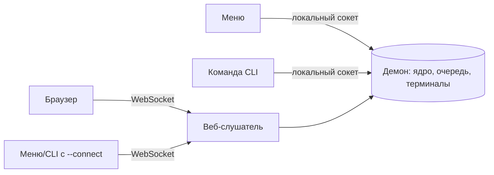

# Remote Control — управление серверами и генерация клиентских конфигов

`essence-rc` — один исполняемый файл, который запускается на **вашем локальном компьютере**. Он подключается к серверам по SSH, настраивает протоколы, генерирует клиентские конфиги для устройств, публикует подписки и управляет AmneziaWG-peers. SSH/SFTP и шифрование age встроены в бинарник; Bash, `ssh`, `scp`, `jq` и `openssl` на локальной машине не нужны.

## Запуск

### Linux / macOS / Android (Termux)

```bash
curl -fsSL https://raw.githubusercontent.com/Morvex885/essence-setup-script/main/install-essence-rc.sh | bash
essence-rc
```

Установщик определяет ОС и архитектуру, скачивает из релиза GitHub архив
`essence-rc-<target>.tar.gz` и `SHA256SUMS`, сверяет SHA-256 и ставит бинарник в
`/usr/local/bin/essence-rc` (при необходимости через `sudo`); в Termux — в
`$PREFIX/bin/essence-rc` без root. Новая копия кладётся рядом с целью и
переименовывается, поэтому уже запущенный `essence-rc` не повреждается.

| Платформа | Target |
|---|---|
| Linux x86_64 (glibc) | `x86_64-unknown-linux-gnu` |
| Linux aarch64 | `aarch64-unknown-linux-gnu` (на musl-системах — `aarch64-unknown-linux-musl`) |
| Linux armv7 (glibc) | `armv7-unknown-linux-gnueabihf` |
| macOS Intel / Apple Silicon | `x86_64-apple-darwin` / `aarch64-apple-darwin` |
| Termux aarch64 | `aarch64-linux-android` (нативный DNS Android; musl-сборка в Termux не резолвит имена) |

Переменные окружения установщика:

| Переменная | Назначение |
|---|---|
| `ESSENCE_RC_VERSION` | Тег релиза (например, `v2.0.0`); по умолчанию — последний релиз |
| `ESSENCE_RC_BASE_URL` | Каталог с ассетами релиза (зеркало); важнее `ESSENCE_RC_VERSION` |
| `ESSENCE_RC_INSTALL_DIR` | Каталог установки вместо `/usr/local/bin` (`$PREFIX/bin` в Termux) |

Переменная передаётся интерпретатору, который выполняет установщик:

```bash
curl -fsSL https://raw.githubusercontent.com/Morvex885/essence-setup-script/main/install-essence-rc.sh | ESSENCE_RC_VERSION=v2.0.0 bash
```

Если `curl` или `tar` нет, установщик пробует поставить их пакетным менеджером
(в Termux — `pkg`, иначе только от root). Для неподдерживаемых платформ (например,
x86_64 или armv7 на musl) соберите бинарник из исходников.

### Windows (x64 / ARM64)

1. Скачайте из [последнего релиза](https://github.com/Morvex885/essence-setup-script/releases/latest)
   `essence-rc-x86_64-pc-windows-msvc.zip` (или `essence-rc-aarch64-pc-windows-msvc.zip`) и `SHA256SUMS`.
2. Сверьте хеш в PowerShell — он должен совпасть со строкой архива в `SHA256SUMS`:
   ```powershell
   (Get-FileHash .\essence-rc-x86_64-pc-windows-msvc.zip -Algorithm SHA256).Hash.ToLower()
   Select-String essence-rc-x86_64-pc-windows-msvc.zip .\SHA256SUMS
   ```
3. Распакуйте `essence-rc.exe` в каталог из `PATH` (например, `%USERPROFILE%\bin`) и запустите:
   ```cmd
   essence-rc
   ```

### Из исходников

```bash
git clone https://github.com/Morvex885/essence-setup-script.git
cd essence-setup-script/remote-control
cargo run -p essence-rc --release                      # меню
cargo run -p essence-rc --release -- node list --json  # команда CLI
```

Нужен Rust с поддержкой edition 2024. Версия встраивается из корневого файла
`VERSION`.

### Режимы запуска

- `essence-rc` без аргументов, когда stdin и stdout — терминал, открывает
  терминальное меню. С перенаправленным stdin или stdout меню не запускается:
  печатается справка (код выхода 0).
- `essence-rc <сущность> <действие> …` — разовая команда без меню
  ([Командная строка](#командная-строка-cli)).
- `essence-rc --connect https://host[:port] …` — меню или команда на удалённом
  демоне ([Удалённое управление](#удалённое-управление---connect)).
- `essence-rc web run` — веб-панель в браузере ([Веб-панель](#веб-панель)).
- `essence-rc web install-service` — автозапуск веб-панели.
- `essence-rc --version` — версия; `essence-rc self update` — обновление из
  релиза; `essence-rc self uninstall [--remove-data]` — удаление.

Ядро выполняется в фоновом [демоне](#демон). Меню и команды запускают его сами
при первом обращении, и он выходит после простоя; отдельно запускать его не
нужно.

Каталог данных Bash-версии автоматически не импортируется и не удаляется.

### Зависимости

| Что | Когда нужно |
|---|---|
| `essence-rc` | Всегда. Один файл без внешних библиотек: SSH/SFTP (russh) и age встроены |
| `git`, `gh` | Только для источника конфигурации GitHub; `apt install git gh` / `brew install git gh` / `pkg install git gh`. Если их нет, команды GitHub отвечают `deps_missing` |
| `qrencode` | Необязательно: QR-код ссылки подписки в меню (веб-панель рисует QR сама) |
| Редактор | Для правки шаблонов в меню: `$VISUAL`, `$EDITOR`, иначе `nano`, иначе `vi`; в Windows — `notepad` |
| Браузер | Для веб-панели: `web run` и `web open` открывают её через `xdg-open` / `open` / `explorer` |
| `curl`, `tar`, `sha256sum` или `shasum` | Только для установщика |

На серверах (нодах) нужен Bash 3.2 или новее: туда загружаются серверные скрипты
essence-setup, встроенные в бинарник.

### Учётная запись источника GitHub

Владелец из локального `source.json` закреплён за источником: смена активного
аккаунта системного `gh` не переключает репозиторий и не переносит конфигурацию.
Первое подключение (`source github-connect --login L`) требует явного логина;
смена владельца выполняется явно командой `source github-change-account --login L`.

Для каждого владельца `essence-rc` хранит отдельный профиль GitHub CLI в
`<каталог данных>/credentials/gh/<логин>` (на Linux обычно
`~/.local/share/essence-remote-control/credentials/gh/<логин>`). На Unix доступ к
каталогам ограничен правами 0700, к файлам — 0600. Токен не записывается в
`source.json` или Git URL; системные `gh auth switch` и `gh auth setup-git` не
вызываются: git получает учётные данные через `gh auth git-credential`
изолированного профиля только на время команды, `GH_TOKEN` и `GITHUB_TOKEN`
дочерним процессам не передаются.

Если профиля нет, `essence-rc` один раз пробует скопировать токен **указанного**
пользователя из системного `gh` (`gh auth token` → `gh auth login --with-token`,
токен идёт только через pipe). Не получилось — команда отвечает
`github_auth_required` с полями `login` и `hint`, а вход через браузер выполняет
`source github-login --login L` (код устройства печатается в журнал). При открытии
уже подключённого источника браузер не открывается: если профиль недоступен,
источник и локальный кэш остаются без изменений; авторизуйте профиль командой
`source github-login --login <логин>` или вручную командой из `hint`:

```bash
GH_CONFIG_DIR="$HOME/.local/share/essence-remote-control/credentials/gh/<логин>" gh auth login --hostname github.com --web
```

На другом устройстве авторизация выполняется заново.

## Архитектура: ядро команд

Вся логика живёт в одном ядре команд: `сущность действие --флаги` → ответ
`{id, ok, data | error}`. Терминальное меню, веб-панель и возможное
нативное приложение — только слои экранов без собственной логики, поэтому тесты
команд проверяют всё, что делают интерфейсы.

### Слои

Cargo workspace `remote-control/` (edition 2024):

| Путь | Назначение | Зависит от |
|---|---|---|
| `remote-control/core` (`rc-core`) | Ядро без вопросов пользователю: модель и локальное состояние, блокировки, секреты, каталог команд и справка (`cli.rs`), диспетчер `dispatch`, подтверждение планом, SSH-транспорт (russh), источник GitHub, домены `nodes`, `clients`, `subscription`, `awg`, `telegram`, самоуправление `self` | — |
| `remote-control/client` (`essence-rc-client`) | Типы протокола v3, `Client`, `DaemonClient` (локальный сокет и WebSocket), `ScriptedClient`, точка подключения, запуск демона | — (`essence-rc-web` только для тестов) |
| `remote-control/web` (`essence-rc-web`) | HTTP/TLS/WebSocket-слушатель и вшитые ассеты веб-панели | — |
| `remote-control/tui` (`essence-rc-tui`) | Библиотека экранов терминального меню (ratatui); с ядром общается только по протоколу через `client` | `client` |
| `remote-control/bin` (`essence-rc`) | Единственный исполняемый файл: демон, разовый CLI, меню, `web *`, автозапуск | все |
| `remote-control/core/templates/*.yaml` | Встроенные шаблоны mihomo; компилируются в бинарник | — |

`tui`, `client` и `web` не зависят от `rc-core` (проверяет
`remote-control/tui/tests/boundary.rs`).

Серверный комплект (`setup-essence.sh`, `modules/`, `common/`, `VERSION`) тоже
встроен в бинарник и загружается на ноду одной SFTP-операцией (`VERSION` —
последним).

### Демон и клиенты

Ядро выполняется только в [демоне](#демон) — фоновом процессе `essence-rc`.
Диспетчер один — `rc_core::dispatch::dispatch(argv, secrets, input, agent_socket,
session)`; своего «режима вызова» у него нет. Все интерфейсы — клиенты демона на
одном [протоколе v3](#протокол-v3):

- **меню** — `essence-rc` без аргументов в терминале;
- **разовый CLI** — `essence-rc сущность действие … [--json]`: секреты берёт из
  `--secrets-stdin` или скрытым вводом с консоли, результат печатает общий
  рендерер ([Командная строка](#командная-строка-cli));
- **браузер** — [веб-панель](#веб-панель);
- **меню или CLI с `--connect`** — те же клиенты на демоне другой машины
  ([Удалённое управление](#удалённое-управление---connect)).

Транспорты: локальный сокет (Unix) или именованный канал (Windows) — для меню и
CLI на машине демона; WebSocket через веб-слушатель демона — для браузера и
`--connect`.



### Демон

На каждый каталог данных работает один демон. На Unix единственность держит
`flock` на `<h>.lock` всё время жизни процесса, на Windows — первый экземпляр
именованного канала. Пути — в разделе [Каталог времени
выполнения](#каталог-времени-выполнения). `--data-dir` важнее
`ESSENCE_RC_DATA_DIR`.

**Запуск по требованию.** Клиент подключается к сокету; если демона нет, клиент
запускает `essence-rc daemon run` отсоединённо (stdin и stdout — null, stderr — в
журнал `<h>.log`, `setsid`, рабочий каталог `/`) и пытается подключиться каждые
50 мс до 60 с. Если демон не запустился, ошибка показывает последние 5 строк
журнала. Если блокировка занята и демон отвечает, `daemon run` печатает «Демон уже
запущен.» и выходит с кодом 0; если не отвечает — ждёт освобождения блокировки до
60 с.

**Простой.** Демон по требованию выходит, когда простаивает
`ESSENCE_RC_DAEMON_LINGER` секунд: 1–6 цифр, `0` допустим, по умолчанию 5; иное
значение — ошибка «ESSENCE_RC_DAEMON_LINGER должна содержать от 1 до 6 цифр.».
Простой — нет соединений, заданий, терминалов и веб-слушателя. Если за 10 с после
запуска никто не подключился, демон выходит.

**Постоянный режим.** Демон, запущенный с `--web`, или демон с запущенной
веб-панелью по простою не выходит. `web stop` возвращает режим по требованию
только демону, запущенному без `--web`; демон `daemon run|start --web` (и служба
автозапуска) остаётся постоянным.

**Остановка.** По `daemon stop`, простою, SIGTERM или SIGINT, событиям консоли
Windows, после успешных `self update` и `self uninstall` демон:

1. перестаёт принимать соединения;
2. отвечает заданиям из очереди `daemon_stopping` «Демон останавливается.
   Повторите команду.»;
3. отменяет терминалы;
4. закрывает сессию (отложенное отправляется в GitHub, блокировка снимается);
5. отвечает инициатору `{"stopping":true}`;
6. удаляет сокет и снимает блокировку.

SIGHUP игнорируется, SIGQUIT завершает демон с кодом 131. Паника ядра пишет в
журнал строку «Ядро завершилось аварийно.» и завершает демон с кодом 1. Локальный
клиент после `daemon_stopping` один раз переподключается и повторяет запрос.

**Обновление.** После успешного `self update` постоянный демон перезапускается
новым бинарником (Unix — `exec` с сохранением блокировки, Windows —
отсоединённый запуск) с абсолютным `--data-dir`. Флаги слушателя исходного
запуска не переносятся: если панель работает, добавляется `--web` с флагами
работающего слушателя (фактический порт, абсолютные пути сертификатов); панель,
остановленная `web stop`, после обновления не поднимается. Демон по требованию
просто останавливается.

**Демон другой версии.** Если отвечает демон другой версии или другого бинарника,
клиент останавливает его, только если тот работает по требованию и простаивает
(`persistent:false`, не больше одного клиента, нет терминалов), и ждёт до 30 с.
Иначе ошибка «Запущен демон другой версии ({v}) с активными клиентами.
Остановите его: essence-rc daemon stop.» или «Запущен демон другой версии ({v}).
Остановите его: essence-rc daemon stop.».

**Журнал.** stderr демона пишется в `<h>.log` (0600); из него клиенты показывают
причину, если демон не запустился.

**Команды.** `daemon status` возвращает `{pid, version, protocol, exe, uptime_s,
persistent, busy, clients:[{origin, since_s}], session:{open, source}, terminals,
web}`. `daemon stop` останавливает демон после текущей операции и доступен только
локально (`local_only` по сети). `daemon run` запускает демон на переднем плане,
`daemon start` — в фоне и печатает `{endpoint, pid[, web]}`. Флаги слушателя
(`--bind`, `--port`, `--tls-cert`, `--tls-key`, `--no-tls`) без `--web` —
`usage`.

### Протокол v3

**Кадрирование.** Сообщение — JSON-объект до 4 МиБ. На локальном сокете — одна
строка на сообщение, разделитель `\n` (завершающий `\r` отбрасывается); слишком
длинная строка рвёт соединение без ответа. По WebSocket —
один объект на текстовый кадр.

**Приветствие.** Первое сообщение демона:

```json
{"event":"hello","protocol":3,"version":"2.0.0","origin":"local","exe":"/usr/local/bin/essence-rc","persistent":false}
{"event":"hello","protocol":3,"version":"2.0.0","origin":"network","listener":{"loopback":true,"tls":false}}
```

Локальные соединения получают ещё `exe` и `persistent`, сетевые — `listener`.

**Запрос.**

```json
{"id":3,"argv":["group","add","--name","LAB"]}
```

| Поле | Значение |
|---|---|
| `id` | Строка без NUL, число или `null`; эхом возвращается в событиях и ответе |
| `argv` | Массив строк без NUL (то же, что аргументы разового CLI); `--secrets-stdin` — `usage` |
| `secrets` | Необязательный объект строк; только разрешённые имена, которые принимает команда, иначе `usage`: «Секреты должны быть JSON-объектом строк.» (форма) или «Секрет не поддерживается командой.» (имя) |
| `input` | Необязательный объект строк — [входные данные](#секреты) команды: не больше 4 имён, до 1 МиБ на значение |
| `env` | Необязательно, только у локальных соединений: `{"SSH_AUTH_SOCK":"/abs"}` — абсолютный путь до 4096 байт |
| `terminal` | Для терминальных команд: `{"term","cols","rows"}`; `term` — 1–64 печатных ASCII-символа, `cols` и `rows` больше 0 |

Ошибки `input`: `usage` «Поле input должно быть JSON-объектом строк.», `invalid`
«Входные данные превышают 1 МиБ.», `usage` «Поле input не поддерживается
командой.».

**События демона.** До ответа демон отправляет события:

| Событие | Когда |
|---|---|
| `{"id","event":"log","level","text"}` | Журнал команды; `level` — `info`, `success`, `warn`, `error` или `output`; управляющие символы C0/C1 вырезаются |
| `{"id","event":"terminal","state":"open"}` | Терминал открыт |
| `{"id","event":"output","data":"<base64>"}` | Вывод терминала |
| `{"id","event":"access","resume":"<64 hex>"}` | Сетевое соединение, перед ответом на первую успешную авторизацию: токен возобновления |
| `{"event":"activity","state":"start"\|"end","command":"<noun verb>","origin"}` | Начало и конец команды любого клиента (наблюдателям) |
| `{"event":"activity","state":"log","level","text"}` | Журнал этой команды (наблюдателям) |

**Ответ** — ровно один на запрос, с тем же `id`:

```json
{"id":3,"ok":true,"data":{"name":"LAB"}}
{"id":3,"ok":false,"error":{"code":"not_found","message":"…"},"exit":1}
```

В режиме GitHub к успешному ответу добавляется поле `sync` (`clean`, `pending`
или `offline`). Ответ с ошибкой несёт `exit` — код выхода разового CLI. Ошибка
может нести дополнительные поля рядом с `code` и `message` (например, `plan` и
`plan_token` у `confirmation_required`, `results` у `telegram`, `fingerprints` у
ошибок ключа сервера). Поля JSON выводятся в порядке объявления.

**Терминал.** Пока терминальная команда работает, клиент отправляет
`{"id","stdin":"<base64>"}`, `{"id","resize":{"cols","rows"}}` и
`{"id","close":true}`; неизвестный `id` игнорируется. Очередь ввода терминала — до
64 сообщений и до 4 МиБ декодированного ввода; SSH-сессия берёт из неё ввод, только
пока её собственный буфер записи в канал (до 64 событий и 4 МиБ) не заполнен, так
что ввод ограничен на всём пути до ноды. Ввод никогда не задерживает чтение
соединения: если очередь заполнена по любому из пределов (терминал ещё не открыт
или не успевает), терминал закрывается — уже принятый ввод доставляется, затем
удалённая сторона получает EOF, а клиент — событие `log` уровня `error` «Ввод
терминала не успевает обрабатываться: терминал закрыт.». `close` тоже закрывает
ввод терминала; через 2 с не завершившийся терминал отменяется — именно этот, а не
более поздний с тем же `id`. Терминал, закрытый `close` или переполнением до
открытия, не запускается: ответ — `remote_failed` с
`reason: "closed"`. Одна нода — один открытый терминал (`conflict` «Терминал ноды
«{name}» уже открыт.»); без поля `terminal` — `tty_required`.

**Наблюдение.** `{"watch":true|false}` без `argv` включает и выключает события
`activity`. Их получают наблюдатели: локальные — всегда, сетевые — после
авторизации.

**Правила.**

- Неразборчивое сообщение, неверный `id` или `argv` — `usage` «Неверный запрос.»;
  при корректном `id` он сохраняется в ответе.
- Каждый запрос, включая `help`, `daemon *` и `web *`, до маршрутизации проходит
  ту же проверку, что и команда ядра: `--secrets-stdin` в `argv`, секрет, который
  команда не принимает, и неподдерживаемое поле `input` — `usage`.
- Повтор `id`, который ещё выполняется, — `usage` «Запрос с таким id уже
  выполняется.».
- Сетевое соединение держит не больше 4 одновременных запросов до авторизации и
  32 после, иначе `usage` «Слишком много одновременных запросов.».
- Запросы всех соединений выполняются по одному, отмены нет. Вставший в очередь
  получает `log` уровня `info` «Ожидание: выполняется «{noun verb}».»
  (неавторизованное сетевое соединение — нет).
- Обрыв соединения отменяет его терминалы и снимает его невыполненные задания без
  ответа.
- При остановке демона невыполненные задания получают `daemon_stopping`.

**Лимиты.** Сообщение — до 4 МиБ; неавторизованное сетевое соединение — до
64 КиБ, не больше 32 таких соединений и 60 с на вход; `input` — до 4 имён по
1 МиБ. События и ответы, которые клиент ещё не прочитал, копятся до 16 МиБ на
соединение; клиент, который перестал читать, отключается (вывод терминала
ограничен отдельно и ждёт клиента).

### Сессия

Сессия ядра одна на демон. Каждое соединение авторизуется само запросом
`session open [--remember-key]` с секретами `script-password`, `vault-password`
(для GitHub с шифрованием) и, для сетевых соединений, `access-token`. До этого
работают только `help`, `session status` и `session open`, а у локальных
соединений ещё `self version`, `daemon *` и `web *`; остальное отвечает
`session_closed` «Сначала откройте сессию: session open.». Шаги `session open`:

1. у сетевого соединения неверный или просроченный код — `auth_failed` «Неверный
   или просроченный код доступа.» с `secret: "access-token"`;
2. проверить пароль запуска (кроме входа по токену возобновления): нет секрета —
   `auth_required`, неверный — `auth_failed` (оба с `secret: "script-password"`);
3. панель на loopback, пароля запуска нет и кода нет — `auth_required` «Требуется
   код доступа: essence-rc web link.» с `secret: "access-token"`;
4. нет ни `source.json`, ни `config.json` — соединение авторизовано, ответ
   `not_configured`; после него работают `source init-local` и мастер GitHub;
5. открыть источник (GitHub: пароль доступа — `vault_password_required` /
   `vault_password_invalid`; формат снимка — `github_format_outdated|newer|invalid`
   с полями `version` и `required`; занята блокировка — `locked`; прочее —
   `source_failed` с этапом); если после открытия сменился хеш пароля запуска —
   проверить пароль снова.

Пароль, доказанный на шаге 2, авторизует соединение и при неудачном открытии
источника; команды, которым нужна сессия, работают после её открытия. Сетевое
соединение после первого успешного входа получает событие `access` с токеном
возобновления ([Доступ](#доступ)).

`session status` не открывает источник и возвращает
`{"configured","source":"local|github|null","open","authorized"}`; `authorized` —
авторизовано ли это соединение и авторизована ли сессия ядра (пароль запуска проверен).

Разовый CLI открывает сессию сам: перед каждой командой (кроме `help`,
`session status|open`, а у локального демона — ещё `self version`, `daemon *`,
`web *`) он отправляет `session open`. С `--connect` сессия открывается и перед
`self version`, `daemon status`, `web status`: сетевой демон отвечает на них
только после входа. Отсутствующий каталог данных — открытая пустая
локальная сессия: читающие команды работают (как `status`), а первое изменение
создаёт локальную конфигурацию. Явный `session open` в таком состоянии отвечает
`not_configured`.

### Секреты

Секреты существуют только в памяти (`Zeroizing`, без `Debug`/`Serialize`): их нет в
argv, журнале, данных ответа и текстах ошибок. Допустимые имена: `password`,
`current-password`, `vault-password`, `new-vault-password`, `script-password`,
`access-token` (одноразовый код из `web link` или токен возобновления веб-панели;
принимает только `session open`).
Каждая команда принимает только свои секреты (они перечислены в справке);
разовый CLI для команд, открывающих сессию, дополнительно принимает
`script-password`, `vault-password` и `access-token`.

В разовом CLI секреты приходят двумя способами:

- `--secrets-stdin` — stdin целиком читается как JSON-объект `{"имя":"значение"}`;
- скрытый ввод с консоли — только если stdin является консолью и ядро ответило
  `auth_required`, `auth_failed`, `missing_secret` (подсказка `secret`) или
  запросило пароль доступа GitHub (`vault-password`, `new-vault-password`); до трёх попыток на секрет. Подтверждения с
  консоли не запрашиваются: ввод `y` ничего не подтверждает.

Переменных окружения с паролями нет. Пароли доступа `vault-password` и
`new-vault-password` не могут заканчиваться CR или LF (`invalid`).

**Входные данные.** Содержимое файлов команд с входными данными (`template
import`, `template check`, `source github-import-recovery-key`) клиент читает сам и передаёт полем
`input.file`; путь демону не передаётся. В каталоге команд такой вход объявлен
токеном `@file` (флаг `--file PATH` обязателен) или `@file?` (необязателен: без
флага поле `input.file` не передаётся; так у `template check`, где вместо файла
можно указать `--name`). В `input` — не больше 4 имён, до 1 МиБ
на значение. CLI и меню принимают только обычный файл не больше 1 МиБ в UTF-8 и
не читают больше этого; символьная ссылка, каталог и прочие специальные файлы
отклоняются, ссылка не разыменовывается. Веб-панель проверяет выбранный в
браузере файл по тем же пределам: 1 МиБ и UTF-8. Ключ восстановления из
каталога данных локального демона CLI и меню отклоняют: `invalid` «Не удалось
импортировать ключ восстановления: файл ключа восстановления не найден, имеет
недопустимый тип или расположен внутри служебного каталога.» (с `--connect`
каталог данных удалённый, проверка не выполняется).

### Подтверждение и токен плана

Опасная команда без `--yes` ничего не меняет и отвечает `confirmation_required`
с полями `plan` (строки плана без секретов) и `plan_token` (16 hex). Токен — первые
16 hex SHA-256 от области команды (`сущность действие` и исходные аргументы без
`--json`, `--yes`, `--plan-token` и `--secrets-stdin`), строк плана и служебной части плана.
Служебная часть привязывает токен к тому, чего нет в `argv`: у `template import`
это SHA-256 содержимого `input.file`, поэтому токен, полученный для одного файла,
для другого содержимого отвечает `plan_changed`.
Выполнение — тот же `argv` с `--yes --plan-token T`. Если план успел измениться,
ответ — `plan_changed` с новым планом и токеном. `--yes` без токена — согласие на
текущий план (для скриптов); `--plan-token` без `--yes` — `usage` уже при разборе.
До согласия выполняются только проверки и чтение.

### Решения вместо вопросов

Команды ничего не спрашивают. Решение, которое иначе задавалось бы посреди
операции, превращается в код `…_required` с данными, а интерфейс сам спрашивает
пользователя и повторяет команду с нужным флагом или секретом:

| Код | Данные | Ответ интерфейса |
|---|---|---|
| `github_auth_required` | `login`, `hint` | `source github-login --login L`, затем повтор |
| `repo_create_required` | `repo` | `--create-repo` |
| `repo_private_required` | — | `--make-private` (согласие — в плане) |
| `storage_mode_required` | `choices` | `--storage age\|none` |
| `new_vault_password_required` | — | секрет `new-vault-password` |
| `existing_config_action_required` | `choices`, `remote_counts`, `local_counts` | `--existing remote\|local\|migrate` |
| `vault_password_required` / `vault_password_invalid` | — | секрет `vault-password` |
| `cache_skip_required` | — | `--without-cache` |
| `target_replace_required` | `repo`, `tracked_files`, `reason` | `--replace-target` (согласие — в плане) |
| `key_provisioning_required` | `nodes` | `--provision-keys yes\|no` |
| `auth_required` / `auth_failed` | `secret` | секрет `script-password` или `access-token` (по полю `secret`) |

Команды, которым нужен живой терминал (`node shell`, `telegram menu`), без
терминала отвечают `tty_required`.

Решения не заменяют подтверждение. `source github-connect` и
`source github-change-account` после всех решений отвечают `confirmation_required`
(с `plan` и `plan_token`), если в плане есть необратимый шаг: сделать репозиторий
приватным (`--make-private`), удалить файлы целевого репозитория
(`--replace-target`, с их числом), заменить конфигурацию GitHub (`--existing local`,
со счётчиками с обеих сторон), хранить без шифрования (`--storage none`) или
выполнить SSH-действия на нодах (новые переносимые ключи и отпечатки закрепляемых
ключей серверов). До согласия ничего не пишется ни локально, ни в GitHub:
репозиторий создаётся или делается приватным только после него. План
`source github-replace-with-local` тоже перечисляет SSH-действия на нодах;
`key_provisioning_required` приходит раньше `confirmation_required`.
При `source github-connect --existing migrate` преобразование формата и
приватизация входят в один план.

Расшифрованный снимок конфигурации GitHub существует только в памяти; ключ
сессии — тоже. Рабочее состояние открытого источника лежит в `github-runtime/`, где
пароли нод зашифрованы ключом устройства. После закрытия сессии расшифрованных
ключей на диске не остаётся (кроме сохранённого `--remember-key`).

Смена аккаунта (`source github-change-account`) ведёт журнал
`account-switch/` с фазами `prepared → push_unknown → target_committed →
local_committed`. Сбой после принятия смены не откатывает её: следующее открытие
сессии завершает переход; если отправка в новый репозиторий не подтверждена и
ожидаемого commit там нет, следующий запуск отменяет смену и возвращает прежний
репозиторий. Прежний репозиторий не меняется. Ответы `*_required` и отказ от плана
не оставляют профиль входа нового аккаунта, если его не было до команды, и не
меняют состояние синхронизации. В режиме `age` `source github-fetch` использует
ключ текущего сеанса и пароль доступа не запрашивает.

### Коды ошибок

Каждая ошибка — `{"code","message",…}`; `message` однострочный.

- Общие: `usage`, `confirmation_required`, `plan_changed`, `session_closed`,
  `not_configured`, `not_found`, `conflict`, `invalid`, `missing_secret`,
  `needs_setup`, `failed`, `partial`, `locked`, `tty_required`, `deps_missing`
  (не найдена или не запускается внешняя команда `git`/`gh`), `local_only`
  (команда доступна только на машине демона), `daemon_stopping`,
  `not_supported`.
- SSH и ноды: `host_key_unknown`, `host_key_mismatch`, `host_key_changed`
  (с `host`, `port`, `fingerprints`), `remote_failed` (с `reason`, например
  `timeout`), `onboarding_failed`, `port_in_use`, `hardening_failed`,
  `nothing_pending`, `not_installed`.
- Вход и пароли: `auth_required`, `auth_failed`, `vault_password_required`,
  `vault_password_invalid`, `vault_work_excessive` (параметр scrypt файла
  `unlock.age` выше допустимого 2^22), `new_vault_password_required`.
- Источник GitHub: `github_auth_required`, `repo_create_required`,
  `repo_private_required`, `storage_mode_required`,
  `existing_config_action_required`, `cache_skip_required`,
  `target_replace_required`, `key_provisioning_required`,
  `github_format_outdated`, `github_format_newer`, `github_format_invalid`,
  `source_failed`.
- Система: `root_required`, `unsafe_path`, `update_failed`.
- Демон и подключение: `daemon_cert_unknown`, `daemon_cert_changed` (с `host`,
  `port`, `fingerprint`), `daemon_unreachable`, `daemon_protocol`.

Коды выхода разового CLI: `0` — успех; `2` — `usage`, `host_key_unknown`,
`daemon_cert_unknown`, `plan_changed` и любой код на `_required` (в том числе
`confirmation_required`, `tty_required`, `auth_required`); для `telegram` ещё `3`
(`not_installed`) и `4` (`partial`); остальное — `1`. В протоколе код выхода
приходит полем `exit` ответа с ошибкой.

## Командная строка (CLI)

С аргументами `essence-rc` работает без меню и без вопросов:

```bash
essence-rc <сущность> <действие> [--флаги] [--json]
essence-rc --help              # все команды (то же: help, -h)
essence-rc client --help       # команды одной сущности (то же: help client)
```

Справка и разбор аргументов строятся из одной таблицы каталога
(`remote-control/core/src/cli.rs`): каждая команда разбирается по своей строке
каталога, поэтому справка бинарника всегда совпадает с тем, что он принимает.

- **Грамматика.** Флаги — `--flag value` или `--flag=value`. Списки (`…` в справке)
  задаются повторением флага (`--name a --name b`); повтор одиночного флага —
  `usage` («Флаг --name указан дважды.»). Неизвестная сущность или флаг, лишний
  аргумент, `--`, значение с переводом строки или NUL — `usage`. Объект команды
  везде выбирается флагом `--name` (у `conn`, `awg`, `telegram`,
  `subscription host|migrate` — нода, у `subscription show|publish|rotate|revoke` —
  клиент); связи задают `--node`, `--group`, `--client`.
- **Глобальные флаги** допустимы в любом месте и у любой команды: `--json`,
  `--yes`, `--plan-token T` (только вместе с `--yes`), `--secrets-stdin`,
  `--help`/`-h`. Значение флага (`--name -h`) справкой не считается.
- **`--connect URL [--fingerprint SHA256:…] [--insecure]`** — выполнить меню или
  команду на удалённом демоне; эти флаги допустимы только перед командой
  ([Удалённое управление](#удалённое-управление---connect)).
- **`--json`**: в stdout ровно один объект `{"id":null,"ok":true,"data":…}` или
  `{"id":null,"ok":false,"error":{"code":…,"message":…,…}}`; в режиме GitHub
  добавляется `sync`. Журнал — в stderr с префиксами `[*]`, `[✓]`, `[!]`, `[✗]`.
  Без `--json` общий рендерер печатает данные: объект — строки `ключ: значение`,
  список объектов — таблицу, план — рамку «Требуется подтверждение:».
- **`--yes`** обязателен для опасных действий. Без него команда показывает план,
  ничего не меняет и завершается с кодом 2 (`confirmation_required`, в ответе
  `plan` и `plan_token`). `--yes --plan-token T` выполняет действие, только если
  план не изменился, иначе — `plan_changed` с новым планом и токеном.
- **stdin и файлы.** stdin читается только для секретов (`--secrets-stdin`,
  JSON-объект `{"имя":"значение"}`) или скрытым вводом, когда stdin — консоль.
  Пример:
  `printf '{"password":"…"}' | essence-rc node password --name de-vps --secrets-stdin`.
  `--file PATH` у команд с входными данными читает клиент: нужен обычный файл (не
  символьная ссылка) в UTF-8 не больше 1 МиБ, иначе `invalid` «Файл {path}
  недоступен.», «Файл {path} не в кодировке UTF-8.» или «Файл {path} больше
  1 МиБ.». `template export --output PATH` записывает клиент: каталог —
  `invalid`, существующий файл — план «Файл {output} будет перезаписан шаблоном
  {file}.»; запись атомарная, символьная ссылка заменяется файлом, а не
  разыменовывается, после записи каталог синхронизируется на диск. Без
  подтверждённой перезаписи файл, появившийся по этому пути во время экспорта,
  не заменяется: `conflict` «Файл {output} появился во время экспорта: повторите
  команду.». С `--connect` файлы читаются и пишутся на машине клиента.
- **Без конфигурации** разовый CLI работает с пустой локальной сессией; явная
  конфигурация создаётся командой `source init-local` или
  `source github-connect --login L`. Решения подключения задают флаги
  (`--create-repo`, `--make-private`, `--storage age|none`,
  `--existing remote|local|migrate`, `--provision-keys yes|no`); без нужного флага
  команда отвечает кодом `*_required` и ничего не меняет. Неудачный
  `source github-connect` удаляет созданное этой командой (новый каталог данных
  исчезает целиком); при существующей локальной конфигурации её файлы
  восстанавливаются, а переносимые ключи, установленные командой, отзываются.
- **Ключ сервера при `node add`**: `--host-key SHA256:…` (сверить отпечаток),
  `--accept-new-host-key` (довериться первому ключу) или `--replace-host-key
  SHA256:… [--yes]` (заменить сменившийся: план с прежними и новым отпечатками).
  `--accept-new-host-key` и `--replace-host-key` вместе не принимаются. Без флагов
  команда завершается с кодом 2 (`host_key_unknown` с отпечатком сервера);
  несовпадение с `--host-key` — `host_key_mismatch`, хост, уже известный с другим
  ключом, — `host_key_changed` `{host,port,fingerprints}`; ни в одном из случаев
  ничего не записывается. Доверие новому ключу существующей ноды —
  `node trust-host-key` (подключение с ожидаемым отпечатком, план, согласие,
  запись). Пины хранятся по `[host]:port`, включая порт 22.
- **Логин и адрес ноды**: `--user` — латиница, цифры, `.`, `_`, `-`, первый символ —
  буква или `_`, до 32 символов; `--ip` — до 253 символов из латиницы, цифр, `.`,
  `_`, `-`, `:` (IPv6 без скобок), первый символ — буква, цифра или `:`; порт —
  1–65535. Иначе `invalid`. Сохранённая нода с небезопасным логином, адресом или
  ссылкой на ключ (`identity` — только `null`, `""`, `"system"` или собственный id
  ноды) не проходит проверку конфигурации (`invalid`).
- **Имя и тег ноды** (`node add`, `node rename`, `node tag`): имя — латиница, цифры,
  `.`, `_`, `-`, не из одних точек; тег — пустой или до 32 символов, Unicode и эмодзи
  допустимы, без управляющих символов и ``; " ' ` $ \ | & < > { } [ ] # , : /``
  (`node add` требует непустой тег). Иначе `invalid`, ничего не записывается.
- **Атомарность нод**: `node add` пишет пин, пароль, ключи и запись ноды одной
  транзакцией и при позднем сбое восстанавливает все затронутые файлы; успешный
  ответ содержит `needs_setup`, если SSH-настройка отложена. `node delete` — сбой
  после удаления компонентов на сервере даёт `partial`
  `{name,scope,deleted,remote_removed}`; отозванный ключ возвращается через
  удерживаемую SSH-сессию и проверяется новым входом.
- **`node harden`**: без `--port` план содержит детерминированный свободный порт,
  поэтому `--yes --plan-token` подтверждает именно его; с `--port` проверяется
  указанный порт (`port_in_use`, `invalid`). План сообщает о замене и отзыве
  прежнего управляемого ключа ноды.
- **Обнаружение подключений** (`conn sync`, `conn list --discover`, `node aliases`):
  один `cat /etc/mihomo/client-config.txt` на ноду, разбираются только ключи
  `name:`; нода без этого файла доступна и не имеет подключений.
- **Отложенная SSH-настройка**: команды SSH для ноды GitHub с отложенной
  настройкой (`missing_identity`, `missing_host_key`) отвечают `needs_setup` до
  плана и до любого SSH; отсутствующий пароль — `missing_secret`.
- **Блокировка**: изменения конфигурации сериализуются через каталог `.rc-lock` в
  каталоге данных (атомарный `mkdir`, владелец в `.rc-lock/owner`). В local-режиме
  команда ждёт до `RC_LOCK_WAIT` секунд (1–6 десятичных цифр, по умолчанию 30;
  иное значение заменяется на 30). В режиме GitHub блокировку весь сеанс держит
  демон; меню и команды подключаются к тому же демону и работают в его сессии.
  Устаревшую блокировку освобождает только один процесс и только при доказанно завершённом
  владельце (или отсутствующем `owner` старше 60 секунд); отказ доступа или
  неопределённый результат смертью владельца не считаются. Если очистку прервал
  `SIGKILL`, может остаться `.rc-lock/.reclaim`: захват завершается `locked` с
  полным путём — удаляйте каталог вручную, только убедившись, что других операций
  нет.
- **Сигналы**: Ctrl+C не прерывает разовую команду; SIGTERM, SIGHUP и SIGQUIT
  восстанавливают консоль после скрытого ввода и завершают процесс с кодом 128+N.
- **Окружение**: `ESSENCE_RC_DATA_DIR` (каталог данных, пустое значение —
  `invalid`), `RC_LOCK_WAIT`; для `self update|version` — необязательный
  `GITHUB_TOKEN` (только заголовком запроса к API GitHub). `RC_LOCK_WAIT` и
  `GITHUB_TOKEN` читаются из окружения демона. `ESSENCE_RC_RUNTIME_DIR` —
  [каталог времени выполнения](#каталог-времени-выполнения),
  `ESSENCE_RC_DAEMON_LINGER` — простой [демона](#демон) до выхода (секунды);
  `ESSENCE_RC_CONNECT`, `ESSENCE_RC_FINGERPRINT`, `ESSENCE_RC_INSECURE` (`=1`) —
  то же, что `--connect`, `--fingerprint` и `--insecure`.

Только редактирование шаблона редактором остаётся за меню и веб-панелью
(редактор в браузере): оно сохраняет изменения командой `template import`. Меню
сервера (`node shell`) и Telegram одной ноды (`telegram menu`) требуют терминала
(`tty_required` без него).

### Каталог команд

Таблицы повторяют вывод `essence-rc help` и `essence-rc <сущность> --help`
версии 2.0.0 (справка генерируется из каталога `remote-control/core/src/cli.rs`).
`[--yes]` — ключ `--yes [--plan-token T]` у команды с подтверждением;
`help [СУЩНОСТЬ]` описан выше.

### Источник (`source`)

| Команда | Описание |
|---|---|
| `source init-local` | Создать локальную конфигурацию |
| `source status` | Источник: тип, репозиторий, ветка, хранение, синхронизация |
| `source github-accounts` | Сохранённые аккаунты GitHub и глобальный вход gh |
| `source github-login --login L` | Войти в GitHub через браузер (код устройства — в журнале) |
| `source github-connect --login L [--create-repo] [--make-private] [--storage age\|none] [--existing remote\|local\|migrate] [--provision-keys yes\|no] [--remember-key] [--replace-target] [--yes]` | Подключить GitHub (секреты vault-password, new-vault-password) |
| `source github-fetch` | Загрузить конфигурацию из GitHub |
| `source github-push` | Отправить конфигурацию в GitHub |
| `source github-change-account --login L [--create-repo] [--make-private] [--storage age\|none] [--existing remote\|local] [--without-cache] [--replace-target] [--yes]` | Сменить аккаунт GitHub (секреты vault-password, new-vault-password) |
| `source github-rewrap-password` | Сменить пароль доступа (секреты vault-password, new-vault-password) |
| `source github-rotate-key [--yes]` | Новый ключ шифрования (секрет new-vault-password) |
| `source github-import-recovery-key --file PATH` | Импортировать ключ восстановления для текущего сеанса |
| `source github-switch-local` | Работать локально без синхронизации с GitHub |
| `source github-replace-with-local [--provision-keys yes\|no] [--yes]` | Заменить конфигурацию GitHub конфигурацией этого компьютера (секреты script-password, vault-password) |
| `source github-migrate-format [--yes]` | Преобразовать конфигурацию GitHub в текущий формат (секреты script-password, vault-password) |
| `source github-delete-repo [--yes]` | Удалить репозиторий GitHub (конфигурация останется локально) |

### Сессия (`session`)

| Команда | Описание |
|---|---|
| `session status` | Состояние: создана ли конфигурация, открыта ли сессия |
| `session open [--remember-key]` | Открыть источник и проверить пароль запуска (секреты script-password, vault-password, access-token) |

### Сводка (`status`)

| Команда | Описание |
|---|---|
| `status` | Сводка: версия, источник, счётчики, проблемы |

`status` не проверяет обновления (`update.latest` всегда `null`) и не создаёт
отсутствующий каталог данных. Сводку команда читает из открытой сессии: для
локального источника это локальные файлы без сети; для GitHub разовый CLI перед
`status` открывает сессию, как перед любой командой с сессией (синхронизация с
GitHub и пароль доступа; при недоступной сети — локальный кэш с предупреждением,
без кэша — ошибка источника).
Поля: `version`, `update`, `script_password`, `source` (`type`, `repo`, `sync`),
`counts`, `password_missing`, `ssh_setup_pending`, `subscription_host` (имя ноды).

### Ноды (`node`)

| Команда | Описание |
|---|---|
| `node list` | Список нод |
| `node show --name N` | Подробности ноды и варианты удаления |
| `node aliases --name N [--set ORIG=ALIAS…] [--unset ORIG…]` | Псевдонимы подключений (без --set/--unset — обнаружить по SSH) |
| `node rename --name N --new-name M` | Переименовать ноду (имя: латиница, цифры, «.», «_», «-») |
| `node tag --name N --tag T` | Задать тег ноды (пустой допустим; до 32 символов, без управляющих и служебных символов) |
| `node password --name N` | Сохранить пароль SSH (секрет password) |
| `node add --name N --ip IP [--port 22] [--user root] --auth key\|password --tag T [--host-key SHA256:… \| --accept-new-host-key] [--replace-host-key SHA256:… [--yes]] [--defer-ssh-setup]` | Добавить ноду (для --auth password — секрет password) |
| `node trust-host-key --name N --host-key SHA256:… [--yes]` | Доверять новому ключу сервера ноды |
| `node delete --name N [--scope local\|server] [--revoke-key] [--yes]` | Удалить ноду |
| `node check --name N` | Проверить SSH-подключение |
| `node upload-scripts --name N [--force [--yes]]` | Загрузить скрипты на ноду |
| `node harden --name N [--port P] [--yes]` | Усилить защиту SSH: ключ, отключение пароля, новый порт (без --port — детерминированный свободный порт из плана) |
| `node setup-ssh [--provision-keys yes\|no] [--on-failure rollback\|defer] [--yes]` | Завершить отложенную SSH-настройку нод (GitHub) |
| `node shell --name N` | Открыть меню сервера по SSH (нужен терминал) |

### Подключения (`conn`)

| Команда | Описание |
|---|---|
| `conn list [--name N [--discover]]` | Подключения нод по группам |
| `conn set --name N --assign G=P…` | Задать подключения групп на ноде: `--assign G=P` на каждое подключение, каждой указанной группе — ровно этот список (`G=` — снять назначение); остальные группы не меняются |
| `conn sync [--name N]` | Обнаружить подключения нод по SSH и убрать устаревшие назначения |

### AmneziaWG (`awg`)

| Команда | Описание |
|---|---|
| `awg status --name N` | Клиенты AmneziaWG на ноде |
| `awg sync --name N` | Создать недостающих клиентов AmneziaWG |
| `awg remove --name N (--peer P… \| --orphans) [--yes]` | Удалить клиентов AmneziaWG |

### Telegram Proxy (`telegram`)

| Команда | Описание |
|---|---|
| `telegram status [--name N… \| --all]` | Состояние Telegram Proxy |
| `telegram install (--name N… \| --all) [--yes]` | Действия Telegram Proxy: установить |
| `telegram refresh-ip (--name N… \| --all) [--yes]` | Действия Telegram Proxy: обновить IP |
| `telegram web-update (--name N… \| --all) [--yes]` | Действия Telegram Proxy: обновить веб-часть |
| `telegram web-restart (--name N… \| --all) [--yes]` | Действия Telegram Proxy: перезапустить веб-часть |
| `telegram backend-restart (--name N… \| --all) [--yes]` | Действия Telegram Proxy: перезапустить backend |
| `telegram remove --component web\|mtproto (--name N… \| --all) [--yes]` | Удалить компонент Telegram Proxy |
| `telegram remove-all (--name N… \| --all) [--yes]` | Удалить Telegram Proxy целиком |
| `telegram menu --name N [--yes]` | Серверное меню Telegram Proxy одной ноды (нужен терминал) |

### Клиенты (`client`)

| Команда | Описание |
|---|---|
| `client list [--group G]` | Список клиентов |
| `client show --name C` | Подробности клиента (с секретами) |
| `client config --name C` | Содержимое готового конфига клиента (с секретами) |
| `client connections --name C [--node N (--proxy P… \| --reset [--yes])]` | Подключения клиента |
| `client add --name C --group G` | Добавить клиента |
| `client rename --name C --new-name D [--yes]` | Переименовать клиента |
| `client nodes --name C (--inherit [--yes] \| --node N…)` | Ноды клиента |
| `client set-group --name C --group G [--yes]` | Сменить группу клиента |
| `client delete --name C… [--yes]` | Удалить клиентов |

### Группы (`group`)

| Команда | Описание |
|---|---|
| `group list` | Список групп |
| `group add --name G [--template T]` | Добавить группу (сразу с шаблоном T; без него — `default.yaml`) |
| `group delete --name G [--yes]` | Удалить группу |
| `group set-template --name G --template T` | Назначить шаблон группе |

### Шаблоны (`template`)

| Команда | Описание |
|---|---|
| `template list` | Список шаблонов |
| `template show --name T` | Показать шаблон |
| `template create --name N [--from T] [--group G]` | Создать шаблон на основе другого |
| `template export --name T --output PATH [--yes]` | Сохранить шаблон в файл |
| `template import --name T --file PATH [--yes]` | Загрузить шаблон из файла |
| `template delete --name T [--yes]` | Удалить пользовательский шаблон |
| `template groups --name T [--group G…] [--yes]` | Задать группы шаблона (остальные его группы — на default.yaml) |
| `template check [--name T] [--file PATH]` | Проверить шаблон: YAML, маркеры, схема mihomo |

`template export` выполняет клиент (`template show` + запись файла); `--file` у
`template import` и `template check` читает клиент (у `template check` флаг
необязателен).

Строки `template list` — `{name, source, overrides, groups}`, ответ `template show`
— `{name, source, overrides, path, content}`: `source` — `builtin` или `custom`,
`overrides: true` — пользовательский файл заменяет встроенный шаблон с тем же
именем.

`template delete` удаляет только пользовательский файл: у встроенного шаблона —
`invalid` «Встроенный шаблон «T» удалить нельзя.», неизвестное имя — `not_found`,
недопустимое — `invalid`. Если файл заменял встроенный шаблон, остаётся
встроенный, группы не меняются; иначе группы удалённого шаблона переводятся на
`default.yaml`. План: «Шаблон «T» будет удалён.» (или «Пользовательский шаблон «T»
будет удалён; останется встроенный «T».») и строка «Группа «G»: шаблон —
«default.yaml»» на каждую группу. Под блокировкой изменения план строится заново:
если состояние изменилось после согласия — `plan_changed` с новым планом. Сбой
удаления файла возвращает группы как были (`failed` с причиной); если и это не
удалось — `partial`. Ответ — `{name, groups, builtin}` (`groups` — переведённые на
`default.yaml`, `builtin` — остался встроенный шаблон).

`template groups` делает список `--group` (повторы убираются, неизвестная группа —
`not_found`, недопустимое имя шаблона — `invalid`) ровно множеством групп шаблона:
перечисленные получают шаблон, его прочие группы — `default.yaml` (у самого
`default.yaml` сбрасывать нечего). Пустой список переводит все группы шаблона на
`default.yaml`. Один план («Группа «G»: шаблон — «T»» / «Группа «G»: шаблон —
«default.yaml»»), одна запись конфигурации; без изменений — ответ без плана; план,
изменившийся к моменту записи, — `plan_changed`. Ответ — `{name, assigned, reset}`.

`template check` только читает. Нужен хотя бы один флаг: проверяется содержимое
`--file`, если он передан (тогда `--name` только подписывает результат), иначе
шаблон `--name`. Шаблон проверяется как каждый конфиг, который из него получится:
вариант без групп (все блоки маркеров удалены) и вариант на каждый тег маркеров,
совпадающий с существующей группой, в порядке появления — не больше 16 вариантов
вместе с вариантом без групп (сверх — предупреждение `variants_limit`); варианты
с одинаковыми строками проверяются один раз. Проверки: незакрытый блок маркера
(ошибка `marker_unclosed`), пустое имя группы в теге — `PC//X`, `PC/`, `/PC`
(предупреждение `marker_invalid`; вариантом не становится), тег без группы с
таким именем (предупреждение `marker_unknown_group`; такой вариант генератор не
создаёт, он не проверяется), в варианте нет строки ровно `proxies:` (ошибка
`proxies` — генератор не вставит прокси), YAML не разбирается, включая
повторяющиеся ключи, вложенность глубже 128 уровней и значения с тегами больше
8 МиБ (тег с префиксом `%TAG` копируется в каждый узел) — то и другое с учётом
раскрытия ссылок `*имя` и копий якорей `&имя` —, якоря, копирующие больше
200 000 узлов (загрузчик копирует каждый узел с якорем, вложенные якоря —
повторно), и ссылки, раскрывающиеся больше чем в 100 000 узлов вместе с
содержимым составных ключей (ошибка `yaml`, до загрузки YAML),
несоответствие JSON-схеме конфигурации mihomo (предупреждение `schema`; схема
MetaCubeX meta-json-schema встроена в бинарник, `remote-control/core/schemas/`,
с двумя исправлениями при загрузке — см. README там;
ссылки и ключи `<<` раскрываются, пустой `proxies:` считается пустым списком;
большие списки и словари проверяются по элементам). Сообщение `schema` —
по-русски из вида нарушения и пути («путь»: ожидается …, допустимые значения: …,
нет обязательного ключа …, неизвестных ключей: N; иначе «значение не
соответствует схеме mihomo»); проверяемые значения и неизвестные ключи в
сообщение не попадают, а ключи, которых схема не знает (имена провайдеров,
хостов и т. п.), в `path` и сообщении заменены на `*` — место показывают строка
и столбец. Строки и столбцы — 1-based, по исходному файлу. Проблема,
одинаковая во всех вариантах, выводится один раз с `variant: null`; иначе — по
одной на вариант (`variant` — тег, `""` — вариант без групп). Проблемы
отсортированы по позиции, выводятся первые 200; `errors`/`warnings` считают
различные проблемы (строка, столбец, код, сообщение) — проблема нескольких
вариантов считается один раз. У проверки один бюджет на запрос: 1000 проблем
схемы и ограниченный объём проверяемых данных на все варианты; исчерпанный бюджет
останавливает проверку (предупреждение `check_limit`, непроверенные варианты в
`variants` не попадают). `truncated: true` — выведены не все проблемы (больше 200
или исчерпан бюджет; тогда счётчики — нижняя граница). `dropped` — диапазоны
строк (включительно), которые вариант удаляет.

```json
{"name": "x.yaml", "errors": 1, "warnings": 2, "truncated": false,
 "problems": [{"line": 12, "column": 3, "level": "error", "code": "yaml",
   "message": "Ошибка YAML: …", "path": null, "variant": null},
  {"line": 40, "column": 9, "level": "warning", "code": "schema",
   "message": "«mode»: допустимые значения: «global», «rule», «direct».", "path": "/mode", "variant": "ROUTER"}],
 "variants": [{"tag": null, "dropped": [[30, 39]]}, {"tag": "ROUTER", "dropped": [[30, 30], [39, 39]]}]}
```

`name` — `null`, если `--name` не передан; `schema` — версия встроенной схемы
(`"meta-json-schema v1.19.33"`).

### Генерация (`generate`)

| Команда | Описание |
|---|---|
| `generate (--all \| --group G \| --client C)` | Сгенерировать конфиги |

`generate` — сущность без действия.

### Демон (`daemon`)

| Команда | Описание |
|---|---|
| `daemon status` | Состояние демона: клиенты, сессия, терминалы |
| `daemon stop` | Остановить демон после текущей операции |
| `daemon run [--data-dir PATH] [--web [--bind IP] [--port P] [--tls-cert PATH --tls-key PATH \| --no-tls]]` | Запустить демон на переднем плане; с --web — постоянный режим с веб-панелью; --data-dir важнее ESSENCE_RC_DATA_DIR |
| `daemon start [--data-dir PATH] [--web [--bind IP] [--port P] [--tls-cert PATH --tls-key PATH \| --no-tls]]` | Запустить демон в фоне и напечатать адрес подключения |

Подробности — в разделе [Демон](#демон).

### Веб-панель (`web`)

| Команда | Описание |
|---|---|
| `web status` | Состояние веб-панели: адрес, TLS, отпечаток сертификата, подключения |
| `web start [--bind IP] [--port P] [--tls-cert PATH --tls-key PATH \| --no-tls]` | Запустить веб-панель в работающем демоне (порт 0 — выбирает ОС) |
| `web stop` | Остановить веб-панель и закрыть сетевые подключения |
| `web link` | Ссылка для входа в веб-панель; без пароля запуска — с одноразовым кодом на 5 минут |
| `web run [--bind IP] [--port P] [--tls-cert PATH --tls-key PATH \| --no-tls] [--no-open]` | Запустить веб-панель и открыть её в браузере; Ctrl+C — остановить |
| `web open [--no-open]` | Открыть работающую веб-панель в браузере |
| `web install-service [--bind IP] [--port P] [--tls-cert PATH --tls-key PATH \| --no-tls]` | Установить автозапуск веб-панели |
| `web uninstall-service` | Удалить автозапуск веб-панели |

Подробности — в разделе [Веб-панель](#веб-панель).

### Подписки (`subscription`)

| Команда | Описание |
|---|---|
| `subscription host [--name N]` | Хост-нода подписок (с --name — задать) |
| `subscription list` | Список подписок |
| `subscription show --name C` | Ссылка и заголовки подписки |
| `subscription headers (--client C \| --group G \| --default) [--set NAME=VALUE…] [--unset NAME…]` | Заголовки подписки |
| `subscription publish --name C [--ttl 30d]` | Опубликовать подписку (TTL: 12h, 30d, 2w) |
| `subscription publish-all [--yes]` | Опубликовать все готовые подписки и удалить с хоста подписки без клиента |
| `subscription rotate --name C [--yes]` | Перевыпустить ссылку |
| `subscription revoke --name C [--yes]` | Отозвать подписку |
| `subscription migrate --name N [--yes]` | Перенести подписки на другую ноду |

Проверки имён и секретов клиентов:

- `group add` — `invalid`, если имя не из латиницы, цифр, `.`, `_`, `-` или
  состоит из одних точек; имя переводится в верхний регистр. Существующая группа —
  `conflict`; `group delete` для группы с клиентами — `conflict`. `group add
  --template T` проверяет шаблон в той же записи конфигурации (неизвестный —
  `not_found`, недопустимое имя — `invalid`, группа тогда не создаётся); ответ —
  `{name, template}` с итоговым именем группы (в верхнем регистре) и шаблоном
  (`default.yaml`, если `--template` не передан). Сохранённые имена
  клиентов и групп перепроверяются при загрузке конфигурации. Каталоги конфигов
  изменяются и удаляются только внутри `generated/` (символьные ссылки наружу
  отклоняются).
- Учётные данные клиента: uuid VLESS — канонический (8-4-4-4-12 hex), пароль HY2 —
  `[A-Za-z0-9_-]{1,128}`, токен подписки — 64 строчных hex. Непригодное значение
  останавливает генерацию для клиента; токен попадает на сервер только через stdin,
  никогда через argv или диагностику.
- `client nodes --inherit` при собственных нодах или подключениях клиента отвечает
  `confirmation_required` с их списком; `client connections --reset` — тоже с
  планом.
- `client rename`: `conflict`, если клиент или каталог конфигов с новым именем уже
  есть. Если у клиента есть ноды с AmneziaWG — план (клиент AmneziaWG со старым
  именем удаляется на этих нодах и создаётся заново при следующей генерации);
  незавершённое удаление — `partial` с `{name,nodes}`.
- `client set-group`: план называет затронутые ноды и старый каталог конфигов;
  `partial` содержит `{name, group}`.
- `client delete`: план перечисляет клиентов и каталоги конфигов; подписки
  отзываются, клиенты AmneziaWG удаляются на всех нодах, где они используются;
  незавершённое удаление — `partial` с `{deleted, revoked, awg_nodes}`.
- `template export`: существующий путь в `--output` (в том числе висячая ссылка)
  перезаписывается только по плану, ссылка заменяется файлом; файл, появившийся
  без такого плана, не заменяется (`conflict`). `template import` поверх
  существующего шаблона или шаблона с ошибками (`template check`, уровень
  `error`) — по плану, токен которого зависит от содержимого файла; одни
  предупреждения плана не требуют. Строки плана: «Шаблон «T» будет
  перезаписан.»; при проблемах «Проблемы шаблона: ошибок — E, предупреждений —
  W.» (с предупреждениями), до 10 строк «  строка L: сообщение» (проблема
  нескольких вариантов — одной строкой) и «  … ещё K». План строится заново под
  блокировкой: другой — `plan_changed`, файл, появившийся при импорте без плана, —
  `conflict`.
  `--file` — только обычный файл до 1 МиБ в UTF-8, символьная ссылка отклоняется
  (`invalid`). Оба файла читает и пишет клиент.
- `subscription headers --set`: имя заголовка — только `[A-Za-z0-9-]`; значение без
  переводов строк, без `$` и без завершающей `\`. Все пары `--set`/`--unset`
  проверяются заранее и записываются одной операцией; сохранённые заголовки
  перепроверяются перед каждой публикацией (`invalid`, ничего не загружается).
- `subscription publish` без `--ttl` сохраняет срок существующей подписки; с `--ttl`
  срок заменяется. TTL — 1–6 цифр без ведущего нуля и единица `h`, `d` или `w`
  (`12h`, `30d`, `2w`), иначе `invalid`. Сбой записи срока после загрузки — новая
  подписка удаляется с хоста. Сбой проверки HTTP после сохранения — `partial` со
  ссылкой; изменение сохранено.
- `subscription publish-all`: план (хост, публикуемые клиенты, 8-символьные
  префиксы осиротевших токенов); `--yes` удаляет только осиротевшие файлы из плана.
  Новые токены сохраняются одной мутацией; незавершённая публикация или очистка —
  `partial` с итогом.
- Нет хоста подписок — `not_configured`; нет сгенерированного конфига клиента —
  `needs_setup`; на ноде не установлен модуль хостинга — `not_installed`.

### Сам essence-rc (`self`)

| Команда | Описание |
|---|---|
| `self version` | Текущая и последняя версия |
| `self update [--yes]` | Обновить essence-rc до последней версии |
| `self uninstall [--remove-data] [--yes]` | Удалить essence-rc (данные сохраняются без --remove-data) |
| `self password-set` | Установить или сменить пароль запуска (секреты password, current-password) |
| `self password-remove [--yes]` | Убрать пароль запуска (секрет current-password) |

- `self version` делает один запрос к API GitHub; без сети отвечает
  `checked:false, latest:null`, а не ошибкой.
- `self update`: метаданные последнего релиза → план → после согласия загрузка
  `essence-rc-<target>.tar.gz` (Windows — `.zip`) и `SHA256SUMS`, проверка SHA-256 и
  атомарная замена собственного бинарника (Unix — переименование в том же каталоге,
  Windows — переименование старого файла с откатом). Сбой — `update_failed` с
  этапом `stage`.
- `self uninstall` удаляет только текущий бинарник и с `--remove-data` — каталог
  данных v2. Корень, домашний каталог и его предки, предки бинарника отклоняются
  (`unsafe_path`); `root_required` — только если каталог бинарника недоступен на
  запись. В Windows исполняемый файл может удаляться после перезагрузки.
- После успешных `self update` и `self uninstall` демон останавливается;
  постоянный демон после `self update` перезапускается новым бинарником.
- `self uninstall` при установленном автозапуске — `conflict` «Сначала удалите
  автозапуск: essence-rc web uninstall-service.»; если состояние автозапуска
  проверить не удалось — `failed` «Не удалось проверить автозапуск…», ничего не
  удаляется.
- Если работает слушатель не на loopback, план `self password-remove` содержит
  строку «Пароль запуска не задан: панель доступна всем в сети.».

---

## Главное меню

Без аргументов в терминале `essence-rc` открывает терминальное меню. Меню работает
в том же процессе (библиотека `essence-rc-tui`) и является клиентом демона —
локального, запускаемого по требованию, или удалённого через `--connect`; данные
оно получает только командами ядра, логики управления в меню нет. Если демон не
запустился, меню показывает последние строки его журнала. Нужен терминал шириной
не менее 70 колонок.

Правила экранов:

- каждый экран перерисовывает полный кадр в рамке (заголовок → контекст →
  разделы действий); данные читаются командой в начале каждой итерации; пустые
  разделы не рисуются;
- `0` и EOF возвращают на предыдущий экран; неизвестный ввод печатает
  «Неверный выбор.» и оставляет экран; буквы принимаются в обоих регистрах;
  выбор из списка — номер, `0` — «Отмена»; мультивыбор — номер переключает
  отметку, Enter подтверждает;
- в кадре с пунктами подсвечен пункт (сначала первый): ↑/↓ двигают подсветку
  по кругу, Enter/→ выбирают её, Esc/← равны `0` (в кадрах с `0) Выход` не
  действуют); набранный ключ переносит подсветку на свой пункт. Меню ставит
  подсветку на пункт, из которого вернулись; после выхода из меню («Назад»,
  Esc) оно снова открывается на первом пункте, как и списки выбора. В
  мультивыборе Пробел переключает подсвеченный пункт, Enter сохраняет, Esc
  отменяет. Голый Enter, нажатый во время выполнения команды, отбрасывается.
  PgUp/PgDn/Home/End прокручивают кадр; в кадре без пунктов прокручивают и ↑/↓,
  а Esc отменяет ввод (y/N — «нет»);
- раздел ведёт от списка к карточке, а карточка собирает все действия над объектом;
  исчезновение объекта возвращает к списку;
- опасное действие сначала показывает план из ответа команды
  (`confirmation_required`) и один вопрос `(y/N)` с ответом «нет» по умолчанию;
  согласие повторяет команду с `--yes --plan-token`, изменившийся план
  показывается заново (не более двух раз);
- коды решений (`*_required`) превращаются в вопросы и флаги, не в ошибки;
- текст ошибки ядра (`error.message`) показывается один раз строкой `[✗] …`, затем
  «Операция завершилась ошибкой. Повторите действие из меню.»; сбой оставляет
  экран доступным, автоматического повтора нет; сбой чтения экрана предлагает
  «Повторить»;
- длинные строки переносятся по словам и в рамке, и в журнале под ней, и в строке
  ввода: текст никогда не обрезается краем кадра;
- пароли вводятся скрытно и уходят в ядро только полем `secrets`, никогда в argv;
- каждый запрос к ядру сразу показывает внизу строку состояния со спиннером и
  временем ожидания («Подключение к GitHub…», «Подключение к серверам…»), пока не
  придёт ответ; журнал команды выводится живьём, до ответа.

Клавиши пунктов меню окрашены по назначению:
**CYAN** — переход и просмотр, **GREEN** — создание, **YELLOW** — изменение,
**RED** — удаление и отзыв; названия пунктов и навигационный `0` — без окраски.
Разделы корневого меню группируются по смыслу цветом главного действия раздела:
создание сущностей (Ноды, Клиенты, Группы, Шаблоны) — GREEN, операции над
конфигурацией и обслуживание (Подключения, Генерация конфигов, Подписки,
Настройки) — YELLOW, просмотр и инфраструктура (AmneziaWG, Telegram Proxy,
Источник конфигурации) — CYAN.

**Ctrl+C и сигналы.** В меню Ctrl+C (клавиша или SIGINT ОС) закрывает соединение
с демоном и завершает программу с кодом 130; сессию ядра закрывает демон при
остановке (отложенное отправляется в GitHub, блокировка снимается). Обычную
команду и редактор Ctrl+C не прерывает: нажатия во время запроса отбрасываются.
В терминальной команде Ctrl+C передаётся удалённому терминалу (см. ниже) и
действует там как обычно — может прервать удалённый процесс. SIGTERM, SIGHUP и
SIGQUIT восстанавливают терминал и завершают процесс с кодом 128+N; аварийное
завершение меню восстанавливает терминал и выходит с кодом 1.

**Терминальные команды.** `node shell` и `telegram menu` демон готовит в своей
сессии (поиск ноды, SSH-подключение, скрипты) и передаёт ввод-вывод терминала по
протоколу. Меню на время запроса приостанавливается (обычный режим терминала,
основной экран) и не читает ввод, Ctrl+C уходит только на удалённый терминал.
Одна нода — один открытый терминал: второй отвечает `conflict`.

### Запуск и вход

Меню выполняет `session status`. Без конфигурации — экран «Первый запуск»:
`1` «Локальная конфигурация» (`source init-local`), `2` «Конфигурация в GitHub»
(мастер GitHub), `0` «Выход». Затем меню открывает сессию (`session open`):

- `vault_password_required` / `vault_password_invalid` — скрытый ввод «Пароль доступа
  к конфигурации GitHub» и вопрос «Сохранить ключ расшифровки на этом устройстве?»
  (`--remember-key`); после трёх неверных паролей — экран «Восстановление запуска»
  (`1` «Повторить», `0` «Выход»);
- `auth_required` / `auth_failed` — скрытый ввод пароля запуска (три попытки, затем
  «Восстановление запуска»); с `secret: access-token` (подключение через
  `--connect` к панели без пароля запуска) — скрытый ввод «Код доступа
  (essence-rc web link)»;
- `github_format_*` — экран «Конфигурация GitHub требует восстановления»: `1`
  «Преобразовать конфигурацию» (`source github-migrate-format`, только для
  устаревшего формата), `2` «Заменить конфигурацией с этого устройства»
  (`source github-replace-with-local`, не для более нового формата), `0` «Выход»;
- `locked` («Конфигурация занята») и прочие сбои — «Восстановление запуска».

Коды выхода запуска: «Выход» на экране первого запуска — `0`; демон не запустился,
сессия не открыта или отказ от восстановления — `1`; Ctrl+C — `130`. После
`self update` и `self uninstall` меню завершается с кодом `0`.

### Сводка

Заголовок `Remote Control vX`; при доступном обновлении — строка «Доступно
обновление vY — раздел o». Контекст: источник («локальная» или `GitHub owner/repo`
со статусом «синхронизировано», «ожидает отправки», «нет связи»); счётчики нод,
клиентов и групп; хост подписок; предупреждения «Нет пароля SSH: …» и «Отложена
SSH-настройка нод — раздел n → h». Данные — команда `status`.

| Клавиша | Раздел | Цвет |
|---|---|---|
| `n` | Ноды | GREEN |
| `c` | Клиенты | GREEN |
| `g` | Группы | GREEN |
| `m` | Шаблоны | GREEN |
| `p` | Подключения | YELLOW |
| `f` | Генерация конфигов | YELLOW |
| `s` | Подписки | YELLOW |
| `a` | AmneziaWG | CYAN |
| `t` | Telegram Proxy | CYAN |
| `i` | Источник конфигурации | CYAN |
| `o` | Настройки | YELLOW |
| `0` | Выход | — |

### Ноды (`n`)

Список `имя  IP:порт` (жёлтым — ноды с паролем SSH, который не сохранён, или с
проблемами переносимости; данные `node list`, `status`) → карточка. В списке:
`a` — добавить ноду, `h` — завершить отложенную SSH-настройку (только если она
ожидает).

**Карточка ноды** (`node show`): адрес, пользователь, вход по ключу или паролю,
наличие пароля SSH, тег, «Требует настройки: …», группы, число клиентов.

| Клавиша | Действие | Команда |
|---|---|---|
| `o` | Меню сервера | `node shell --name N` |
| `t` | Telegram Proxy на ноде | `telegram menu --name N` |
| `p` | Подключения ноды | экран «Подключения ноды» |
| `a` | Клиенты AmneziaWG | экран «AmneziaWG: N» |
| `k` | Проверить подключение | `node check --name N` |
| `u` | Загрузить скрипты принудительно | `node upload-scripts --name N --force` (план и подтверждение) |
| `h` | Усилить защиту SSH | `node harden --name N [--port P]` |
| `r` | Переименовать | `node rename --name N --new-name M` |
| `e` | Тег | `node tag --name N --tag T` |
| `w` | Пароль SSH (только для входа по паролю) | `node password --name N` (секрет `password`) |
| `l` | Псевдонимы подключений | `node aliases --name N` |
| `d` | Удалить ноду | `node delete --name N --scope … [--revoke-key]` — объём выбирается из `delete_options` ответа `node show` |

Ошибки ноды решает общий обработчик: `missing_secret` — «Пароль SSH для ноды не
сохранён. Сохранить сейчас?» и `node password`; `host_key_changed` /
`host_key_unknown` — план `node trust-host-key --name N --host-key SHA256:…` и
вопрос «Доверять новому ключу?»; `needs_setup` — подсказка «раздел n → h». После
решения команда повторяется.

Если `telegram menu` отвечает, что скрипты на ноде отсутствуют, устарели или
повреждены (`invalid` с полем `state`), экран «Скрипты на ноде» предлагает `u`
«Загрузить скрипты» (`node upload-scripts --name N`, для повреждённой или
неизвестной установки — `--force`) с планом и подтверждением. Само меню Telegram
скрипты не загружает и после загрузки заново не открывается.

**Добавление ноды.** Вопросы по порядку: название (по умолчанию `vps-1`), IP,
SSH-порт (22), логин (`root`), способ входа («SSH-ключ» или «Пароль»), пароль
(скрыто), тег (обязателен). Затем `node add … --accept-new-host-key`.
`host_key_changed` — план `node add … --replace-host-key SHA256:…` и вопрос
«Обновить ключ ноды?»; `remote_failed` — «Повторить попытку? (Y/n)» (для парольной
ноды можно ввести новый пароль, Enter — прежний); `onboarding_failed` —
«Повторить» или «Сохранить ноду и настроить позже» (`--defer-ssh-setup`).

**Усиление SSH.** Меню спрашивает «SSH-порт (Enter — подобрать свободный)» и
отправляет `node harden --name N [--port P]`; ответ — план с портом. `port_in_use`
и `invalid` для указанного порта — вопрос заново. Затем один вопрос «Усилить
защиту SSH?». `hardening_failed` с `console_required` — предупреждение «Проверьте
доступ через консоль провайдера.».

**SSH-настройка.** `node setup-ssh`: `key_provisioning_required` — список нод и
вопрос «Создать переносимый SSH-ключ для этих нод?» (`--provision-keys yes|no`);
затем план и подтверждение. План перечисляет по каждой ноде отпечаток
закрепляемого ключа сервера («Ключ сервера NAME (IP:PORT) будет закреплён:
SHA256:…»); закрепляются только ключи из плана. `onboarding_failed` — «Повторить»
или «Отложить проблемные ноды» (`--on-failure defer`). `nothing_pending` — ничего
делать не нужно.

**Псевдонимы.** `node aliases --name N` обнаруживает подключения по SSH; для
каждого вводится псевдоним (Enter — оставить, `-` — убрать), затем один вызов
`node aliases --name N --set ORIG=ALIAS … --unset ORIG …`.

### Клиенты (`c`)

Список `имя  (ГРУППА)` (`client list`) → карточка. `a` — добавить клиента (имя и
выбор группы → `client add`), `d` — удалить клиентов (мультивыбор без
предварительных отметок → `client delete` с планом).

**Карточка клиента** (`client list`): группа, ноды (от группы или свои), подписка.
Секреты не показываются.

| Клавиша | Действие | Команда |
|---|---|---|
| `v` | Показать данные подключения (явный запрос; секреты показываются) | `client show --name C` |
| `s` | Подписка | экран «Подписка клиента» |
| `f` | Сгенерировать конфиг | `generate --client C` |
| `n` | Ноды клиента: назначить или изменить свои (отмечены текущие), вернуть от группы | `client nodes --name C --node N…` / `--inherit` (с планом) |
| `p` | Подключения по нодам (только для клиента со своими нодами): настроить найденные прокси или сбросить на групповые | `conn list --name N --discover`, `client connections --name C --node N --proxy P…` / `--reset` |
| `g` | Сменить группу | `client set-group --name C --group G` (с планом) |
| `r` | Переименовать | `client rename --name C --new-name D` (с планом, если удаляется клиент AmneziaWG) |
| `d` | Удалить клиента | `client delete --name C` (с планом) |

При частичном удалении карточка закрывается, только если клиент указан в
`deleted`. В просмотре пустой список нод обозначается «нет». Выбор ноды для
подключений показывает её адрес и порт; исчезнувшие ноды исключаются из выбора.

**Подписка клиента** (хост — `subscription host`): `p` опубликовать (срок:
сохранить текущий или «Без срока», `12h`, `30d`, `2w` или свой → `subscription
publish --name C [--ttl T]`, затем ссылка), `v` показать ссылку (`subscription
show --name C`: URL, срок, заголовки, строка `curl`, JSON и QR-код, если есть
`qrencode`), `i` итоговые заголовки с источниками (`subscription headers --client
C`), `h` заголовки клиента, `r` сменить токен (`subscription rotate`, с планом),
`x` отозвать (`subscription revoke`, с планом).
**Заголовки** (`subscription headers --client C|--group G`): `a` установить
(`--set NAME=VALUE`), `d` удалить (`--unset NAME`; у клиента — только собственные).
Источники заголовков в меню показаны как «по умолчанию», «группа» и «клиент»;
машинные значения остаются `default`, `group`, `client`.

### Группы (`g`)

Список `ИМЯ  (шаблон)` (`group list`) → карточка; `a` — добавить группу: название,
затем выбор шаблона из `template list` (`default.yaml` первым) → `group add --name G
--template T`. **Карточка группы**: шаблон, число клиентов, ноды. `t` — выбрать
шаблон (`group set-template`) или «Создать новый шаблон» (`template create --name T
--group G`, затем редактор), `c` — подключения нод: выбор ноды (единственная
берётся сразу; нод нет — «Нет нод.») → `conn list --name N --discover` →
мультивыбор найденных прокси (и назначенных, но больше не найденных) с отметками
текущих прокси группы → `conn set --name N --assign G=P…` (пустой выбор снимает
назначение; без изменений команда не отправляется), `h` — заголовки подписки
группы, `f` — сгенерировать конфиги группы (`generate --group G`), `d` — удалить
группу (`group delete` с планом).

### Шаблоны (`m`)

Список `имя  (встроенный|пользовательский)` (`template list`) → карточка; `a` —
создать шаблон: имя, затем «На основе» — выбор из `template list` (`default.yaml`
первым) → `template create --name T --from B`, затем редактор. **Карточка шаблона**:
источник и группы. `v` показать (`template show`), `x` экспорт в файл, `e`
редактировать, `i` импорт из файла (`template import`), `c` проверить
(`template check --name T`: «Проблем нет» или строки «строка L: ошибка|предупреждение
— сообщение» с тегом варианта в скобках), `g` группы шаблона (мультивыбор групп
из `group list`, отмечены текущие группы шаблона → `template groups --name T
--group G…` с планом; у `default.yaml` предлагаются только группы других шаблонов,
без отметок — снять группу с `default.yaml` нельзя; без изменений — «Изменений
нет.»). Только у
пользовательского шаблона — `d`: «Удалить шаблон» или, если он заменяет
встроенный, «Сбросить к встроенному» (`template delete` с планом; после удаления
меню возвращается к списку). Экспорт: меню читает
`template show` и пишет файл само (существующий файл — вопрос «Перезаписать
файл?»; файл, появившийся во время экспорта без этого вопроса, не заменяется —
«Не удалось записать {path}: файл появился во время экспорта.»); импорт `i` — с
планом (перезапись или шаблон с проблемами) и вопросом «Импортировать шаблон?».
Импортируется только обычный файл (не символьная ссылка) в
UTF-8 не больше 1 МиБ: иначе «Файл недоступен или не в UTF-8.» или «Файл больше
1 МиБ.». В путях
`~` и `~/` обозначают домашний каталог; прочие выражения не разворачиваются.

**Редактор.** Меню читает `template show`, пишет содержимое во временный файл
(каталог 0700, файл 0600) и запускает `$VISUAL`, иначе `$EDITOR`, иначе `nano`,
иначе `vi` (Windows — `notepad`); строка редактора делится на слова без shell
(кавычки и `\` поддерживаются, подстановки не выполняются). Меню на это время
приостанавливается. Без изменений — «Изменений нет.»; иначе `template import
--name N` с содержимым рабочей копии в `input.file`, с планом и вопросом «Сохранить изменения шаблона?». Если
импорт отклонён (ошибка ядра или отказ от плана — перезаписи или шаблона с
проблемами) или редактор завершился с ошибкой после правки, рабочая копия
сохраняется: `r` — снова открыть её в редакторе, `d`/EOF — отменить изменения.
Временные файлы удаляются после успешного импорта или отмены.

### Подключения (`p`)

Только при входе и по `s` выполняется `conn sync` (SSH-обнаружение и удаление
устаревших назначений; данные берутся и при `partial`). Перерисовка и возврат из
подэкрана ничего не меняют: назначения читаются `conn list`, найденные прокси и
доступность — из последней синхронизации. Для каждой ноды показано покрытие по
группам `ГРУППА: назначено/найдено` (зелёный — всё назначено, жёлтый — частично,
тусклый — неизвестно или нет), проблемные ноды — «недоступна», «не загружена»,
«не сохранена», «пропущена». Список нод → **подключения ноды**
(`conn sync --name N` при входе и по `s`, перерисовка — `conn list --name N`):
найденные прокси с метками групп; `b` — назначить подключения группам: список
прокси ноды (найденные и назначенные, но больше не найденные) с их группами,
выбор прокси открывает мультивыбор всех групп с отметками текущих; правки
копятся локально, `s` «Сохранить» отправляет одну команду `conn set --name N
--assign G=P…` только для групп, чей набор прокси изменился (без изменений —
«Изменений нет.», команда не отправляется), `0` — отмена без изменений; `l` —
псевдонимы подключений, `s` — синхронизировать с нодой. Если синхронизация
ноды упала на исправимой ошибке
ноды, меню выполняет `node check` и предлагает её решить.

### Генерация (`f`)

Строки `ГРУППА → шаблон` (`group list`). `a` — всем клиентам (`generate --all`),
`g` — по группе (`generate --group G`), `c` — одному клиенту (`generate --client
C`). После команды (в том числе при `partial`) показывается «Итог генерации»:
готово, пропущено, ошибки, ноды с ошибкой, каталог.

### Подписки (`s`)

Хост-нода и базовый URL (`subscription host`). `h` — выбрать хост-ноду
(`subscription host --name N`; исправимые ошибки ноды предлагается решить на
месте), `l` — список подписок (`subscription list`: клиент, срок, «действует»,
«истекла», «без срока», «срок неизвестен»), `u` — обновить все подписки
(`subscription publish-all` с планом, затем «Итог публикации подписок»), `m` —
перенос на другую ноду (`subscription migrate --name N` с планом), `c` — подписка
клиента, `g` — заголовки группы. Если опубликованных подписок нет, перенос
сообщает об этом и не меняет хост.

### AmneziaWG (`a`)

Список нод → экран ноды (`awg status --name N`): используемые клиенты,
неиспользуемые («не используется») и ещё не созданные («не создан»); если
AmneziaWG не установлен — пояснение. `r` — обновить; при установленном AmneziaWG:
`c` — создать недостающих (`awg sync --name N`), `d` — удалить клиента
(`awg remove --name N --peer P`), `x` — удалить неиспользуемых
(`awg remove --name N --orphans`) — оба с планом и подтверждением.

### Telegram Proxy (`t`)

| Клавиша | Действие | Команда |
|---|---|---|
| `o` | Управление одной нодой | `telegram menu --name N` |
| `s` | Общий статус нод | `telegram status --all` |
| `i` | Включить MTProto Proxy | `telegram install --name N…` |
| `p` | Обновить IP-адрес MTProto | `telegram refresh-ip --name N…` |
| `w` | Обновить Web Proxy | `telegram web-update --name N…` |
| `r` | Перезапустить Web Proxy | `telegram web-restart --name N…` |
| `b` | Перезапустить службу MTProxy | `telegram backend-restart --name N…` |
| `d` | Отключить способ доступа (Web Proxy или MTProto Proxy) | `telegram remove --component web\|mtproto --name N…` |
| `x` | Отключить Telegram Proxy полностью | `telegram remove-all --name N…` |

Пакетные действия выбирают ноды мультивыбором без предварительных отметок и
выполняются через подтверждение плана; после ответа показывается таблица
«нода  статус  причина» по `results` (в том числе при `not_installed` и
`partial`). Если скрипты на ноде для `o` нужно обновить, предлагается отдельная
подтверждённая загрузка (см. [Ноды](#ноды-n)).

### Источник конфигурации (`i`)

Локальная конфигурация: `g` — подключить GitHub (мастер). GitHub: репозиторий,
ветка, хранение (зашифровано или без шифрования), синхронизация; `f` — загрузить
из GitHub (`source github-fetch`), `p` — отправить (`source github-push`), `c` —
сменить аккаунт (мастер, `source github-change-account`), для режима `age`: `r` —
сменить пароль доступа (`source github-rewrap-password`), `v` — новый ключ
шифрования (`source github-rotate-key`, с планом), `k` — импортировать ключ
восстановления (`source github-import-recovery-key`: меню читает файл само, по
тем же правилам, что импорт шаблона; файл внутри каталога данных локального
демона отклоняется без запроса); `e` — работать
локально без синхронизации (`source github-switch-local`), `l` — заменить GitHub
локальной конфигурацией (`source github-replace-with-local`, с планом), `d` —
удалить репозиторий (`source github-delete-repo`, с планом; если удалить не
удалось, показывается ссылка на настройки репозитория для ручного удаления).
После смены аккаунта меню так же показывает ссылку на прежний репозиторий.

**Мастер GitHub** выбирает аккаунт (сохранённые, глобальный `gh`, «Указать другой
логин»; данные `source github-accounts`) и повторяет `source github-connect` или
`source github-change-account`, накапливая решения по кодам:
`github_auth_required` — «Войти в GitHub через браузер сейчас? (Y/n)»
(`source github-login`), `repo_create_required` — «Создать приватный репозиторий
…?», `storage_mode_required` — «Зашифровать паролем (age)» или «Без шифрования»,
`new_vault_password_required` — новый пароль дважды,
`existing_config_action_required` — «Использовать конфигурацию из GitHub (ноды N,
клиенты M)», «Заменить её конфигурацией с этого устройства», «Преобразовать
конфигурацию из GitHub», `vault_password_required` — пароль доступа и (при
подключении) вопрос о сохранении ключа, `cache_skip_required` — «Продолжить смену
аккаунта без локального кэша?», `key_provisioning_required` — вопрос о переносимом
ключе, `target_replace_required` — причина (например, репозиторий прежней
Bash-версии) и вопрос «Заменить их конфигурацией этого устройства?»; удаление
файлов затем ещё раз входит в план команды. `repo_private_required` своего
вопроса не задаёт: флаг ставится сразу, а согласие даётся одним подтверждением
плана команды (повтор с `--yes --plan-token`). Отказ на любом шаге — «Отменено.» без
изменений.

### Настройки (`o`)

Версия, последняя доступная версия (`self version`), статус пароля запуска
(`status`). Версия проверяется один раз при входе в раздел; при перерисовках
обновляется только статус пароля. `u` — обновить (`self update` с планом, только
при доступном обновлении), `l` — установить или сменить пароль запуска (текущий
пароль, если задан, затем новый дважды → `self password-set`), `r` — убрать
(текущий пароль → `self password-remove` с планом), `x` — удалить с сохранением или
удалением локальных данных (`self uninstall [--remove-data]` с планом). После
обновления или удаления меню завершается.

### Экраны и команды

Сводная таблица: какие команды (argv) отправляет каждый экран.

| Экран | Команды |
|---|---|
| Запуск | `session status`; `source init-local`; `session open [--remember-key]` (секреты `script-password`, `vault-password`, `access-token`) |
| Восстановление GitHub | `source github-migrate-format`, `source github-replace-with-local [--provision-keys yes\|no]` |
| Сводка | `status`, `subscription list`, `group list`, `node list` |
| Ноды | `node list`, `status`; `node add --name N --ip IP --port P --user U --auth key\|password --tag T --accept-new-host-key` / `--replace-host-key SHA256:…` / `--defer-ssh-setup`; `node setup-ssh [--provision-keys yes\|no] [--on-failure defer]` |
| Карточка ноды | `node show`, `node shell`, `telegram menu`, `node check`, `node upload-scripts [--force]`, `node harden [--port P]`, `node rename`, `node tag`, `node password`, `node aliases [--set …] [--unset …]`, `node delete --scope … [--revoke-key]`, `node trust-host-key --host-key SHA256:…` |
| Подключения | `conn sync [--name N]`, `conn list [--name N]`, `group list`, `conn set --name N --assign G=P…`, `node check` |
| AmneziaWG | `node list`, `awg status`, `awg sync`, `awg remove --peer P` / `--orphans` |
| Telegram Proxy | `node list`, `telegram menu --name N`, `telegram status --all`, `telegram install\|refresh-ip\|web-update\|web-restart\|backend-restart\|remove-all --name N…`, `telegram remove --component web\|mtproto --name N…` |
| Клиенты | `client list`, `group list`, `client add`, `client delete --name C…`, `client show`, `generate --client C`, `node list`, `client nodes --node N…` / `--inherit`, `client connections [--node N --proxy P… \| --reset]`, `conn list --name N --discover`, `client set-group`, `client rename` |
| Подписка клиента | `subscription host`, `subscription publish --name C [--ttl T]`, `subscription show`, `subscription headers --client C [--set … \| --unset …]`, `subscription rotate`, `subscription revoke` |
| Группы | `group list`, `template list`, `group add --name G [--template T]`, `node list`, `conn list --name N --discover`, `conn set --name N --assign G=P…`, `group set-template`, `template create --group G`, `subscription headers --group G [--set … \| --unset …]`, `generate --group G`, `group delete` |
| Шаблоны | `template list`, `template create`, `template show` (и экспорт), `template import --name T` (+`input.file`), `template check --name T`, `group list`, `template groups --name T --group G…`, `template delete --name T` |
| Генерация | `group list`, `client list`, `generate --all\|--group G\|--client C` |
| Подписки | `subscription host [--name N]`, `node list`, `subscription list`, `subscription publish-all`, `subscription migrate --name N`, `client list`, `group list` |
| Источник | `source status`, `source github-accounts`, `source github-login`, `source github-connect`, `source github-change-account`, `source github-fetch`, `source github-push`, `source github-rewrap-password`, `source github-rotate-key`, `source github-import-recovery-key`, `source github-switch-local`, `source github-replace-with-local`, `source github-delete-repo` |
| Настройки | `self version`, `status`, `self update`, `self password-set`, `self password-remove`, `self uninstall [--remove-data]` |

Подтверждаемые команды после согласия повторяются с `--yes --plan-token T`.

## Веб-панель

Веб-панель — браузерный клиент демона: те же действия, что в меню, на тех же
командах ядра (разделы и вкладки — в [«Экраны»](#экраны)). Слушатель (HTTP или
HTTPS и WebSocket `/ws`) работает внутри демона, ассеты панели вшиты в бинарник.

### Запуск

- `essence-rc web run [--bind IP] [--port P] [--tls-cert PATH --tls-key PATH |
  --no-tls] [--no-open]` запускает панель (`web start`) и получает ссылку входа
  (`web link`). В stderr печатаются `[*] Веб-панель: URL`, `[*] Отпечаток
  сертификата: SHA256:…` (при TLS) и `[*] Ctrl+C — остановить.`; браузер
  открывается, если нет `--no-open`. С `--json` в stdout — объект `{web, link}`.
  Команда ждёт Ctrl+C, SIGTERM или SIGHUP (Windows — события консоли), затем
  выполняет `web stop`, печатает «Веб-панель остановлена.» и выходит с кодом 0.
  Если после `web start` не удалось получить ссылку или подписаться на события,
  `web run` выполняет `web stop` и только потом сообщает ошибку. Если демон
  исчез, печатается «Демон остановлен.» и код выхода 1. Если панель
  уже работает, `web run` ведёт себя как `web open`. После `self update` команда
  до 30 с переподключается к новому демону и поднимает слушатель заново.
- `essence-rc web open [--no-open]` подключается к демону без его запуска; если
  панели нет — `not_configured` «Веб-панель не запущена: essence-rc web run.».
  Печатает ссылку и открывает браузер (`xdg-open`, `open` или `explorer`) через
  временный файл-переадресацию в [каталоге времени
  выполнения](#каталог-времени-выполнения): ссылка с кодом не попадает в argv.
- `essence-rc web link` — ссылка для входа: при пароле запуска `{url:"<url>/"}`,
  без пароля — `{url:"<url>/#ticket=<64 hex>", expires_in:300}`; панель не
  запущена — `not_configured`.
- `web start`, `web stop`, `web status` управляют слушателем работающего демона.
  `web status` и `web start` возвращают
  `{enabled, url, bind, port, tls, fingerprint, clients, open}` (`open` — панель
  не на loopback и пароля запуска нет). Повторный `web start` — `conflict`
  «Веб-панель уже запущена.». `web stop` отвечает `{"enabled":false}` и закрывает
  сетевые соединения; демон, запущенный без `--web`, возвращается в режим по
  требованию.
- `essence-rc daemon run --web …` (на переднем плане) и `daemon start --web …`
  (в фоне) запускают демон в постоянном режиме сразу с панелью.

`web start`, `web stop`, `web link` и `daemon stop` доступны только на машине
демона (`local_only` для сетевых соединений).

### Доступ

Вход в панель — запрос `session open` (секреты `script-password` и
`access-token`). Правило выбирается по адресу слушателя и паролю запуска:

- **Слушатель на loopback, пароля запуска нет** — вход только по одноразовому
  коду из ссылки `web link` (`#ticket=…`). Код — 32 случайных байта в hex,
  действует 300 с и тратится при первом входе. Без кода — `auth_required`
  «Требуется код доступа: essence-rc web link.», неверный или просроченный —
  `auth_failed` «Неверный или просроченный код доступа.» (оба с
  `secret: access-token`).
- **Пароль запуска задан** — вход по паролю запуска (`script-password`) с любого
  адреса; ссылка `web link` кода не содержит.
- **Слушатель не на loopback, пароля нет** — панель открыта всем в сети.
  `web run`, `daemon start --web` и `web install-service` печатают предупреждение
  «Пароль запуска не задан: панель доступна всем в сети.»; `web start` и
  `web status` сообщают об этом полем `open: true`, демон пишет строку в свой
  журнал, а панель показывает баннер.

После первого успешного входа сетевое соединение получает событие `access` с
токеном возобновления: браузер хранит его в `sessionStorage` вкладки и
предъявляет как `access-token` при переподключении, без пароля и кода. Если код
из ссылки отклонён (просрочен или уже использован), вкладка с сохранённым
токеном входит по токену. Токен
живёт 12 часов с последнего использования; одновременно хранится не больше 64
(вытесняется давно не использованный). Смена пароля запуска снимает авторизацию
и терминалы у остальных соединений и аннулирует все коды и токены.

Перед сетевым `session open` после неудач подряд выдерживается пауза: 0, 0, 0, 1,
2, 4, 8, 16, 30 с (дальше — 30 с). Неудачами считаются `auth_failed` и
`vault_password_invalid`; доказанный пароль сбрасывает счётчик. Неавторизованное
соединение: сообщения до 64 КиБ, не больше 32 таких соединений, 60 с на вход.

### Сеть и TLS

- `--bind IP` (по умолчанию `127.0.0.1`) и `--port P` (по умолчанию `8377`; `0` —
  порт выбирает ОС). Занятый порт — `port_in_use` с полем `port`.
- Свои `--tls-cert PATH --tls-key PATH` задаются только вместе, несовместимы с
  `--no-tls` и включают TLS на любом адресе, в том числе на loopback.
- Без своих файлов на адресе не на loopback (и без `--no-tls`) панель использует
  самоподписанный сертификат `<каталог данных>/web/cert.pem` и `key.pem`: он
  создаётся один раз и переиспользуется; SAN — `localhost`, `127.0.0.1`, `::1` и
  адрес `--bind`, если это не `0.0.0.0` или `::`.
- На loopback без своих файлов и с `--no-tls` панель работает без TLS.
- Отпечаток сертификата — `SHA256:<64 hex>` от DER; его печатают `web run` и
  `web status`, с ним сверяется вопрос `--connect`.
- Заголовок `Host`: на loopback — `localhost`, `127.0.0.1` или `::1` с портом
  слушателя; иначе — любой IP-литерал, `localhost` или имя из SAN. `Origin` у
  `/ws`: без заголовка — допустимо; `null`, другая схема, хост или порт — 403.
- Ответы несут CSP `default-src 'self'; style-src 'self' 'unsafe-inline'; img-src
  'self' data:; connect-src 'self' wss://<Host>; frame-ancestors 'none';
  base-uri 'none'; form-action 'none'` (`ws://<Host>` без TLS; адрес WebSocket
  берётся из проверенного заголовка `Host`, при отклонённом `Host` —
  `connect-src 'self'`), `X-Content-Type-Options: nosniff`,
  `X-Frame-Options: DENY`, `Referrer-Policy: no-referrer`, `Cache-Control: no-store`.
- Маршруты: `/` — страница панели, `/assets/…` — вшитые ассеты, `/ws` —
  WebSocket; остальное — 404.
- Лимиты: кадр WebSocket до 4 МиБ, заголовки HTTP за 30 с, TLS-рукопожатие за
  10 с, не больше 128 TCP-соединений, ping каждые 30 с. Соединений, ещё не
  приславших заголовки первого запроса (включая TLS-рукопожатие), — не больше 32,
  из них с одного IP-адреса — не больше 8; лишние закрываются сразу, место
  освобождается после получения заголовков.

### Удалённое управление (--connect)

`essence-rc --connect URL [--fingerprint SHA256:…] [--insecure] [КОМАНДА]`
подключает меню (без команды) или разовую команду к демону другой машины через
его веб-слушатель. Флаги стоят перед командой (после глобальных флагов вроде
`--yes` и `--plan-token T`); вместо них можно задать
`ESSENCE_RC_CONNECT`, `ESSENCE_RC_FINGERPRINT` и `ESSENCE_RC_INSECURE` (включается
только значением `1`). Пустые или не в UTF-8 `ESSENCE_RC_CONNECT` и
`ESSENCE_RC_FINGERPRINT` — `usage`; `ESSENCE_RC_FINGERPRINT` читается, только если
и адрес взят из `ESSENCE_RC_CONNECT`. Флаг без значения (следующее слово
начинается с `--`) — `usage` «Укажите значение: --connect URL.» (для
`--fingerprint` — так же); следующий флаг остаётся в команде, так что с `--json`
ошибка приходит JSON-конвертом.

- `https://host[:port]` подключается к `wss://host:port/ws` (порт по умолчанию
  8377). `http://` с адресом, отличным от loopback-IP (в том числе `localhost`), без
  `--insecure` — `usage` «Незашифрованное подключение: укажите https:// или
  --insecure.»; при любом `http://` печатается предупреждение «Соединение не
  шифруется.».
- Сертификат проверяется по закреплению: с `--fingerprint` — только по нему (файл
  не читается), иначе по файлу `<каталог данных>/known-daemons.json`
  (`{"host:port":"SHA256:hex"}`; запись — под блокировкой ОС на файле рядом
  `.lock`, файл остаётся на диске); без закрепления нужна цепочка, валидная по
  webpki.
- Если от демона 90 с не приходит ни одного кадра (слушатель шлёт ping каждые
  30 с) или сообщение демону не удалось отправить либо оно не ушло за 90 с,
  соединение считается потерянным: «Соединение с демоном потеряно.».
- Неизвестный сертификат на живой консоли — вопрос «Доверять этому сертификату?
  (y/N)» с отпечатком; согласие закрепляет его. Без консоли — `daemon_cert_unknown`
  (поля `host`, `port`, `fingerprint`, выход 2). Сменившийся сертификат —
  `daemon_cert_changed`, демон недоступен — `daemon_unreachable`, другой протокол —
  `daemon_protocol` «Несовместимый протокол демона: N. Обновите более старую
  сторону.».
- Вход — как в панели: пароль запуска или код доступа (скрытый ввод «Код доступа
  (essence-rc web link)»). Токены возобновления хранит только браузер.
- С `--connect` запрещены `daemon run|start` и
  `web run|open|install-service|uninstall-service` (`usage` «Команда выполняется
  только на машине демона.»), а команды `LOCAL` (`daemon stop`, `web start|stop|link`)
  отвечают `local_only`. `self version`, `daemon status` и `web status` до входа
  открыты только локальным соединениям, поэтому с `--connect` разовый CLI сначала
  открывает сессию (пароль запуска или код доступа), затем выполняет команду.
  Файлы `--file` и `--output` читаются и пишутся на машине клиента.

### Автозапуск

`essence-rc web install-service [--bind IP] [--port P] [--tls-cert PATH --tls-key
PATH | --no-tls]` регистрирует запуск `<exe> daemon run --web --data-dir <abs>
<флаги>` (Windows — `daemon start`) при входе в систему. Перед установкой команда
проверяет флаги и останавливает работающий демон: если он отказался остановиться
или ещё доступен через 30 с, ответ — `failed` и ничего не меняется. Прежний файл
службы, который не удалось прочитать, — тоже `failed` до записи. Файл службы
пишется атомарно. При сбое установки команда пытается откатить изменения:
systemd — вернуть прежний unit и его состояние (включён ли, запущен ли) или
удалить новый; macOS — прежний агент выгружается только после записи нового
plist и при сбое загружается обратно. Откат — попытка, а не гарантия: его
собственные ошибки не исправляются (например, на Windows удалённая прежняя
задача может не вернуться, если не записался и файл автозагрузки).
Место установки (unit, plist, файл автозагрузки или задача планировщика)
записывается в `<каталог данных>/web/autostart.json`. Если запись есть,
`self uninstall` и `web uninstall-service` используют только её, какими бы ни
были сейчас `HOME`, `XDG_CONFIG_HOME` или `APPDATA`. Стандартное место
проверяется, только когда записи нет. Сама запись ищется в каталоге данных, а он
по умолчанию тоже зависит от окружения (на Linux — `XDG_DATA_HOME` и `HOME`, на
macOS — `HOME`): если оно изменилось после установки, укажите прежний каталог
через `ESSENCE_RC_DATA_DIR`, иначе команды не увидят запись и проверят только
новое стандартное место.

Повреждённый файл — `invalid` «Файл {path} повреждён: удалите его и повторите
команду.»; `web uninstall-service` проверяет его до остановки демона и ничего не
меняет. После удаления записи команды проверяют только стандартное место:
если служба ставилась при другом окружении, сначала восстановите запись из
резервной копии или найдите и удалите прежнюю службу вручную (места — в таблице
ниже).

На Windows переход на файл автозагрузки (если задачу создать не удалось)
выполняется, только когда прежней задачи `essence-rc-web` нет или она удалена.
Если проверить или удалить её не удалось — `failed`, файл не пишется и запись не
меняется: иначе удаление автозапуска не увидело бы оставшуюся задачу.

Успех установки подтверждается ответом панели: команда до 10 с ждёт, что демон
службы сообщит `web status` с `enabled: true`. Иначе — `failed` «Служба
установлена, но веб-панель не запустилась за 10 с.» (с подсказкой `journalctl`
для systemd); служба остаётся установленной. Ответ — `{service, unit, started}`;
`web uninstall-service` — `{removed}`. Удаление тоже сначала останавливает
работающий демон; если `systemctl disable --now`, `launchctl bootout` (кроме
«служба не загружена») или удаление существующей задачи `schtasks /Delete`
завершились ошибкой, ответ — `failed`, а служба остаётся.

| ОС | Где | Как |
|---|---|---|
| Linux (systemd, есть `/run/systemd/system`) | Пользователь: `$XDG_CONFIG_HOME` или `~/.config` + `/systemd/user/essence-rc-web.service`; root: `/etc/systemd/system/essence-rc-web.service` | `Restart=always`, `RestartSec=2`, `WantedBy=default.target` (root — `multi-user.target`); `systemctl [--user] daemon-reload`, `enable`, `restart`; подсказка `loginctl enable-linger` |
| macOS | `~/Library/LaunchAgents/com.essence-rc.web.plist` | `RunAtLoad`, `KeepAlive`; `launchctl bootout`, затем `bootstrap gui/<uid>` |
| Windows | Задача планировщика `essence-rc-web` (`/SC ONLOGON /RL LIMITED`) | При неудаче — `essence-rc-web.cmd` в папке автозагрузки |

На прочих ОС — `not_supported`. Для root бинарник и каталог данных должны
принадлежать root и быть недоступны на запись группе и прочим (`unsafe_path`).
`self uninstall` при установленном автозапуске отвечает `conflict` «Сначала
удалите автозапуск: essence-rc web uninstall-service.»; если состояние
автозапуска проверить не удалось (файл службы недоступен, ошибка `schtasks`,
unit-файл на Linux без systemd), — `failed`, и ничего не удаляется.

### Экраны

Меню панели слева: Сводка, Ноды, Клиенты, Группы, Шаблоны, Подписки, Telegram
Proxy, затем Источник, Настройки и Журнал. Действия — те же команды, планы и
коды решений, что в меню; вместо цепочки вопросов значения собираются одной
формой, опасные действия по-прежнему подтверждаются планом ядра. `node shell`
и `telegram menu` открываются терминалом в браузере (xterm). QR-код подписки
панель рисует сама, без `qrencode`.

Адрес экрана — `#/раздел/объект/вкладка`, например `#/nodes/vps-1/awg`;
неизвестный раздел ведёт на сводку, исчезнувший объект — к списку раздела.

| Раздел | Что на экране |
|---|---|
| Сводка | Счётчики нод, клиентов, групп и подписок; «Требует внимания» (нет пароля SSH, отложенная SSH-настройка, не задан хост подписок, рассинхронизация GitHub, обновление, открытая панель, группа без нод — по `group list`, нода, чьи подключения не назначены ни одной группе — по `group list` и `node list`, со ссылкой на вкладку «Подключения» ноды); «Добавить ноду», «Добавить клиента», «Сгенерировать конфиги» |
| Ноды | Таблица нод с состоянием; «Синхронизировать все» — `conn sync` по всем нодам и `conn list`, ниже — обзор «Подключения по группам» (назначено группе / найдено на ноде, недоступные ноды отмечены), как экран меню «Подключения»; страница ноды с вкладками «Обзор», «Подключения» (`conn sync --name`/`conn list --name`; назначение группам — форма с полем на каждое подключение, текущие группы отмечены, снятая отметка снимает назначение; одна `conn set --name N --assign G=P …` только для изменённых групп (без изменений команды нет); назначенные, но не найденные на ноде подключения показаны с отметкой «не найдено на ноде», их можно снять и при недоступной ноде; псевдонимы), «AmneziaWG» (`awg status\|sync\|remove`), «Обслуживание» (проверка, загрузка скриптов, усиление SSH, Telegram Proxy ноды, удаление) |
| Клиенты | Таблица с отметками для удаления нескольких («Выбрать все» при поиске отмечает только найденные строки); страница клиента с вкладками «Обзор», «Доступ» (ноды и подключения по нодам; удалённая нода отмечена), «Подписка» (публикация, ссылка, заголовки, токен; нечитаемый хост подписок — «не удалось прочитать») |
| Группы | Таблица групп (у группы без нод вместо списка нод — «Добавить подключения»); страница группы: шаблон, ноды, клиенты группы, генерация, заголовки подписки; «Подключения нод…» — выбор ноды (единственная выбирается сама), найденные на ней подключения (`conn list --name N --discover`, назначенные группе отмечены) → `conn set --name N --assign G=P…` (без отметок назначение снимается) |
| Шаблоны | Таблица шаблонов (встроенный, пользовательский, изменённый встроенный); редактор шаблона |
| Подписки | Хост-нода и базовый URL (или «не задана»), таблица опубликованных подписок; «Обновить все подписки», «Хост-нода…», «Заголовки группы» и перенос на другую ноду доступны и без хоста — сбой объясняет ядро |
| Telegram Proxy | Статус нод загружается кнопкой (опрос по SSH) и перечитывается после пакетного действия; пакетные действия по выбранным нодам |
| Источник | Локальная конфигурация или GitHub: синхронизация, смена аккаунта, пароли и ключи, опасные действия |
| Настройки | Версия и обновление, пароль запуска, оформление, блок «Демон» (`daemon status`), удаление remote-control |
| Журнал | Сообщения команд и итоги операций текущей вкладки с фильтром «Все / Ошибки / Предупреждения», копированием и очисткой |

Генерация конфигов — форма «Кому: всем / группе / одному клиенту», доступная со
сводки, из клиентов и групп; отдельных разделов «Подключения», «Генерация» и
«AmneziaWG» нет — это обзор и вкладки страниц нод и формы.

Отличия от меню:

- **редактор шаблона** — Ace (подсветка YAML, поиск Ctrl+F, переход к
  следующей проблеме Alt+E, на macOS F4; Tab в тексте — отступ, Esc выводит
  фокус из текста, после чего Tab идёт дальше по странице). Ctrl/Cmd+S
  сохраняет черновик с любого места страницы редактора. Черновик проверяется
  `template check --name T` с текстом в `input.file` при открытии, через 0,5 с
  после правки и после смены групп шаблона; одновременно идёт одна проверка,
  отчёт для устаревшего текста отбрасывается, а отметки снимаются при правке
  до нового отчёта. Проблемы показываются отметками у строк и списком; выбор
  варианта («Без группы» или тег группы) приглушает строки, которых в нём
  нет, проблемы других вариантов в списке приглушены, щелчок по проблеме
  переключает вариант и переходит к строке. Исчезнувший из отчёта тег
  возвращает выбор к «Без группы».
  «Сохранить» — `template import --name T` с черновиком в `input.file`; план
  ядро показывает при перезаписи сохранённого шаблона или ошибках проверки (в
  плане — найденные проблемы, и предупреждения тоже); одни предупреждения
  плана не требуют, отказ от плана оставляет черновик. Первое сохранение
  встроенного шаблона без ошибок создаёт пользовательскую копию без плана.
  Под списком проблем — версия встроенной схемы (`schema` ответа `template
  check`). Правки, сделанные во время
  сохранения, остаются черновиком. Уход со страницы с несохранённым
  черновиком требует подтверждения; если шаблон удалён другим клиентом,
  панель предлагает скачать несохранённые изменения и возвращается к списку.
  «Удалить» / «Сбросить к встроенному» — `template delete`, «Группы…» —
  `template groups` (у `default.yaml` его группы отмечены без возможности
  снять: группе нужно назначить другой шаблон). «Экспорт сохранённого» —
  скачивание сохранённого текста в файл `<имя>`; «Импорт из файла» — выбор
  файла (не больше 1 МиБ, строго UTF-8: иначе «Файл больше 1 МиБ.» или «Файл
  недоступен или не в UTF-8.»), при несохранённом черновике — сначала вопрос
  о его замене, затем импорт (план — по тем же правилам, что у «Сохранить»);
- в клиенте — просмотр и скачивание готового конфига `<имя>.yaml`
  (`client config`);
- выбор темы (системная, светлая, тёмная) — три кнопки внизу меню и блок
  «Оформление» в «Настройках»; выбор хранится в `localStorage` браузера; в
  «Настройках» ещё блок «Демон»; сбой чтения версии или состояния демона
  показывается в своём блоке с кнопкой «Повторить чтение»;
- формы проверяют поля до отправки (обязательные, порт ноды, срок подписки —
  по правилу ядра: 1–6 цифр без ведущего нуля и `h`, `d` или `w`); сбой
  добавления ноды возвращает форму с прежним вводом (кроме пароля); отказ от
  формы — выход;
- окна закрываются Esc и кнопками, щелчок по фону окно не закрывает; при смене
  раздела или объекта открытые окна закрываются значением отмены (окна
  операций остаются);
- в шапке — источник и состояние синхронизации, индикатор команды, которую
  выполняет другой клиент (события `activity`; фоновая проверка шаблона его не
  включает), отметка «нет связи» и баннер, если панель открыта всем в сети;
- сообщения об успехе и предупреждения исчезают через 5 с, ошибки — по кнопке;
  сообщения видны и поверх окон; все они остаются в разделе «Журнал» (до 2000
  записей), непросмотренные ошибки отмечены счётчиком у пункта меню; сбои
  фоновых чтений (счётчик подписок на сводке, хост подписок у клиента) не
  всплывают, а записываются в журнал предупреждением;
- уход со страницы с несохранёнными правками спрашивается один раз; отказ
  возвращает прежний адрес без новой записи в истории браузера;
- раскладка: от 1024 px — меню с подписями, 640–1023 px — только иконки, уже
  640 px — меню по кнопке в шапке (фокус внутри меню, Esc закрывает), таблицы
  — карточками, диалоги — на весь экран;
- демон с несовместимым протоколом (например, после обновления) переводит
  открытую вкладку на экран ошибки подключения с кнопкой «Перезагрузить
  страницу».

---

## Telegram Proxy на нодах

`telegram menu --name N` открывает серверное меню Telegram Proxy одной ноды по
SSH с терминалом (ссылки, смена секрета, спонсорский тег, диагностика); без
терминала команда отвечает `tty_required`. Сначала выполняется read-only проверка
ноды: SSH, ключ сервера, версия скриптов. Скрипты эта команда **не загружает**:
если их нет или они старше встроенного комплекта, ответ — `invalid` с полем
`state` (`missing`, `outdated`, `broken`) и подсказкой `node upload-scripts --name N`
(для повреждённой или неизвестной установки — с `--force`). Меню превращает такой
ответ в отдельную подтверждённую загрузку и само серверное меню после неё заново не
открывает.

Пакетные команды `telegram status|install|refresh-ip|web-update|web-restart|backend-restart|remove|remove-all`
принимают `--name N…` или `--all` и проходят три фазы:

1. **Read-only preflight** всех выбранных нод (параллельно): SSH-параметры, пароль
   и пины из одного снимка конфигурации, проверка версии скриптов. Отсутствующие
   или более старые скрипты отмечаются для загрузки; недоступная, повреждённая или
   неизвестная установка исключается с причиной, остальные ноды продолжают работу.
2. **Один план** для всех нод (кроме `status`): действие и пояснение, каждая нода
   с адресом, пометкой «будут загружены скрипты vX» или причиной исключения. В
   токен входят SHA-256 встроенного комплекта скриптов и его `VERSION`. Без `--yes`
   ноды не меняются. План установки напоминает: «В межсетевом экране провайдера
   разрешите TCP/2398 и запретите TCP/8888.».
3. **Исполнители** работают на замороженном снимке preflight (уже
   аутентифицированные соединения), не перечитывают конфигурацию и ничего не
   спрашивают; одновременно — не больше четырёх нод. Загрузка скриптов, если она
   есть в плане, выполняется перед действием и проверяется повторной пробой.
   Установка и удаления передают серверу `--force`: согласием служит план.

`telegram status` только читает: без плана и без загрузок; нода с устаревшими
скриптами исключается с подсказкой. Статус отдельно показывает состояние на ноде
и внешнюю доступность (HTTPS Web Proxy по IPv4/IPv6, TCP MTProto), проверяемую с
вашего компьютера; неполные проверки помечаются «не проверено». Серверный текст
маскируется до попадания в журнал и данные; пакетные команды не печатают ссылки и
секреты.

Результаты по нодам — `results`: `{node, code, status, reason}`, где `status` —
`ok`, `not_installed`, `partial` или `error`. Итог: любая строка `error` →
`remote_failed` (код выхода 1); иначе `partial` → код 4; иначе `not_installed`
(хотя бы на части нод) → код 3; иначе успех. Приоритет `1 > 4 > 3 > 0`.
Автоматического повтора нет.

## Концепции

### Ноды

Нода — это VPS-сервер с установленным essence-setup. Хранит SSH-параметры (адрес,
порт, пользователь, вход по ключу или паролю), имя, стабильный id и
опциональный тег (`DE`, `RU` и т.п.). Пароль SSH хранится локально в `secrets.json`,
зашифрованный AES-256-GCM ключом устройства (`secret.key`). Ключи серверов
закрепляются в `ssh/known-hosts.json` по `[host]:port`. Выбор ноды открывает её
карточку; SSH-сессия запускается только действием «Меню сервера» (`node shell`),
которое при необходимости сначала обновляет серверные скрипты.

Переименование ноды (`node rename`) обновляет ссылки в подключениях, клиентах и
хостинге подписок. Удаление (`node delete`) предлагает объём: только локальная
запись, удаление компонентов на ноде и/или отзыв управляемого SSH-ключа (варианты
возвращает `node show` в `delete_options`). План показывает все цели; без `--yes`
ничего не меняется. Если серверное удаление или отзыв ключа не подтверждены,
локальная нода сохраняется. Одна мутация удаляет ноду, её подключения, ссылки
клиентов, `subscription_host`, пароль, пины (если адрес не используется другой
нодой) и файлы ключа.

### Группы

Группа — тип устройства. По умолчанию: **ROUTER**, **PC**, **MOBILE**.

Каждой группе назначается шаблон (по умолчанию `default.yaml`). Блоки шаблона, помеченные именем группы, попадают в конфиги клиентов этой группы (см. раздел [Шаблоны](#шаблоны)).

Список нод группы **производный** — высчитывается из `connections[]`: группа считается активной на ноде, если в ней есть хоть один прокси этой ноды. Явного поля `groups[].nodes` нет.

### Клиенты

Клиент — конкретное устройство (роутер, телефон, ноутбук). Привязан к группе. При создании (`client add`) автоматически получает:

- `vless_uuid` — случайный UUID версии 4;
- `hy2_password` — 16 случайных байт в hex.

Эти данные подставляются в сгенерированный конфиг и синхронизируются на ноды при генерации (пользователи listener'ов), чтобы каждый клиент имел свой идентификатор на сервере.

По умолчанию клиент наследует ноды от группы (`inherit_nodes_from_group: true`). Команды клиента позволяют:

- **Назначить свои ноды** — отвязать от группы и указать явный `clients[].nodes[]` (`client nodes --name C --node N…`; вернуть — `client nodes --name C --inherit`)
- **Настроить свои подключения** — выбор прокси по нодам (`client connections --name C --node N --proxy P…`; сброс — `--reset`)
- **Поменять группу** — `client set-group`, с обновлением пользователей listener'ов на старых и новых нодах
- **Переименовать клиента** — `client rename`, с переносом каталога сгенерированных конфигов и удалением клиента AmneziaWG со старым именем (по плану)

### Подключения нод для групп (Connections)

Каждая нода может иметь несколько подключений: VLESS TCP/xHTTP/gRPC, Hysteria2, AmneziaWG, каскадные ноды. Не все из них нужны всем группам.

Раздел **p** главного меню и команды `conn`:

1. `conn sync [--name N]` по SSH читает `/etc/mihomo/client-config.txt` нод, обнаруживает подключения и убирает устаревшие назначения (в том числе из `clients[].connections`; запись клиента остаётся). Сначала опрашиваются все ноды, затем по одной записи на изменённую ноду. Недоступные ноды пропускаются; при ошибках ответ — `partial` с `{nodes, ok, failed, total, stopped_at}`.
2. `conn list [--name N [--discover]]` показывает назначения без SSH; с `--discover` добавляет найденные на ноде подключения.
3. `conn set --name N --assign G=P [--assign G=P2 …]` задаёт подключения групп на ноде одной записью: `--assign G=P` — по флагу на каждое подключение (значение делится по первому `=`, имя подключения может содержать запятые), каждой упомянутой группе — ровно собранный список (порядок сохраняется, повторы убираются), `G=` снимает назначение, остальные группы не меняются. Набор группы на ноде — объединение всех её записей; группа, у которой набор прокси (без учёта порядка) уже такой же, не меняется; если не изменилось ничего — записи нет. Ответ `{"node", "changed": [{"group", "proxies"}]}` — только изменённые группы. Без `--assign` — `usage`; `G=` вместе с `G=P` для одной группы — `usage`; пустое имя группы или нет `=` — `invalid`; неизвестная нода или группа — `not_found` (у группы extra `group`).

Покрытие по группам в меню показано цветом (зелёный/жёлтый/тусклый).

```
de-vps
  ROUTER: 2/4
  PC: 4/4
  MOBILE: 0/4
```

Устаревшие подключения (прокси, удалённые на сервере) вычищаются из `connections[]` при каждой синхронизации; обнаружение назначений не добавляет.

Для GitHub каждое сохранённое изменение сразу фиксируется и отправляется; при недоступном GitHub оно остаётся локально в состоянии «ожидает отправки».

### Клиенты AmneziaWG

Команды `awg` (раздел **a** меню):

- `awg status --name N` — по ноде: установлен ли AmneziaWG и список клиентов (используемые `used`, неиспользуемые `orphan`, отсутствующие `missing`) относительно ожидаемого набора;
- `awg sync --name N` — создать недостающих клиентов одной пакетной операцией;
- `awg remove --name N (--peer P… | --orphans)` — удалить клиентов (с планом и подтверждением).

Ожидаемый набор определяется клиентами, которым на ноде назначено подключение AmneziaWG. Клиентов создаёт и удаляет серверный модуль `amneziawg.sh`; локальная конфигурация не меняется.

### Шаблоны

Шаблон — YAML-файл с полным конфигом mihomo, в котором блоки для разных групп обёрнуты маркерами.

#### Формат маркеров

```yaml
# --- ROUTER ---
redir-port: 1182
tproxy-port: 1181
# --- ROUTER ---

# --- PC/MOBILE ---
tun:
  enable: true
  stack: mixed
# --- PC/MOBILE ---
```

- `# --- ГРУППА ---` ... `# --- ГРУППА ---` — начало и конец блока
- `# --- ГРУППА1/ГРУППА2 ---` — блок активен для нескольких групп (разделитель `/`)
- При генерации: если группа клиента входит в список — содержимое остаётся, маркеры убираются. Если не входит — **весь блок удаляется**
- Окончания строк CRLF читаются как LF (маркеры, строка `proxies:`, номера строк проверки); сгенерированный конфиг — с LF

#### Управление шаблонами

- Встроенные шаблоны (`remote-control/core/templates/*.yaml`) встроены в бинарник; пользовательский файл `templates/<имя>.yaml` активного состояния с тем же именем имеет приоритет
- Просмотр и список: `template show`, `template list`; создание на основе другого — `template create --name N [--from T] [--group G]`; обмен файлами — `template export` и `template import`
- Проверка: `template check [--name T] [--file PATH]` — маркеры, наличие `proxies:`, YAML и схема mihomo для каждого варианта существующих групп; импорт шаблона с проблемами требует подтверждения
- Редактирование: терминальное меню (раздел **m** → карточка шаблона → `e`) открывает редактор и сохраняет результат командой `template import`; веб-панель — страница шаблона `#/templates/<имя>` с редактором Ace и проверкой черновика `template check` на лету; правка встроенного шаблона сохраняется как пользовательский шаблон с тем же именем
- Удаление: `template delete --name T` — пользовательский шаблон удаляется (его группы переходят на `default.yaml`); пользовательская замена встроенного шаблона удаляется, и снова действует встроенный
- Назначение группе: `group set-template --name G --template T`; все группы шаблона сразу — `template groups --name T --group G…`

---

## Усиление защиты SSH

Команда `node harden --name N [--port P]` (карточка ноды → `h`):

1. Создаёт переносимый SSH-ключ ed25519, устанавливает его на сервер и проверяет вход по нему
2. Отключает вход по паролю (`PasswordAuthentication no`, `KbdInteractiveAuthentication no`); перед перезапуском sshd делается резервная копия `sshd_config` и проверка `sshd -t`
3. Меняет SSH-порт: без `--port` — первый свободный из детерминированной последовательности по id ноды в диапазоне 49152–65535 (порт виден в плане), с `--port` — указанный
4. Открывает новый порт в UFW/firewalld и проверяет подключение новым ключом на новом порту; прежний порт закрывается
5. Записывает новое состояние ноды одной операцией — только после проверки

Без `--yes` команда возвращает план с портом (`confirmation_required`); занятый порт — `port_in_use{port}`, неверный — `invalid`. Исходная аутентифицированная SSH-сессия удерживается как канал восстановления: при сбое конфигурация sshd возвращается из резервной копии, установленный ключ отзывается (`hardening_failed` с `stage`, `rolled_back` и `console_required`; `console_required: true` — только если откат не подтверждён). Прежний управляемый ключ ноды заменяется новым и отзывается на сервере.

Команда `node setup-ssh` («Завершить отложенную SSH-настройку» в списке нод) доступна только в режиме GitHub и только после отложенной настройки — пока у нод нет переносимых SSH-ключей или закреплённых ключей серверов, нужных для синхронизации через GitHub; нет отложенной настройки — `nothing_pending`. Сначала выполняются все удалённые шаги (отпечатки серверов из плана, установка и проверка ключей), затем одно изменение состояния; при сбое установленные ключи отзываются (`onboarding_failed{node,step,rolled_back}`), с `--on-failure defer` проблемные ноды остаются отложенными.

---

## Генерация конфигов

Команда `generate (--all | --group G | --client C)` (раздел **f** меню):

- `--group G` — обновить конфиги всех клиентов группы
- `--all` — полный пересчёт по всем группам
- `--client C` — один клиент

### Что происходит при генерации

1. Берётся шаблон группы
2. Удаляются блоки, не относящиеся к группе клиента
3. Каждая затронутая нода обрабатывается **одним SSH-соединением**: создаются недостающие клиенты AmneziaWG, читается конфигурация подключений ноды, затем синхронизируются пользователи listener'ов (серверные listener'ы начинают принимать UUID и пароль каждого клиента)
4. Прокси фильтруются по подключениям группы (или своим подключениям клиента) и подставляются учётные данные клиента
5. Готовый `config.yaml` атомарно сохраняется в `<каталог данных>/generated/<group>/<client>/config.yaml` (права 0600, без символьных ссылок) — только когда все прокси клиента разрешены
6. **Итог генерации** — данные ответа `{ok, skipped, failed, nodes_ok, nodes_failed, dir}`: готовые, пропущенные и ошибочные клиенты, результат каждой ноды и каталог конфигов. При ошибках ответ — `partial`, данные сохраняются; прежний конфиг клиента остаётся. Публикация подписок выполняется отдельно (`subscription publish`, раздел **s**).

Каталог `generated/` всегда лежит в корне каталога данных и никогда не синхронизируется с GitHub.

---

## Подписки

Раздел **s** главного меню и команды `subscription`. Подписки публикуются через nginx на одной из нод
(хост-ноде); клиент получает свой сгенерированный YAML по адресу
`<base_url>/sub/<token>`, например `https://sub.example.com:2096/sub/<token>`.

### Команды

| Команда | Действие |
|---|---|
| `subscription host [--name N]` | Показать или назначить хост-ноду с установленным серверным модулем подписок; читаются технические `base_url`, `sub_dir`, `nginx_group` |
| `subscription publish --name C [--ttl 30d]` | Создать токен, загрузить YAML и сниппет nginx, проверить ссылку по HTTP |
| `subscription publish-all [--yes]` | Пакетно обновить подписки и удалить осиротевшие файлы (по плану с подтверждением) |
| `subscription show --name C` | URL, срок действия и итоговые HTTP-заголовки |
| `subscription list` | Клиенты, сроки и состояния (`active`, `expired`, `unlimited`, `unknown`); токены скрыты |
| `subscription rotate --name C [--yes]` | Создать новый токен и удалить старую ссылку |
| `subscription revoke --name C [--yes]` | Удалить файлы с хоста, токен и срок из `config.json`; заголовки клиента сохраняются |
| `subscription migrate --name N [--yes]` | Перенести все подписки на другую ноду |
| `subscription headers (--client C \| --group G \| --default) [--set NAME=VALUE…] [--unset NAME…]` | Просмотр и изменение HTTP-заголовков |

Смена токена, отзыв, перенос и пакетная публикация — с планом и подтверждением
(`--yes --plan-token`). Токен (64 строчных hex) сохраняется локально только после
загрузки; на сервер он передаётся только через stdin. TTL — `12h`, `30d`, `2w` и
вообще 1–6 цифр без ведущего нуля с единицей `h`, `d` или `w`; сроки хранятся на
хосте в `expiry.list`.

Если хост уже задан и существуют опубликованные токены, `subscription host --name N`
не разрешает выбрать другую ноду: ответ `conflict` направляет в
`subscription migrate --name N`, конфигурация и публикации не меняются. Начальное
назначение хоста, повторное назначение той же ноды и смена хоста без опубликованных
токенов допустимы. Перенос удаляет старые ссылки только после загрузки всех
подписок на новую ноду.

### Наследование заголовков

```
default  (из subscription_default_headers; если ключа нет — встроенные значения)
   ↓ переопределяется
group    (из groups[].subscription_headers)
   ↓ переопределяется
client   (из clients[].subscription.headers)
```

По умолчанию устанавливаются:

- `Content-Disposition: attachment; filename="config.yaml"` — имя файла при скачивании
- `profile-update-interval: 24` — интервал обновления у клиентов (mihomo / Clash.Meta)

Заголовки рендерятся в nginx-сниппет отдельного токена. Имя — только латиница, цифры и дефис; значения с переводом строки, `$` или завершающим `\` отклоняются (`invalid`).

---
## Пошаговый гайд

В скобках — клавиши меню и эквивалентные команды.

### 1. Добавить ноду

**n → a** (`node add`) → ввести название, IP, SSH-порт и логин → выбрать **SSH-ключ** или **Пароль** → ввести тег → пройти проверку SSH; после неё нода сохраняется. При сбое подключения меню предлагает повторить попытку.

### 2. Настроить сервер

**n** → выбрать ноду → **o** «Меню сервера» (`node shell --name N`) → настроить протоколы (VLESS, Hysteria2, AmneziaWG, WARP). Серверные скрипты загружаются автоматически.

### 3. (Опционально) Усилить защиту SSH

В карточке ноды: **h** (`node harden --name N`) → Enter для автоматического порта → подтвердить план: будет настроен переносимый ключ, отключён вход по паролю и сменён порт.

Если настройка была отложена, в списке нод выберите
**h) Завершить отложенную SSH-настройку** (`node setup-ssh`). После подготовки SSH-ключей и
ключей серверов пункт автоматически исчезнет.

### 4. Назначить подключения группам

**p** → выбрать ноду → **b** → выбрать подключение, отметить его группы, **s** — сохранить (`conn set --name N --assign G=P…`); или в карточке группы **g** → группа → **c**.

### 5. Добавить клиентов

**c → a** (`client add --name C --group G`) → ввести имя → выбрать группу. Данные доступа сгенерируются автоматически.

### 6. Сгенерировать конфиги

**f → a** (всем) или **g** (по группе) (`generate --all` / `generate --group G`). Готовые конфиги — в `<каталог данных>/generated/`.

### 7. (Опционально) Опубликовать подписки

На хост-ноде, в главном меню setup-essence: **s) Хостинг подписок → 1) Установить** (если хостинг ещё не установлен). Через essence-rc: **n** → нода → **o** «Меню сервера» → **s) Хостинг подписок → 1) Установить**.

Локально, в главном меню essence-rc: **s → h** (хост-нода, `subscription host --name N`) → **u** «Обновить все подписки» (`subscription publish-all`).

---

## Структура config.json

```jsonc
{
  "schema_version": 2,
  "nodes": [{                          // Список серверов (VPS)
    "id": "32-hex-stable-id",         // Стабильный идентификатор, не меняется при переименовании
    "name": "de-vps",                  // Уникальное имя ноды
    "ip": "1.2.3.4",                   // IP или домен
    "port": 22,                        // SSH-порт
    "user": "root",                    // SSH-пользователь
    "auth": "key",                     // "key" или "password"
    "identity": "system",              // null, "", "system" либо id ноды (переносимый ключ ssh/identities/<id>)
    "secret_id": null,                 // Обязательный ключ: null для "key", "node:<id>:ssh-password" для "password"
    "tag": "DE",                       // Опциональный тег (без тега ключ отсутствует)
    "aliases": {}                      // Псевдонимы подключений: {"ИМЯ_НА_НОДЕ": "ПСЕВДОНИМ"} (node aliases)
  }],
  "groups": [{                         // Группы устройств
    "name": "ROUTER",                  // Имя группы (верхний регистр)
    "template": "default.yaml",        // Шаблон конфига (по умолчанию default.yaml)
    "subscription_headers": []         // Необязательно: HTTP-заголовки, наследуемые клиентами группы
  }],
  "clients": [{                        // Устройства
    "name": "my-phone",                // Уникальное имя
    "group": "MOBILE",                 // Группа
    "inherit_nodes_from_group": true,  // true — ноды от группы, false — свои
    "nodes": [],                       // Только при inherit=false: свои ноды
    "connections": [                   // Только при inherit=false: свои подключения
      { "node": "de-vps", "proxies": ["VLESS TCP"] }
    ],
    "credentials": {                   // Учётные данные клиента (генерируются автоматически)
      "vless_uuid": "...",
      "hy2_password": "..."
    },
    "subscription": {                  // Подписка (до первой публикации может содержать только headers)
      "token": "...",                  // 64-hex токен
      "created_at": "2026-04-20T12:00:00Z",
      "expires_at": null,              // null = без TTL
      "headers": []                    // Заголовки клиента
    }
  }],
  "connections": [{                    // Какие прокси ноды доступны каким группам
    "node": "de-vps",
    "groups": [
      { "name": "ROUTER", "proxies": ["VLESS TCP", "HY2"] },
      { "name": "MOBILE", "proxies": ["VLESS TCP"] }
    ]
  }],
  "subscription_host": {               // Необязательно: нода-хост подписок
    "node": "de-vps",
    "base_url": "https://sub.example.com:2096",
    "sub_dir": "/var/lib/essence-sub",
    "nginx_group": "www-data"          // По умолчанию www-data
  },
  "subscription_default_headers": [    // Необязательно: заголовки по умолчанию (без ключа действуют встроенные)
    { "name": "Content-Disposition", "value": "attachment; filename=\"config.yaml\"" },
    { "name": "profile-update-interval", "value": "24" }
  ]
}
```

Схема строгая: неизвестные поля ноды (в том числе устаревшее `pass`) отклоняются,
имена нод, групп и клиентов уникальны и проверяются каноническими валидаторами,
ссылки на ноды (`connections`, `clients[].nodes`, `clients[].connections`) должны
указывать на существующие ноды; иначе `invalid`. Миграции старых форматов и
сохранения неизвестных полей нет. Необязательное поле
`minimum_remote_control_version` задаёт минимальную версию `essence-rc`.

Пароль ноды с `auth: "password"` хранится не в `config.json`, а в `secrets.json`
(`schema_version: 1`, карта `node_passwords`) под ключом `node:<id>:ssh-password`.
Значение — base64 от nonce (12 байт), шифротекста AES-256-GCM и тега (16 байт);
ключ — SHA-256 от `secret.key` (32 случайных байта устройства), идентификатор
`node:<id>:ssh-password` входит в associated data, поэтому шифротекст нельзя
переставить к другой ноде. `secret.key` создаётся при первой записи пароля и при
непустом контейнере паролей автоматически не заменяется.

Рядом лежит `manifest.json` (`schema_version: 2`):
`minimum_remote_control_version`, `portability` (`status`: `ready` или
`needs_setup`; `issues`: `{node_id, reason}` с причинами `missing_identity`,
`missing_secret`, `missing_host_key`), `access.script_password_hash` и метаданные
шаблонов `templates`. Ключи серверов — `ssh/known-hosts.json`: карта
`"[host]:port"` → список отпечатков `SHA256:…` (порт указывается всегда, включая 22).

**Формат снимка GitHub.** Переносимый снимок — `vault_version: 1`,
`minimum_remote_control_version` (`2.0.0`), `portability`, `access`, `config`,
`secrets` (`schema_version: 2`, пароли открытым текстом внутри снимка), `templates`
(`{content, source, sha256}`), `ssh` (`identities`, `known_hosts`). При записи в
`github-runtime/` пароли шифруются ключом принимающего устройства. Снимок старого
формата не открывается (`github_format_outdated`); восстановление — командами
`source github-migrate-format` (обычный commit поверх истории, без force-push) или
`source github-replace-with-local` (заменить GitHub конфигурацией только этого
компьютера). Обе команды показывают план и выполняются только с `--yes`; они сами
проверяют пароль запуска (секрет `script-password`). Для репозитория без шифрования
(`none`) план предупреждает, что пароли SSH и ключи будут храниться в GitHub
открыто. Если снимок создан более новой версией (`minimum_remote_control_version`
выше установленной или формат новее — `github_format_newer`), остаётся только
обновить `essence-rc` (`self update`). При подключении к репозиторию старого формата
`source github-connect` предлагает `--existing migrate`; смена аккаунта на такой
репозиторий прерывается с подсказкой. Репозиторий без конфигурации Remote
Control 2 — посторонние файлы, нечитаемое дерево или конфигурация Bash-версии 1.x
(её снимок формата 2 с минимальной версией 1.x считается чужим, а не более новым) —
при `source github-connect` и `source github-change-account` даёт
`target_replace_required` с причиной; с `--replace-target` все файлы удаляются
(остаются в истории Git) и публикуется конфигурация этого компьютера.

`age` защищает весь переносимый снимок; `none` хранит пароли SSH и приватные
ключи открыто, доступно читателям репозитория, включая историю Git.
Переносимые SSH-ключи лежат в `ssh/identities/<node-id>` и `.pub`, ключи
серверов — в `ssh/known-hosts.json`; `identity: "system"` использует
системную SSH-настройку (SSH-agent, затем `~/.ssh/id_*`).

---

## Хранение данных

Каталог данных — `dirs::data_dir()/essence-remote-control`:

| ОС | Каталог |
|---|---|
| Linux, Termux | `$XDG_DATA_HOME/essence-remote-control` или `~/.local/share/essence-remote-control` |
| macOS | `~/Library/Application Support/essence-remote-control` |
| Windows | `%APPDATA%\essence-remote-control` |

Переменная `ESSENCE_RC_DATA_DIR` задаёт другой каталог (пустое значение
запрещено). Отсутствующий каталог создаётся только первым успешным изменением.

| Путь | Назначение |
|---|---|
| `config.json` | Конфигурация, схема 2 (см. [Структура config.json](#структура-configjson)) |
| `manifest.json` | Схема 2: минимальная версия, переносимость, хеш пароля запуска, метаданные шаблонов |
| `secrets.json` | Пароли SSH нод, AES-256-GCM |
| `secret.key` | 32 случайных байта — ключ устройства |
| `auth.txt` | Хеш пароля запуска (Argon2id) |
| `source.json` | Только для GitHub: `{type:"github", repo, branch, private_verified}`; отсутствие означает локальный источник |
| `templates/` | Пользовательские шаблоны |
| `ssh/identities/` | Переносимые SSH-ключи нод (`<id>`, `<id>.pub`) |
| `ssh/known-hosts.json` | Закреплённые отпечатки ключей серверов |
| `github-store/` | Постоянное bare-зеркало репозитория GitHub |
| `github-sessions/` | Временный worktree открытой сессии; удаляется при закрытии |
| `github-runtime/` | Рабочее состояние открытого GitHub-источника (те же файлы, пароли зашифрованы ключом устройства); в Git не попадает |
| `credentials/gh/<login>/` | Изолированные профили GitHub CLI |
| `credentials/github-config.agekey` | Сохранённый ключ расшифровки (только с `--remember-key`) |
| `account-switch/` | Журнал смены аккаунта GitHub для восстановления после сбоя |
| `import-backups/` | Прежние локальные файлы после `source github-switch-local` |
| `generated/` | Сгенерированные конфиги клиентов; никогда не синхронизируется |
| `.rc-lock/` | Блокировка (`owner` — PID, время рождения процесса, токен) |
| `web/` | Самоподписанный сертификат веб-панели `cert.pem` и ключ `key.pem` (0600, каталог 0700); `autostart.json` — где установлен автозапуск (`web install-service`) |
| `known-daemons.json` (+ `.lock`) | Закреплённые сертификаты удалённых демонов для `--connect` |

`auth.txt`, `secret.key`, `source.json`, `credentials/` и блокировка всегда лежат в
корне; для открытого GitHub-источника логические файлы (`config.json`,
`secrets.json`, `manifest.json`, `templates/`, `ssh/`) читаются из
`github-runtime/`.

Запись выполняется через закрытый временный файл в том же каталоге, `fsync` и
атомарную замену; ошибка до замены сохраняет прежний файл. На Unix новые файлы
получают права 0600, каталоги — 0700; на Windows доступ только владельцу задаётся
ACL при создании. Символьные ссылки как конечные назначения чувствительных файлов
не принимаются. Это защита локальных файлов, а не изоляция от другого кода с
правами того же пользователя.

При подключении GitHub (`source github-connect`) используется фиксированный
приватный репозиторий `<GitHub owner>/essence-remote-control-config`, ветка `main`.
Режим хранения записан в `storage.json`: `age` хранит `recipient.txt`, `unlock.age`
(ключ, зашифрованный паролем доступа) и `state.json.age` (снимок); `none` хранит
`config.json`, `secrets.json`, `manifest.json`, `ssh/known-hosts.json`,
`templates/*.yaml` и `ssh/identities/` без шифрования. Дерево репозитория
проверяется по списку разрешённых путей. Способ хранения нельзя незаметно сменить
для существующего репозитория.

Нечитаемый или отсутствующий пароль отдельной ноды не блокирует публикацию:
её настройки и связи сохраняются, но пароль не отправляется; нода получает
`missing_secret` / `needs_setup`. Предыдущий пароль из GitHub не подставляется.
Общая ошибка формата, записи или шифрования прерывает операцию.

В списке нод (раздел **n**) проблемная нода выделена, в карточке ноды `w`
предлагает скрытый повторный ввод (`node password`); отказ, EOF или пустой пароль не меняют данные.
Сохранение обновляет только локальный пароль и синхронизирует его штатным путём:
пароль на VPS не меняется, SSH и загрузка скриптов автоматически не запускаются.
Статусы «синхронизировано» / «ожидает отправки» описывают доставку снимка, а не
готовность SSH каждой ноды.

Каждое изменение в режиме GitHub: блокировка → изменение → снимок → commit в
локальную ветку → push. Офлайн-изменение остаётся commit в локальной ветке и
получает статус «ожидает отправки» (`pending`); следующий процесс открывает
именно этот commit, а `source github-push` или закрытие сессии повторяют push.
Если локальная и удалённая ветки изменились независимо, открытие останавливается
(`source_failed`, этап «сверка локальных и удалённых изменений») без слияния,
чтобы не потерять данные.

При недоступном GitHub повторный запуск открывает локальную копию (`offline`)
только с прежним локальным профилем, совпадающим origin и сохранённой веткой.
Подтверждённая ошибка авторизации или несовпадение аккаунта блокирует открытие.

Ошибка сохранения останавливает зависимые действия и не закрывает текущее меню.
Повтор запускается только вручную. При синхронизации подключений ранее
сохранённые ноды остаются; недоступная при обнаружении нода не блокирует
обнаружение остальных.

Публикация всех подписок сначала загружает серверный пакет, затем сохраняет
новые токены одной мутацией. Это не атомарная транзакция между сервером и
локальным состоянием: при сбое ответ `partial` перечисляет опубликованное.

Поздний отказ локальной точки восстановления не означает, что изменение не
применилось: проверьте состояние перед повтором. Ключ расшифровки можно сохранить
на устройстве (`--remember-key`) или импортировать из файла восстановления для
текущего сеанса (`source github-import-recovery-key --file PATH`; ключ другого
хранилища — `invalid`).

Только в зашифрованном режиме доступны `source github-rewrap-password`,
`source github-rotate-key` и `source github-import-recovery-key --file PATH`.
Смена пароля и новый ключ имеют разные последствия:

- **`source github-rewrap-password`** (секреты `vault-password`,
  `new-vault-password`) — меняет только пароль, которым открывается
  существующий ключ. Текущая конфигурация не получает новый ключ; старые версии
  в истории GitHub могут открываться прежним паролем.
- **`source github-rotate-key --yes`** (секрет `new-vault-password`) — создаёт
  новый ключ и заново шифрует им текущую конфигурацию; сохранённый ключ
  заменяется новым. Пароли нод не меняются. Старые версии в истории GitHub
  остаются доступными по прежнему ключу.

Пароль запуска является частью логического состояния: в режиме `age` его хеш
зашифрован, а в режиме без шифрования виден в `manifest.json` приватного
репозитория. Сам файл `auth.txt` в Git не добавляется.

### Каталог времени выполнения

Сокет, блокировка и журнал демона лежат вне каталога данных:

| Условие | Каталог |
|---|---|
| Задан `ESSENCE_RC_RUNTIME_DIR` | Этот каталог (пустой или относительный путь — ошибка) |
| Windows | `%LOCALAPPDATA%\essence-rc\run` |
| root (Unix) | `/run/essence-rc` (если `/run` нет — `/var/run/essence-rc`) |
| macOS | `~/Library/Caches/essence-rc/run` |
| Linux | `/run/user/<uid>/essence-rc`, если `/run/user/<uid>` принадлежит пользователю; иначе `~/.cache/essence-rc/run` |

`/tmp`, `XDG_RUNTIME_DIR` и `TMPDIR` не используются. Имена файлов строятся из
`<h>` — первых 16 hex SHA-256 от байтов пути `<каталог данных>`, `\n` и байтов
пути `<каталог времени выполнения>`. В каталоге данных символьные ссылки
существующей части пути разрешаются, а недостающий хвост дописывается как есть
(каталоги не создаются). Поэтому при любом написании пути у каталога данных
один демон в пределах одного каталога времени выполнения; с разными
`ESSENCE_RC_RUNTIME_DIR` для одного каталога данных запустятся разные демоны
(изменения состояния и тогда идут под блокировкой каталога данных), а клиент
найдёт только демона своего каталога. Клиенты и служба автозапуска должны
использовать одно значение `ESSENCE_RC_RUNTIME_DIR`:

| Файл | Назначение |
|---|---|
| `<h>.sock` | Сокет демона (Unix, 0600; принимаются только соединения того же uid) |
| `\\.\pipe\essence-rc-<h>` | Именованный канал демона (Windows; DACL только владельца, удалённые клиенты отклоняются) |
| `<h>.lock` | Блокировка единственного демона (Unix) |
| `<h>.log` | Журнал демона — его stderr (0600) |
| `<h>-open-<16 hex>.html` | Переадресация для открытия панели в браузере (`web open`, `web run`; 0600, удаляется через 30 с) |

Каталог создаётся с правами 0700. Если путь — не каталог, символьная ссылка,
чужой каталог или каталог, доступный группе или прочим, ответ — `unsafe_path`;
права молча не исправляются. Путь сокета длиннее 100 символов — ошибка «Путь
сокета демона слишком длинный: задайте ESSENCE_RC_RUNTIME_DIR.».

Токены возобновления и одноразовые коды доступа веб-панели демон хранит только в
памяти (SHA-256). Токен возобновления на стороне клиента хранит только браузер
(`sessionStorage` вкладки). Ссылку с одноразовым кодом `web open` и `web run` без
`--no-open` на время открытия браузера записывают в файл-переадресацию
`<h>-open-<16 hex>.html` (0600, удаляется через 30 с).

## Пароль запуска

Раздел **o) Настройки** и команды `self password-set` / `self password-remove`.
Установка и смена требуют текущий пароль (секрет `current-password`), если он уже
задан; новый пароль — секрет `password`. Удаление требует проверки текущего пароля
и подтверждения плана. Пустой пароль или пароль с LF (переводом строки) —
`invalid` до записи, прежний пароль сохраняется.

Хеш хранится в `auth.txt` как PHC-строка Argon2id v19 с профилем приложения:
m=19456 KiB, t=2, p=1, соль 16 байт, результат 32 байта. Другие параметры
(включая огромные корректно закодированные стоимости) отклоняются **до** проверки
пароля; повреждённый хеш блокирует доступ, а не отключает пароль. Для источника
GitHub тот же хеш сохраняется в логическом состоянии согласно выбранному режиму
шифрования. Пароль запуска защищает все команды, которым нужна сессия, включая
`status`: без секрета — `auth_required`, неверный — `auth_failed`. При запуске меню
даёт три попытки ввода пароля, затем предлагает восстановление.
