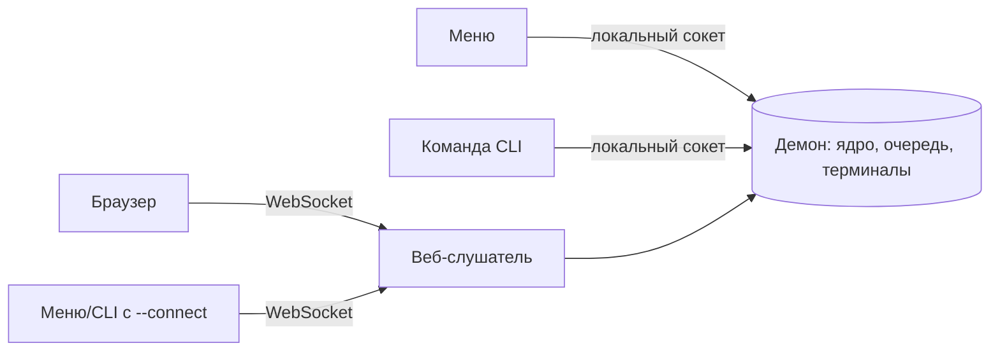

# Remote Control — управление серверами и генерация клиентских конфигов

`essence-rc` — один исполняемый файл, который запускается на **вашем локальном компьютере**. Он хранит желаемое состояние серверов (профили нод, роли, каскады), сам рендерит серверные файлы и применяет их на нодах по SSH, генерирует клиентские конфиги для устройств и публикует подписки. SSH/SFTP и шифрование age встроены в бинарник; Bash, `ssh`, `scp`, `jq` и `openssl` на локальной машине не нужны.

## Запуск

### Linux / macOS / Android (Termux)

```bash
curl -fsSL https://raw.githubusercontent.com/Morvex885/essence-setup-script/main/install-essence-rc.sh | bash
essence-rc
```

Установщик определяет ОС и архитектуру, скачивает из релиза GitHub архив
`essence-rc-<target>.tar.gz` и `SHA256SUMS`, сверяет SHA-256 и ставит бинарник в
`/usr/local/bin/essence-rc` (при необходимости через `sudo`); в Termux — в
`$PREFIX/bin/essence-rc` без root. Новая копия кладётся рядом с целью и
переименовывается, поэтому уже запущенный `essence-rc` не повреждается.

| Платформа | Target |
|---|---|
| Linux x86_64 (glibc) | `x86_64-unknown-linux-gnu` |
| Linux aarch64 | `aarch64-unknown-linux-gnu` (на musl-системах — `aarch64-unknown-linux-musl`) |
| Linux armv7 (glibc) | `armv7-unknown-linux-gnueabihf` |
| macOS Intel / Apple Silicon | `x86_64-apple-darwin` / `aarch64-apple-darwin` |
| Termux aarch64 | `aarch64-linux-android` (нативный DNS Android; musl-сборка в Termux не резолвит имена) |

Переменные окружения установщика:

| Переменная | Назначение |
|---|---|
| `ESSENCE_RC_VERSION` | Тег релиза (например, `v2.1.0`); по умолчанию — последний релиз |
| `ESSENCE_RC_BASE_URL` | Каталог с ассетами релиза (зеркало); важнее `ESSENCE_RC_VERSION` |
| `ESSENCE_RC_INSTALL_DIR` | Каталог установки вместо `/usr/local/bin` (`$PREFIX/bin` в Termux) |

Переменная передаётся интерпретатору, который выполняет установщик:

```bash
curl -fsSL https://raw.githubusercontent.com/Morvex885/essence-setup-script/main/install-essence-rc.sh | ESSENCE_RC_VERSION=v2.1.0 bash
```

Если `curl` или `tar` нет, установщик пробует поставить их пакетным менеджером
(в Termux — `pkg`, иначе только от root). Для неподдерживаемых платформ (например,
x86_64 или armv7 на musl) соберите бинарник из исходников.

### Windows (x64 / ARM64)

1. Скачайте из [последнего релиза](https://github.com/Morvex885/essence-setup-script/releases/latest)
   `essence-rc-x86_64-pc-windows-msvc.zip` (или `essence-rc-aarch64-pc-windows-msvc.zip`) и `SHA256SUMS`.
2. Сверьте хеш в PowerShell — он должен совпасть со строкой архива в `SHA256SUMS`:
   ```powershell
   (Get-FileHash .\essence-rc-x86_64-pc-windows-msvc.zip -Algorithm SHA256).Hash.ToLower()
   Select-String essence-rc-x86_64-pc-windows-msvc.zip .\SHA256SUMS
   ```
3. Распакуйте `essence-rc.exe` в каталог из `PATH` (например, `%USERPROFILE%\bin`) и запустите:
   ```cmd
   essence-rc
   ```

### Из исходников

```bash
git clone https://github.com/Morvex885/essence-setup-script.git essence
cd essence/remote-control
cargo run -p essence-rc --release                      # меню
cargo run -p essence-rc --release -- node list --json  # команда CLI
```

Нужен Rust с поддержкой edition 2024. Версия встраивается из корневого файла
`VERSION`.

### Режимы запуска

- `essence-rc` без аргументов, когда stdin и stdout — терминал, открывает
  терминальное меню. С перенаправленным stdin или stdout меню не запускается:
  печатается справка (код выхода 0).
- `essence-rc <сущность> <действие> …` — разовая команда без меню
  ([Командная строка](#командная-строка-cli)).
- `essence-rc --connect https://host[:port] …` — меню или команда на удалённом
  демоне ([Удалённое управление](#удалённое-управление---connect)).
- `essence-rc web run` — веб-панель в браузере ([Веб-панель](#веб-панель)).
- `essence-rc web install-service` — автозапуск веб-панели.
- `essence-rc --version` — версия; `essence-rc self update` — обновление из
  релиза; `essence-rc self uninstall [--remove-data]` — удаление.

Ядро выполняется в фоновом [демоне](#демон). Меню и команды запускают его сами
при первом обращении, и он выходит после простоя; отдельно запускать его не
нужно.

Каталог данных Bash-версии автоматически не импортируется и не удаляется.

### Зависимости

| Что | Когда нужно |
|---|---|
| `essence-rc` | Всегда. Один файл без внешних библиотек: SSH/SFTP (russh) и age встроены |
| `git`, `gh` | Только для источника конфигурации GitHub; `apt install git gh` / `brew install git gh` / `pkg install git gh`. Если их нет, команды GitHub отвечают `deps_missing` |
| `qrencode` | Необязательно: QR-код ссылки подписки в меню (веб-панель рисует QR сама) |
| Редактор | Для правки шаблонов в меню: `$VISUAL`, `$EDITOR`, иначе `nano`, иначе `vi`; в Windows — `notepad` |
| Браузер | Для веб-панели: `web run` и `web open` открывают её через `xdg-open` / `open` / `explorer` |
| `curl`, `tar`, `sha256sum` или `shasum` | Только для установщика |

На нодах нужны Debian или Ubuntu с systemd. Серверный исполнитель (Bash) встроен
в бинарник и загружается на ноду командой `node apply`.

### Учётная запись источника GitHub

Владелец из локального `source.json` закреплён за источником: смена активного
аккаунта системного `gh` не переключает репозиторий и не переносит конфигурацию.
Первое подключение (`source github-connect --login L`) требует явного логина;
смена владельца выполняется явно командой `source github-change-account --login L`.

Для каждого владельца `essence-rc` хранит отдельный профиль GitHub CLI в
`<каталог данных>/credentials/gh/<логин>` (на Linux обычно
`~/.local/share/essence-remote-control/credentials/gh/<логин>`). На Unix доступ к
каталогам ограничен правами 0700, к файлам — 0600. Токен не записывается в
`source.json` или Git URL; системные `gh auth switch` и `gh auth setup-git` не
вызываются: git получает учётные данные через `gh auth git-credential`
изолированного профиля только на время команды, `GH_TOKEN` и `GITHUB_TOKEN`
дочерним процессам не передаются.

Если профиля нет, `essence-rc` один раз пробует скопировать токен **указанного**
пользователя из системного `gh` (`gh auth token` → `gh auth login --with-token`,
токен идёт только через pipe). Не получилось — команда отвечает
`github_auth_required` с полями `login` и `hint`, а вход через браузер выполняет
`source github-login --login L` (код устройства печатается в журнал). При открытии
уже подключённого источника браузер не открывается: если профиль недоступен,
источник и локальный кэш остаются без изменений; авторизуйте профиль командой
`source github-login --login <логин>` или вручную командой из `hint`:

```bash
GH_CONFIG_DIR="$HOME/.local/share/essence-remote-control/credentials/gh/<логин>" gh auth login --hostname github.com --web
```

На другом устройстве авторизация выполняется заново.

## Архитектура: ядро команд

Вся логика живёт в одном ядре команд: `сущность действие --флаги` → ответ
`{id, ok, data | error}`. Терминальное меню, веб-панель и возможное
нативное приложение — только слои экранов без собственной логики, поэтому тесты
команд проверяют всё, что делают интерфейсы.

### Слои

Cargo workspace `remote-control/` (edition 2024):

| Путь | Назначение | Зависит от |
|---|---|---|
| `remote-control/core` (`rc-core`) | Ядро без вопросов пользователю: модель и локальное состояние, блокировки, секреты, каталог команд и справка (`cli.rs`), диспетчер `dispatch`, подтверждение планом, SSH-транспорт (russh), источник GitHub, домены `nodes`, `server` (профили, каскады, рендер желаемого состояния ноды, `node apply`, встроенный исполнитель), `clients`, `subscription`, `telegram`, самоуправление `self` | — |
| `remote-control/client` (`essence-rc-client`) | Типы протокола v3, `Client`, `DaemonClient` (локальный сокет и WebSocket), `ScriptedClient`, точка подключения, запуск демона | — (`essence-rc-web` только для тестов) |
| `remote-control/web` (`essence-rc-web`) | HTTP/TLS/WebSocket-слушатель и вшитые ассеты веб-панели | — |
| `remote-control/tui` (`essence-rc-tui`) | Библиотека экранов терминального меню (ratatui); с ядром общается только по протоколу через `client` | `client` |
| `remote-control/bin` (`essence-rc`) | Единственный исполняемый файл: демон, разовый CLI, меню, `web *`, автозапуск | все |
| `remote-control/core/templates/*.yaml` | Встроенные шаблоны mihomo; компилируются в бинарник | — |

`tui`, `client` и `web` не зависят от `rc-core` (проверяет
`remote-control/tui/tests/boundary.rs`).

Серверный исполнитель (`node-agent/` и библиотеки `common/common.sh`,
`common/cert.sh`) тоже встроен в бинарник (`core/src/server/bundle.rs`).
`node apply` загружает его на ноду в `/root/essence-node/agent/<хэш>/` с файлом
`MANIFEST`, когда этого каталога нет или он повреждён; у каждой версии RC свой
каталог.

### Демон и клиенты

Ядро выполняется только в [демоне](#демон) — фоновом процессе `essence-rc`.
Диспетчер один — `rc_core::dispatch::dispatch(argv, secrets, input, agent_socket,
session)`; своего «режима вызова» у него нет. Все интерфейсы — клиенты демона на
одном [протоколе v3](#протокол-v3):

- **меню** — `essence-rc` без аргументов в терминале;
- **разовый CLI** — `essence-rc сущность действие … [--json]`: секреты берёт из
  `--secrets-stdin` или скрытым вводом с консоли, результат печатает общий
  рендерер ([Командная строка](#командная-строка-cli));
- **браузер** — [веб-панель](#веб-панель);
- **меню или CLI с `--connect`** — те же клиенты на демоне другой машины
  ([Удалённое управление](#удалённое-управление---connect)).

Транспорты: локальный сокет (Unix) или именованный канал (Windows) — для меню и
CLI на машине демона; WebSocket через веб-слушатель демона — для браузера и
`--connect`.



### Демон

На каждый каталог данных работает один демон. На Unix единственность держит
`flock` на `<h>.lock` всё время жизни процесса, на Windows — первый экземпляр
именованного канала. Пути — в разделе [Каталог времени
выполнения](#каталог-времени-выполнения). `--data-dir` важнее
`ESSENCE_RC_DATA_DIR`.

**Запуск по требованию.** Клиент подключается к сокету; если демона нет, клиент
запускает `essence-rc daemon run` отсоединённо (stdin и stdout — null, stderr — в
журнал `<h>.log`, `setsid`, рабочий каталог `/`) и пытается подключиться каждые
50 мс до 60 с. Если демон не запустился, ошибка показывает последние 5 строк
журнала. Если блокировка занята и демон отвечает, `daemon run` печатает «Демон уже
запущен.» и выходит с кодом 0; если не отвечает — ждёт освобождения блокировки до
60 с.

**Простой.** Демон по требованию выходит, когда простаивает
`ESSENCE_RC_DAEMON_LINGER` секунд: 1–6 цифр, `0` допустим, по умолчанию 5; иное
значение — ошибка «ESSENCE_RC_DAEMON_LINGER должна содержать от 1 до 6 цифр.».
Простой — нет соединений, заданий, терминалов и веб-слушателя. Если за 10 с после
запуска никто не подключился, демон выходит.

**Постоянный режим.** Демон, запущенный с `--web`, или демон с запущенной
веб-панелью по простою не выходит. `web stop` возвращает режим по требованию
только демону, запущенному без `--web`; демон `daemon run|start --web` (и служба
автозапуска) остаётся постоянным.

**Остановка.** По `daemon stop`, простою, SIGTERM или SIGINT, событиям консоли
Windows, после успешных `self update` и `self uninstall` демон:

1. перестаёт принимать соединения;
2. отвечает заданиям из очереди `daemon_stopping` «Демон останавливается.
   Повторите команду.»;
3. отменяет терминалы;
4. закрывает сессию (отложенное отправляется в GitHub, блокировка снимается);
5. отвечает инициатору `{"stopping":true}`;
6. удаляет сокет и снимает блокировку.

SIGHUP игнорируется, SIGQUIT завершает демон с кодом 131. Паника ядра пишет в
журнал строку «Ядро завершилось аварийно.» и завершает демон с кодом 1. Локальный
клиент после `daemon_stopping` один раз переподключается и повторяет запрос.

**Обновление.** После успешного `self update` постоянный демон перезапускается
новым бинарником (Unix — `exec` с сохранением блокировки, Windows —
отсоединённый запуск) с абсолютным `--data-dir`. Флаги слушателя исходного
запуска не переносятся: если панель работает, добавляется `--web` с флагами
работающего слушателя (фактический порт, абсолютные пути сертификатов); панель,
остановленная `web stop`, после обновления не поднимается. Демон по требованию
просто останавливается.

**Демон другой версии.** Если отвечает демон другой версии или другого бинарника,
клиент останавливает его, только если тот работает по требованию и простаивает
(`persistent:false`, не больше одного клиента, нет терминалов), и ждёт до 30 с.
Иначе ошибка «Запущен демон другой версии ({v}) с активными клиентами.
Остановите его: essence-rc daemon stop.» или «Запущен демон другой версии ({v}).
Остановите его: essence-rc daemon stop.».

**Журнал.** stderr демона пишется в `<h>.log` (0600); из него клиенты показывают
причину, если демон не запустился.

**Команды.** `daemon status` возвращает `{pid, version, protocol, exe, uptime_s,
persistent, busy, clients:[{origin, since_s}], session:{open, source}, terminals,
web}`. `daemon stop` останавливает демон после текущей операции и доступен только
локально (`local_only` по сети). `daemon run` запускает демон на переднем плане,
`daemon start` — в фоне и печатает `{endpoint, pid[, web]}`. Флаги слушателя
(`--bind`, `--port`, `--tls-cert`, `--tls-key`, `--no-tls`) без `--web` —
`usage`.

### Протокол v3

**Кадрирование.** Сообщение — JSON-объект до 4 МиБ. На локальном сокете — одна
строка на сообщение, разделитель `\n` (завершающий `\r` отбрасывается); слишком
длинная строка рвёт соединение без ответа. По WebSocket —
один объект на текстовый кадр.

**Приветствие.** Первое сообщение демона:

```json
{"event":"hello","protocol":3,"version":"2.1.0","origin":"local","exe":"/usr/local/bin/essence-rc","persistent":false}
{"event":"hello","protocol":3,"version":"2.1.0","origin":"network","listener":{"loopback":true,"tls":false}}
```

Локальные соединения получают ещё `exe` и `persistent`, сетевые — `listener`.

**Запрос.**

```json
{"id":3,"argv":["group","add","--name","LAB"]}
```

| Поле | Значение |
|---|---|
| `id` | Строка без NUL, число или `null`; эхом возвращается в событиях и ответе |
| `argv` | Массив строк без NUL (то же, что аргументы разового CLI); `--secrets-stdin` — `usage` |
| `secrets` | Необязательный объект строк; только разрешённые имена, которые принимает команда, иначе `usage`: «Секреты должны быть JSON-объектом строк.» (форма) или «Секрет не поддерживается командой.» (имя) |
| `input` | Необязательный объект строк — [входные данные](#секреты) команды: не больше 4 имён, до 1 МиБ на значение |
| `env` | Необязательно, только у локальных соединений: `{"SSH_AUTH_SOCK":"/abs"}` — абсолютный путь до 4096 байт |
| `terminal` | Для терминальных команд: `{"term","cols","rows"}`; `term` — 1–64 печатных ASCII-символа, `cols` и `rows` больше 0 |

Ошибки `input`: `usage` «Поле input должно быть JSON-объектом строк.», `invalid`
«Входные данные превышают 1 МиБ.», `usage` «Поле input не поддерживается
командой.».

**События демона.** До ответа демон отправляет события:

| Событие | Когда |
|---|---|
| `{"id","event":"log","level","text"}` | Журнал команды; `level` — `info`, `success`, `warn`, `error` или `output`; управляющие символы C0/C1 вырезаются |
| `{"id","event":"progress","percent","text"}` | Живая строка долгой команды (`node apply`, снятие ноды): `percent` — целое 0–100, `text` — одна строка без управляющих символов; каждая заменяет предыдущую, в журнал и наблюдателям не идёт; приходит раз в секунду, пока команда ждёт ноды |
| `{"id","event":"terminal","state":"open"}` | Терминал открыт |
| `{"id","event":"output","data":"<base64>"}` | Вывод терминала |
| `{"id","event":"access","resume":"<64 hex>"}` | Сетевое соединение, перед ответом на первую успешную авторизацию: токен возобновления |
| `{"event":"activity","state":"start"\|"end","command":"<noun verb>","origin"}` | Начало и конец команды любого клиента (наблюдателям) |
| `{"event":"activity","state":"log","level","text"}` | Журнал этой команды (наблюдателям) |

**Ответ** — ровно один на запрос, с тем же `id`:

```json
{"id":3,"ok":true,"data":{"name":"LAB"}}
{"id":3,"ok":false,"error":{"code":"not_found","message":"…"},"exit":1}
```

В режиме GitHub к успешному ответу добавляется поле `sync` (`clean`, `pending`
или `offline`). Ответ с ошибкой несёт `exit` — код выхода разового CLI. Ошибка
может нести дополнительные поля рядом с `code` и `message` (например, `plan` и
`plan_token` у `confirmation_required`, `results` у `telegram`, `fingerprints` у
ошибок ключа сервера). Поля JSON выводятся в порядке объявления.

**Терминал.** Пока терминальная команда работает, клиент отправляет
`{"id","stdin":"<base64>"}`, `{"id","resize":{"cols","rows"}}` и
`{"id","close":true}`; неизвестный `id` игнорируется. Очередь ввода терминала — до
64 сообщений и до 4 МиБ декодированного ввода; SSH-сессия берёт из неё ввод, только
пока её собственный буфер записи в канал (до 64 событий и 4 МиБ) не заполнен, так
что ввод ограничен на всём пути до ноды. Ввод никогда не задерживает чтение
соединения: если очередь заполнена по любому из пределов (терминал ещё не открыт
или не успевает), терминал закрывается — уже принятый ввод доставляется, затем
удалённая сторона получает EOF, а клиент — событие `log` уровня `error` «Ввод
терминала не успевает обрабатываться: терминал закрыт.». `close` тоже закрывает
ввод терминала; через 2 с не завершившийся терминал отменяется — именно этот, а не
более поздний с тем же `id`. Терминал, закрытый `close` или переполнением до
открытия, не запускается: ответ — `remote_failed` с
`reason: "closed"`. Одна нода — один открытый терминал (`conflict` «Терминал ноды
«{name}» уже открыт.»); без поля `terminal` — `tty_required`.

**Наблюдение.** `{"watch":true|false}` без `argv` включает и выключает события
`activity`. Их получают наблюдатели: локальные — всегда, сетевые — после
авторизации.

**Правила.**

- Неразборчивое сообщение, неверный `id` или `argv` — `usage` «Неверный запрос.»;
  при корректном `id` он сохраняется в ответе.
- Каждый запрос, включая `help`, `daemon *` и `web *`, до маршрутизации проходит
  ту же проверку, что и команда ядра: `--secrets-stdin` в `argv`, секрет, который
  команда не принимает, и неподдерживаемое поле `input` — `usage`.
- Повтор `id`, который ещё выполняется, — `usage` «Запрос с таким id уже
  выполняется.».
- Сетевое соединение держит не больше 4 одновременных запросов до авторизации и
  32 после, иначе `usage` «Слишком много одновременных запросов.».
- Запросы всех соединений выполняются по одному, отмены нет. Вставший в очередь
  получает `log` уровня `info` «Ожидание: выполняется «{noun verb}».»
  (неавторизованное сетевое соединение — нет).
- Обрыв соединения отменяет его терминалы и снимает его невыполненные задания без
  ответа.
- При остановке демона невыполненные задания получают `daemon_stopping`.

**Лимиты.** Сообщение — до 4 МиБ; неавторизованное сетевое соединение — до
64 КиБ, не больше 32 таких соединений и 60 с на вход; `input` — до 4 имён по
1 МиБ. События и ответы, которые клиент ещё не прочитал, копятся до 16 МиБ на
соединение; клиент, который перестал читать, отключается (вывод терминала
ограничен отдельно и ждёт клиента).

### Сессия

Сессия ядра одна на демон. Каждое соединение авторизуется само запросом
`session open [--remember-key]` с секретами `script-password`, `vault-password`
(для GitHub с шифрованием) и, для сетевых соединений, `access-token`. До этого
работают только `help`, `session status` и `session open`, а у локальных
соединений ещё `self version`, `daemon *` и `web *`; остальное отвечает
`session_closed` «Сначала откройте сессию: session open.». Шаги `session open`:

1. у сетевого соединения неверный или просроченный код — `auth_failed` «Неверный
   или просроченный код доступа.» с `secret: "access-token"`;
2. проверить пароль запуска (кроме входа по токену возобновления): нет секрета —
   `auth_required`, неверный — `auth_failed` (оба с `secret: "script-password"`);
3. панель на loopback, пароля запуска нет и кода нет — `auth_required` «Требуется
   код доступа: essence-rc web link.» с `secret: "access-token"`;
4. нет ни `source.json`, ни `config.json` — соединение авторизовано, ответ
   `not_configured`; после него работают `source init-local` и мастер GitHub;
5. открыть источник (GitHub: пароль доступа — `vault_password_required` /
   `vault_password_invalid`; формат снимка — `github_format_outdated|newer|invalid`
   с полями `version` и `required`; занята блокировка — `locked`; прочее —
   `source_failed` с этапом); если после открытия сменился хеш пароля запуска —
   проверить пароль снова.

Пароль, доказанный на шаге 2, авторизует соединение и при неудачном открытии
источника; команды, которым нужна сессия, работают после её открытия. Сетевое
соединение после первого успешного входа получает событие `access` с токеном
возобновления ([Доступ](#доступ)).

`session status` не открывает источник и возвращает
`{"configured","source":"local|github|null","open","authorized"}`; `authorized` —
авторизовано ли это соединение и авторизована ли сессия ядра (пароль запуска проверен).

Разовый CLI открывает сессию сам: перед каждой командой (кроме `help`,
`session status|open`, а у локального демона — ещё `self version`, `daemon *`,
`web *`) он отправляет `session open`. С `--connect` сессия открывается и перед
`self version`, `daemon status`, `web status`: сетевой демон отвечает на них
только после входа. Отсутствующий каталог данных — открытая пустая
локальная сессия: читающие команды работают (как `status`), а первое изменение
создаёт локальную конфигурацию. Явный `session open` в таком состоянии отвечает
`not_configured`.

### Секреты

Секреты существуют только в памяти (`Zeroizing`, без `Debug`/`Serialize`): их нет в
argv, журнале, данных ответа и текстах ошибок. Допустимые имена: `password`,
`current-password`, `vault-password`, `new-vault-password`, `script-password`,
`access-token` (код панели из `web link` или токен возобновления веб-панели;
принимает только `session open`).
Каждая команда принимает только свои секреты (они перечислены в справке);
разовый CLI для команд, открывающих сессию, дополнительно принимает
`script-password`, `vault-password` и `access-token`.

В разовом CLI секреты приходят двумя способами:

- `--secrets-stdin` — stdin целиком читается как JSON-объект `{"имя":"значение"}`;
- скрытый ввод с консоли — только если stdin является консолью и ядро ответило
  `auth_required`, `auth_failed`, `missing_secret` (подсказка `secret`) или
  запросило пароль доступа GitHub (`vault-password`, `new-vault-password`); до трёх попыток на секрет. Подтверждения с
  консоли не запрашиваются: ввод `y` ничего не подтверждает.

Переменных окружения с паролями нет. Пароли доступа `vault-password` и
`new-vault-password` не могут заканчиваться CR или LF (`invalid`).

**Входные данные.** Содержимое файлов команд с входными данными (`template
import`, `template check`, `source github-import-recovery-key`) клиент читает сам и передаёт полем
`input.file`; путь демону не передаётся. В каталоге команд такой вход объявлен
токеном `@file` (флаг `--file PATH` обязателен) или `@file?` (необязателен: без
флага поле `input.file` не передаётся; так у `template check`, где вместо файла
можно указать `--name`). В `input` — не больше 4 имён, до 1 МиБ
на значение. CLI и меню принимают только обычный файл не больше 1 МиБ в UTF-8 и
не читают больше этого; символьная ссылка, каталог и прочие специальные файлы
отклоняются, ссылка не разыменовывается. Веб-панель проверяет выбранный в
браузере файл по тем же пределам: 1 МиБ и UTF-8. Ключ восстановления из
каталога данных локального демона CLI и меню отклоняют: `invalid` «Не удалось
импортировать ключ восстановления: файл ключа восстановления не найден, имеет
недопустимый тип или расположен внутри служебного каталога.» (с `--connect`
каталог данных удалённый, проверка не выполняется).

### Подтверждение и токен плана

Опасная команда без `--yes` ничего не меняет и отвечает `confirmation_required`
с полями `plan` (строки плана без секретов) и `plan_token` (16 hex). Токен — первые
16 hex SHA-256 от области команды (`сущность действие` и исходные аргументы без
`--json`, `--yes`, `--plan-token` и `--secrets-stdin`), строк плана и служебной части плана.
Служебная часть привязывает токен к тому, чего нет в `argv`: у `template import`
это SHA-256 содержимого `input.file`, поэтому токен, полученный для одного файла,
для другого содержимого отвечает `plan_changed`.
Выполнение — тот же `argv` с `--yes --plan-token T`. Если план успел измениться,
ответ — `plan_changed` с новым планом и токеном. `--yes` без токена — согласие на
текущий план (для скриптов); `--plan-token` без `--yes` — `usage` уже при разборе.
До согласия выполняются только проверки и чтение.

### Решения вместо вопросов

Команды ничего не спрашивают. Решение, которое иначе задавалось бы посреди
операции, превращается в код `…_required` с данными, а интерфейс сам спрашивает
пользователя и повторяет команду с нужным флагом или секретом:

| Код | Данные | Ответ интерфейса |
|---|---|---|
| `github_auth_required` | `login`, `hint` | `source github-login --login L`, затем повтор |
| `repo_create_required` | `repo` | `--create-repo` |
| `repo_private_required` | — | `--make-private` (согласие — в плане) |
| `storage_mode_required` | `choices` | `--storage age\|none` |
| `new_vault_password_required` | — | секрет `new-vault-password` |
| `existing_config_action_required` | `choices`, `remote_counts`, `local_counts` | `--existing remote\|local\|migrate` |
| `vault_password_required` / `vault_password_invalid` | — | секрет `vault-password` |
| `cache_skip_required` | — | `--without-cache` |
| `target_replace_required` | `repo`, `tracked_files`, `reason` | `--replace-target` (согласие — в плане) |
| `key_provisioning_required` | `nodes` | `--provision-keys yes\|no` |
| `auth_required` / `auth_failed` | `secret` | секрет `script-password` или `access-token` (по полю `secret`) |
| `domain_required` | `name` | вопрос «Домен ноды» → `node domain --name N --domain D`, затем повтор команды |

Команда, которой нужен живой терминал (`node shell`), без терминала отвечает
`tty_required`.

Решения не заменяют подтверждение. `source github-connect` и
`source github-change-account` после всех решений отвечают `confirmation_required`
(с `plan` и `plan_token`), если в плане есть необратимый шаг: сделать репозиторий
приватным (`--make-private`), удалить файлы целевого репозитория
(`--replace-target`, с их числом), заменить конфигурацию GitHub (`--existing local`,
со счётчиками с обеих сторон), хранить без шифрования (`--storage none`) или
выполнить SSH-действия на нодах (новые переносимые ключи и отпечатки закрепляемых
ключей серверов). До согласия ничего не пишется ни локально, ни в GitHub:
репозиторий создаётся или делается приватным только после него. План
`source github-replace-with-local` тоже перечисляет SSH-действия на нодах;
`key_provisioning_required` приходит раньше `confirmation_required`.
При `source github-connect --existing migrate` преобразование формата и
приватизация входят в один план.

Расшифрованный снимок конфигурации GitHub существует только в памяти; ключ
сессии — тоже. Рабочее состояние открытого источника лежит в `github-runtime/`, где
пароли нод зашифрованы ключом устройства. После закрытия сессии расшифрованных
ключей на диске не остаётся (кроме сохранённого `--remember-key`).

Смена аккаунта (`source github-change-account`) ведёт журнал
`account-switch/` с фазами `prepared → push_unknown → target_committed →
local_committed`. Сбой после принятия смены не откатывает её: следующее открытие
сессии завершает переход; если отправка в новый репозиторий не подтверждена и
ожидаемого commit там нет, следующий запуск отменяет смену и возвращает прежний
репозиторий. Прежний репозиторий не меняется. Ответы `*_required` и отказ от плана
не оставляют профиль входа нового аккаунта, если его не было до команды, и не
меняют состояние синхронизации. В режиме `age` `source github-fetch` использует
ключ текущего сеанса и пароль доступа не запрашивает.

### Коды ошибок

Каждая ошибка — `{"code","message",…}`; `message` однострочный.

- Общие: `usage`, `confirmation_required`, `plan_changed`, `session_closed`,
  `not_configured`, `not_found`, `conflict`, `exists` (профиль или каскад с
  таким именем уже есть), `in_use` (объект занят: профиль с нодами, нода с
  ролями при снятии профиля, нода с незавершённым применением), `invalid`,
  `missing_secret`, `needs_setup`, `failed`, `partial`, `locked`,
  `nothing_pending` (нечего делать: нет нод, ожидающих применения, или
  отложенной SSH-настройки), `tty_required`, `deps_missing` (не найдена или не
  запускается внешняя команда `git`/`gh`), `local_only` (команда доступна
  только на машине демона), `daemon_stopping`, `not_supported`.
- SSH и ноды: `host_key_unknown`, `host_key_mismatch`, `host_key_changed`
  (с `host`, `port`, `fingerprints`), `remote_failed` (с `reason`, например
  `timeout`), `onboarding_failed`, `port_in_use`, `hardening_failed`,
  `domain_required` (с `name`: профилю ноды нужен домен ноды),
  `not_installed` (хост подписок или Telegram Proxy ещё не применены на ноде).
- Вход и пароли: `auth_required`, `auth_failed`, `vault_password_required`,
  `vault_password_invalid`, `vault_work_excessive` (параметр scrypt файла
  `unlock.age` выше допустимого 2^22), `new_vault_password_required`.
- Источник GitHub: `github_auth_required`, `repo_create_required`,
  `repo_private_required`, `storage_mode_required`,
  `existing_config_action_required`, `cache_skip_required`,
  `target_replace_required`, `key_provisioning_required`,
  `github_format_outdated`, `github_format_newer`, `github_format_invalid`,
  `source_failed`.
- Система: `root_required`, `unsafe_path`, `update_failed`.
- Демон и подключение: `daemon_cert_unknown`, `daemon_cert_changed` (с `host`,
  `port`, `fingerprint`), `daemon_unreachable`, `daemon_protocol`.

**Сбои нод в `node apply`.** Если хоть одна нода не применена, ответ — `partial`
с полями `applied`, `unchanged` и `failed[]`; запись `failed` —
`{name, stage, code, message, port?}`, `message` выводится после имени ноды.
`stage` — где произошёл сбой:

| `stage` | `code` |
|---|---|
| `probe` — подключение и проба ноды до плана (сбой соединения — не ключа сервера и не входа — повторяется один раз через 2 с) | код ошибки SSH или ноды (`remote_failed`, `host_key_unknown`, `host_key_changed`, `needs_setup`, `missing_secret`); `unsupported_os` — не Debian/Ubuntu с systemd; `port_busy` (с `port`) — порт, нужный ноде, занят чужой службой; при `--profile` и `--pending` — ошибка рендера ноды (`domain_required`, `invalid`) |
| `warp` — регистрация аккаунта WARP | код ошибки регистрации (обычно `remote_failed`) |
| `start` — запись операции, загрузка и запуск исполнителя | `missing_secret` (нет ключа ноды или секрета роли), `in_use` (на ноде уже выполняется применение), `start` (не удалось загрузить или запустить исполнитель) |
| этап исполнителя: `init`, `packages`, `system`, `mihomo`, `dns`, `site`, `certificate`, `prepare`, `config`, `firewall`, `cleanup` | `failed` — сбой этапа (в том числе другая операция держит блокировку ноды или исполнитель остановился без результата; если исполнитель знает причину, `message` говорит, что сделать: нет заголовков текущего ядра для AmneziaWG — обновите ядро, перезагрузите сервер и повторите `node apply`); `rolled_back` — сбой на этапах `config`, `firewall` или `cleanup` (внутри транзакции), файлы, бинарник mihomo и правила UFW возвращены; `rollback_failed` — откат не завершён (не вернулся файл или правило, не поднялась служба, работавшая до операции, или отказал откат фичи): резервные копии оставлены на ноде в `<op>/backup`, файлы и порты попытки RC считает своими, нода остаётся «ожидает применения»; `timeout` — нет связи с нодой больше 10 минут или операция идёт дольше 60 минут (операция остаётся записанной, следующий `node apply` продолжает её опрос) |

С `--name N` ошибка рендера названной ноды (например, `domain_required`)
возвращается сразу как ошибка всей команды, чтобы интерфейс решил её и
повторил команду.

Коды выхода разового CLI: `0` — успех; `2` — `usage`, `host_key_unknown`,
`daemon_cert_unknown`, `plan_changed` и любой код на `_required` (в том числе
`confirmation_required`, `tty_required`, `auth_required`, `domain_required`);
для `telegram status` ещё `3` (`not_installed`) и `4` (`partial`); остальное —
`1`. В протоколе код выхода приходит полем `exit` ответа с ошибкой.

## Командная строка (CLI)

С аргументами `essence-rc` работает без меню и без вопросов:

```bash
essence-rc <сущность> <действие> [--флаги] [--json]
essence-rc --help              # все команды (то же: help, -h)
essence-rc client --help       # команды одной сущности (то же: help client)
```

Справка и разбор аргументов строятся из одной таблицы каталога
(`remote-control/core/src/cli.rs`): каждая команда разбирается по своей строке
каталога, поэтому справка бинарника всегда совпадает с тем, что он принимает.

- **Грамматика.** Флаги — `--flag value` или `--flag=value`. Списки (`…` в справке)
  задаются повторением флага (`--name a --name b`); повтор одиночного флага —
  `usage` («Флаг --name указан дважды.»). Неизвестная сущность или флаг, лишний
  аргумент, `--`, значение с переводом строки или NUL — `usage`. Объект команды
  везде выбирается флагом `--name` (у `conn`, `telegram`, `subscription host`
  — нода, у `profile` — профиль, у `cascade` — каскад, у
  `subscription show|publish|rotate|revoke` и `client awg-config` — клиент); связи задают `--node`,
  `--group`, `--client`, `--profile`, `--entry`.
- **Глобальные флаги** допустимы в любом месте и у любой команды: `--json`,
  `--yes`, `--plan-token T` (только вместе с `--yes`), `--secrets-stdin`,
  `--help`/`-h`. Значение флага (`--name -h`) справкой не считается.
- **`--connect URL [--fingerprint SHA256:…] [--insecure]`** — выполнить меню или
  команду на удалённом демоне; эти флаги допустимы только перед командой
  ([Удалённое управление](#удалённое-управление---connect)).
- **`--json`**: в stdout ровно один объект `{"id":null,"ok":true,"data":…}` или
  `{"id":null,"ok":false,"error":{"code":…,"message":…,…}}`; в режиме GitHub
  добавляется `sync`. Журнал — в stderr с префиксами `[*]`, `[✓]`, `[!]`, `[✗]`.
  Без `--json` общий рендерер печатает данные: объект — строки `ключ: значение`,
  список объектов — таблицу, план — рамку «Требуется подтверждение:».
- **`--yes`** обязателен для опасных действий. Без него команда показывает план,
  ничего не меняет и завершается с кодом 2 (`confirmation_required`, в ответе
  `plan` и `plan_token`). `--yes --plan-token T` выполняет действие, только если
  план не изменился, иначе — `plan_changed` с новым планом и токеном.
- **stdin и файлы.** stdin читается только для секретов (`--secrets-stdin`,
  JSON-объект `{"имя":"значение"}`) или скрытым вводом, когда stdin — консоль.
  Пример:
  `printf '{"password":"…"}' | essence-rc node password --name de-vps --secrets-stdin`.
  `--file PATH` у команд с входными данными читает клиент: нужен обычный файл (не
  символьная ссылка) в UTF-8 не больше 1 МиБ, иначе `invalid` «Файл {path}
  недоступен.», «Файл {path} не в кодировке UTF-8.» или «Файл {path} больше
  1 МиБ.». `template export --output PATH` записывает клиент: каталог —
  `invalid`, существующий файл — план «Файл {output} будет перезаписан шаблоном
  {file}.»; запись атомарная, символьная ссылка заменяется файлом, а не
  разыменовывается, после записи каталог синхронизируется на диск. Без
  подтверждённой перезаписи файл, появившийся по этому пути во время экспорта,
  не заменяется: `conflict` «Файл {output} появился во время экспорта: повторите
  команду.». С `--connect` файлы читаются и пишутся на машине клиента.
- **Без конфигурации** разовый CLI работает с пустой локальной сессией; явная
  конфигурация создаётся командой `source init-local` или
  `source github-connect --login L`. Решения подключения задают флаги
  (`--create-repo`, `--make-private`, `--storage age|none`,
  `--existing remote|local|migrate`, `--provision-keys yes|no`); без нужного флага
  команда отвечает кодом `*_required` и ничего не меняет. Неудачный
  `source github-connect` удаляет созданное этой командой (новый каталог данных
  исчезает целиком); при существующей локальной конфигурации её файлы
  восстанавливаются, а переносимые ключи, установленные командой, отзываются.
- **Ключ сервера при `node add`**: `--host-key SHA256:…` (сверить отпечаток),
  `--accept-new-host-key` (довериться первому ключу) или `--replace-host-key
  SHA256:… [--yes]` (заменить сменившийся: план с прежними и новым отпечатками).
  `--accept-new-host-key` и `--replace-host-key` вместе не принимаются. Без флагов
  команда завершается с кодом 2 (`host_key_unknown` с отпечатком сервера);
  несовпадение с `--host-key` — `host_key_mismatch`, хост, уже известный с другим
  ключом, — `host_key_changed` `{host,port,fingerprints}`; ни в одном из случаев
  ничего не записывается. Доверие новому ключу существующей ноды —
  `node trust-host-key` (подключение с ожидаемым отпечатком, план, согласие,
  запись). Пины хранятся по `[host]:port`, включая порт 22.
- **Логин и адрес ноды**: `--user` — латиница, цифры, `.`, `_`, `-`, первый символ —
  буква или `_`, до 32 символов; `--ip` — до 253 символов из латиницы, цифр, `.`,
  `_`, `-`, `:` (IPv6 без скобок), первый символ — буква, цифра или `:`; порт —
  1–65535. Иначе `invalid`. Сохранённая нода с небезопасным логином, адресом или
  ссылкой на ключ (`identity` — только `null`, `""`, `"system"` или собственный id
  ноды) не проходит проверку конфигурации (`invalid`).
- **Имена** (`node add`, `node rename`, `profile add`, `client add`, `client rename`,
  `group add`, `cascade add`): латиница, цифры, `.`, `_`, `-`, без пробелов, не из
  одних точек, без ограничения длины. Иначе `invalid` с сообщением, что допустимо,
  и примером верного имени (буквы в нижнем регистре; русская, украинская и
  белорусская кириллица и латиница с диакритикой транслитерируются, остальное —
  дефисы: «VLESS TCP HY2» → «vless-tcp-hy2», «Zürich Straße» → «zurich-strasse»;
  занятое имя того же вида получает `-2`, `-3`, …); extra `name` и, если пример
  получился, `suggestion`. Ничего не записывается.
- **Тег ноды** (`node tag`, `node add`): пустой или до 32 символов, Unicode и эмодзи
  допустимы, без управляющих символов и ``; " ' ` $ \ | & < > { } [ ] # , : /``
  (`node add` требует непустой тег). Иначе `invalid`, ничего не записывается.
- **Атомарность нод**: `node add` пишет пин, пароль, ключи и запись ноды одной
  транзакцией и при позднем сбое восстанавливает все затронутые файлы; успешный
  ответ содержит `needs_setup`, если SSH-настройка отложена. `node delete` — сбой
  после удаления компонентов на сервере даёт `partial`
  `{name,scope,deleted,remote_removed}`; отозванный ключ возвращается через
  удерживаемую SSH-сессию и проверяется новым входом.
- **`node harden`**: без `--port` план содержит детерминированный свободный порт,
  поэтому `--yes --plan-token` подтверждает именно его; с `--port` проверяется
  указанный порт (`port_in_use`, `invalid`). План сообщает о замене и отзыве
  прежнего управляемого ключа ноды.
- **Подключения нод** (`conn sync`, `conn list --discover`, `node aliases`)
  выводятся из профиля ноды и её каскадов без SSH: `VLESS TCP`, `VLESS xHTTP`,
  `VLESS gRPC`, `Hysteria2`, `AWG` и имена каскадов; нода без профиля
  подключений не имеет.
- **Отложенная SSH-настройка**: команды SSH для ноды GitHub с отложенной
  настройкой (`missing_identity`, `missing_host_key`) отвечают `needs_setup` до
  плана и до любого SSH; отсутствующий пароль — `missing_secret`.
- **Блокировка**: изменения конфигурации сериализуются через каталог `.rc-lock` в
  каталоге данных (атомарный `mkdir`, владелец в `.rc-lock/owner`). В local-режиме
  команда ждёт до `RC_LOCK_WAIT` секунд (1–6 десятичных цифр, по умолчанию 30;
  иное значение заменяется на 30). В режиме GitHub блокировку весь сеанс держит
  демон; меню и команды подключаются к тому же демону и работают в его сессии.
  Устаревшую блокировку освобождает только один процесс и только при доказанно завершённом
  владельце (или отсутствующем `owner` старше 60 секунд); отказ доступа или
  неопределённый результат смертью владельца не считаются. Если очистку прервал
  `SIGKILL`, может остаться `.rc-lock/.reclaim`: захват завершается `locked` с
  полным путём — удаляйте каталог вручную, только убедившись, что других операций
  нет.
- **Сигналы**: Ctrl+C не прерывает разовую команду; SIGTERM, SIGHUP и SIGQUIT
  восстанавливают консоль после скрытого ввода и завершают процесс с кодом 128+N.
- **Окружение**: `ESSENCE_RC_DATA_DIR` (каталог данных, пустое значение —
  `invalid`), `RC_LOCK_WAIT`; для `self update|version` — необязательный
  `GITHUB_TOKEN` (только заголовком запроса к API GitHub). `RC_LOCK_WAIT` и
  `GITHUB_TOKEN` читаются из окружения демона. `ESSENCE_RC_RUNTIME_DIR` —
  [каталог времени выполнения](#каталог-времени-выполнения),
  `ESSENCE_RC_DAEMON_LINGER` — простой [демона](#демон) до выхода (секунды);
  `ESSENCE_RC_CONNECT`, `ESSENCE_RC_FINGERPRINT`, `ESSENCE_RC_INSECURE` (`=1`) —
  то же, что `--connect`, `--fingerprint` и `--insecure`.

Только редактирование шаблона редактором остаётся за меню и веб-панелью
(редактор в браузере): оно сохраняет изменения командой `template import`.
Оболочка ноды (`node shell`) требует терминала (`tty_required` без него).

### Каталог команд

Таблицы повторяют вывод `essence-rc help` и `essence-rc <сущность> --help`
версии 2.1.0 (справка генерируется из каталога `remote-control/core/src/cli.rs`).
`[--yes]` — ключ `--yes [--plan-token T]` у команды с подтверждением;
`help [СУЩНОСТЬ]` описан выше.

### Источник (`source`)

| Команда | Описание |
|---|---|
| `source init-local` | Создать локальную конфигурацию |
| `source status` | Источник: тип, репозиторий, ветка, хранение, синхронизация |
| `source github-accounts` | Сохранённые аккаунты GitHub и глобальный вход gh |
| `source github-login --login L` | Войти в GitHub через браузер (код устройства — в журнале) |
| `source github-connect --login L [--create-repo] [--make-private] [--storage age\|none] [--existing remote\|local\|migrate] [--provision-keys yes\|no] [--remember-key] [--replace-target] [--yes]` | Подключить GitHub (секреты vault-password, new-vault-password) |
| `source github-fetch` | Загрузить конфигурацию из GitHub |
| `source github-push` | Отправить конфигурацию в GitHub |
| `source github-change-account --login L [--create-repo] [--make-private] [--storage age\|none] [--existing remote\|local] [--without-cache] [--replace-target] [--yes]` | Сменить аккаунт GitHub (секреты vault-password, new-vault-password) |
| `source github-rewrap-password` | Сменить пароль доступа (секреты vault-password, new-vault-password) |
| `source github-rotate-key [--yes]` | Новый ключ шифрования (секрет new-vault-password) |
| `source github-import-recovery-key --file PATH` | Импортировать ключ восстановления для текущего сеанса |
| `source github-switch-local` | Работать локально без синхронизации с GitHub |
| `source github-replace-with-local [--provision-keys yes\|no] [--yes]` | Заменить конфигурацию GitHub конфигурацией этого компьютера (секреты script-password, vault-password) |
| `source github-migrate-format [--yes]` | Преобразовать конфигурацию GitHub в текущий формат (секреты script-password, vault-password) |
| `source github-delete-repo [--yes]` | Удалить репозиторий GitHub (конфигурация останется локально) |

### Сессия (`session`)

| Команда | Описание |
|---|---|
| `session status` | Состояние: создана ли конфигурация, открыта ли сессия |
| `session open [--remember-key]` | Открыть источник и проверить пароль запуска (секреты script-password, vault-password, access-token) |

### Сводка (`status`)

| Команда | Описание |
|---|---|
| `status` | Сводка: версия, источник, счётчики, проблемы |

`status` не проверяет обновления (`update.latest` всегда `null`) и не создаёт
отсутствующий каталог данных. Сводку команда читает из открытой сессии: для
локального источника это локальные файлы без сети; для GitHub разовый CLI перед
`status` открывает сессию, как перед любой командой с сессией (синхронизация с
GitHub и пароль доступа; при недоступной сети — локальный кэш с предупреждением,
без кэша — ошибка источника).
Поля: `version`, `update`, `script_password`, `source` (`type`, `repo`, `sync`),
`counts`, `password_missing`, `ssh_setup_pending`, `subscription_host` (имя ноды).

### Ноды (`node`)

| Команда | Описание |
|---|---|
| `node list` | Список нод |
| `node show --name N` | Подробности ноды и варианты удаления |
| `node aliases --name N [--set ORIG=ALIAS…] [--unset ORIG…]` | Псевдонимы подключений (без --set/--unset — подключения профиля ноды) |
| `node rename --name N --new-name M` | Переименовать ноду (имя: латиница, цифры, «.», «_», «-») |
| `node tag --name N --tag T` | Задать тег ноды (пустой допустим; до 32 символов, без управляющих и служебных символов) |
| `node password --name N` | Сохранить пароль SSH (секрет password) |
| `node add --name N --ip IP [--port 22] [--user root] --auth key\|password --tag T [--host-key SHA256:… \| --accept-new-host-key] [--replace-host-key SHA256:… [--yes]] [--defer-ssh-setup] [--profile P] [--domain D]` | Добавить ноду (для --auth password — секрет password) |
| `node trust-host-key --name N --host-key SHA256:… [--yes]` | Доверять новому ключу сервера ноды |
| `node delete --name N [--scope local\|server] [--revoke-key] [--yes]` | Удалить ноду |
| `node check --name N` | Проверить SSH-подключение |
| `node profile --name N --profile P` | Назначить ноде профиль (пустой P — снять профиль) |
| `node domain --name N --domain D` | Домен ноды для сайта-заглушки и сертификата (пустой D — убрать) |
| `node port --name N --protocol vless-xhttp\|vless-grpc\|hysteria2\|amneziawg --port P` | Порт протокола на ноде вместо порта профиля (пустой P — как в профиле) |
| `node apply (--name N… \| --profile P \| --pending) [--yes]` | Применить профиль и роли на нодах |
| `node warp-reregister --name N [--yes]` | Перерегистрировать аккаунт WARP ноды |
| `node harden --name N [--port P] [--yes]` | Усилить защиту SSH: ключ, отключение пароля, новый порт (без --port — детерминированный свободный порт из плана) |
| `node setup-ssh [--provision-keys yes\|no] [--on-failure rollback\|defer] [--yes]` | Завершить отложенную SSH-настройку нод (GitHub) |
| `node shell --name N` | Открыть оболочку на ноде по SSH (нужен терминал) |

- `node add --profile P [--domain D]` сохраняет ноду сразу с профилем
  (ключи ноды создаются в той же записи); на сервер она попадает через
  `node apply`.
- `node profile`, `node domain`, `node port` меняют только желаемое состояние:
  нода становится `pending`. Снять профиль у ноды, которая обслуживает хост
  подписок, Telegram Proxy или каскад, нельзя (`in_use` с `roles`).
- `node apply` выбирает ноды флагом `--name N…`, всеми нодами профиля
  (`--profile P`) или всеми ожидающими (`--pending`: состояние `pending` или
  `running`); целей нет — `nothing_pending`. Ответ — `{applied, failed,
  unchanged}`, при сбоях — `partial` (см. [Коды ошибок](#коды-ошибок) и
  [Применение и состояние ноды](#применение-и-состояние-ноды)).
- `node list` и `node show` возвращают у ноды `profile`, `domain`, `ports`,
  `status` (`none|pending|running|applied`), `proxies` (подключения профиля),
  `warp` (`off` — WARP выключен в профиле ноды или профиля нет, `none` —
  включён, но аккаунт ещё не зарегистрирован, `free` — бесплатный аккаунт,
  `plus` — WARP+), `telegram` (`{"hostname","tag"}` — нода обслуживает Telegram
  Web Proxy, иначе `null`) и `subscription` (`{"hostname","port"}` — нода —
  хост подписок, иначе `null`).
- `node warp-reregister` создаёт новый аккаунт WARP на ноде (план; WARP
  выключен в профиле — `invalid`); после него нужен `node apply`.
- `node shell` открывает интерактивную оболочку пользователя ноды.

**Применение (`node apply`).** На ноде работает исполнитель (`node-agent/apply.sh`)
отдельным юнитом systemd; RC загружает каталог операции, запускает его и опрашивает
его файл `status` раз в 2 с (обрыв — переподключение). Исполнитель пишет в `status`
атомарно (tmp + `mv`) `stage=` (этап), `progress=` (общий процент 0–100, только
растёт: этапу достаётся доля по весу — пакеты, подготовка компонентов с AmneziaWG и
Telegram, сертификаты — больше; внутри `packages` процент идёт от apt через
`APT::Status-Fd`) и `detail=` (текущее действие: «nginx: распаковка», «сборка модуля
ядра amneziawg», «выпуск сертификата de.example.com»; без управляющих символов, до
120 символов, без секретов). Одни проценты пишутся не чаще раза в секунду, смена
действия — сразу. В журнале — одна строка на смену этапа («de: установка пакетов»)
и сбои; ход работы — живой строкой (событие `progress`), которая обновляется раз в
секунду, даже если статус не менялся и пока RC ждёт ответа ноды на опрос (тогда —
с состоянием на начало опроса), — время идёт:

```
Нода de: 37 % · этап 1/10 «установка пакетов» · nginx: распаковка · 1:42
Ноды: 54 % · готово 1/3 · de 37 % «установка пакетов» · nl 71 % «сертификаты» · 1:42
```

Несколько нод — одна общая строка: средний процент нод без сбоя (применённая нода
считается за 100 %), «готово N/M» — только применённые ноды, ноды со сбоем — отдельно
«ошибка: имя, …» (в средний процент и «готово» они не входят), затем у каждой
выполняющейся — процент и этап, без текущего действия (`Ноды: 54 % · готово 1/3 ·
ошибка: fi · de 37 % «установка пакетов» · 1:42`), так что она
одинаково переписывается на месте в CLI, строке состояния меню и окне операции
веб-панели. Разовый CLI рисует её в stderr одной строкой через `\r` (обрезана по
отображаемой ширине терминала — широкий символ занимает две колонки; перед строкой
журнала стирается) — только на терминале и без
`--json`. Меню показывает её вместо строки «Применение на нодах…» с полосой из десяти
клеток, веб-панель — полосой с процентом в окне операции.

**Поддерживаемые ОС нод.** Debian 12/13 и Ubuntu 22.04/24.04/26.04 с systemd —
единый список `SUPPORTED_OS` в `remote-control/core/src/server/os.rs`. Проба перед
планом читает `ID` и `VERSION_ID` из `/etc/os-release`; другая ОС или версия, а
также нода без systemd исключаются до плана строкой `failed[]` с кодом
`unsupported_os` и сообщением вида «ОС ноды «ubuntu 25.10» не поддерживается:
нужна Debian 12/13 или Ubuntu 22.04/24.04/26.04 с systemd» (ОС не определена —
«не удалось определить ОС ноды: …»). Исполнитель получает тот же список в spec
(`SUPPORTED_OS`, `ID:VERSION_ID:suite`); шаг AmneziaWG берёт из него suite PPA
Amnezia (Debian — `jammy`, Ubuntu — `jammy`/`noble`/`resolute`).

**Журнал при сбое.** Если нода завершилась ошибкой или откатом, RC читает последние
400 строк журнала операции и выводит не больше 25: без ANSI-цветов, пустых строк
и PEM-блоков (`-----BEGIN …-----`…`-----END …-----`, например сертификат из вывода
acme.sh); сначала до 10 последних строк исполнителя `[!]`/`[✗]`, затем последние
остальные строки.

### Профили (`profile`)

| Команда | Описание |
|---|---|
| `profile list` | Профили нод |
| `profile show --name P` | Подробности профиля и его ноды |
| `profile add --name P (--acme-email E \| --random-acme-email) [--reality self-steal\|sni] [--sni-domain D] [--site-source simple\|sni\|nothing\|random] [--mihomo-version vX.Y.Z] [--vless-tcp on\|off] [--xhttp off\|reality\|nginx] [--xhttp-port P] [--grpc on\|off] [--grpc-port P] [--hysteria2 on\|off] [--hysteria2-port P] [--hysteria2-obfs on\|off] [--amneziawg on\|off] [--amneziawg-port P] [--amneziawg-dns DNS] [--warp on\|off] [--ipv6 default\|enabled\|disabled]` | Добавить профиль нод (без порта — случайный; без версии — последняя mihomo) |
| `profile set --name P [флаги profile add]` | Изменить профиль: только переданные поля |
| `profile delete --name P [--yes]` | Удалить профиль без нод |
| `profile warp-license --name P [--clear]` | Ключ WARP+ профиля (секрет password) |
| `profile mihomo-versions` | Последние версии mihomo для профиля (GitHub, не ниже v1.19.18) |

- `profile add` без `--mihomo-version` запрашивает последнюю версию mihomo в
  GitHub (сбой — `failed` с подсказкой указать версию); существующее имя —
  `exists`. Ответ `profile list|show|add|set` — все поля профиля, `warp_plus`
  (задан ли ключ WARP+) и `nodes`.
- `profile set` меняет только переданные поля и проверяет профиль целиком;
  после изменения ноды профиля ждут `node apply --profile P`.
- `profile delete` для профиля с нодами — `in_use` с `nodes`; удаляет и ключ
  WARP+ профиля.
- `profile warp-license` сохраняет ключ WARP+ (латиница, цифры и дефисы, до
  64 символов) из секрета `password`; `--clear` удаляет его. Ключ привязывается
  к аккаунтам нод при следующем `node apply`.

`profile mihomo-versions` только читает GitHub (releases API, `metadata_client`,
как `self version`): до 10 последних опубликованных версий `vX.Y.Z` не ниже
v1.19.18 без пререлизов и черновиков, новые первыми. Данные: `{"latest": "vX.Y.Z",
"versions": [...]}`; сбой сети или пустой список — `failed` («укажите версию
вручную в виде vX.Y.Z»). Меню и панель показывают по нему выбор версии.

### Каскады (`cascade`)

| Команда | Описание |
|---|---|
| `cascade list` | Каскады |
| `cascade add --name C --entry N --listener vless-tcp\|vless-xhttp\|vless-grpc\|hysteria2 (--exit-node M --exit-proxy P \| --file PATH)` | Добавить каскад: клиенты входной ноды выходят через другую ноду или внешний сервер (файл с URI vless://, hysteria2://) |
| `cascade delete --name C [--yes]` | Удалить каскад и снять его назначения |

`--exit-proxy` — `"VLESS TCP"`, `"VLESS xHTTP"`, `"VLESS gRPC"` или `Hysteria2`;
`--file` читает клиент, из файла берётся первая строка. Входной листенер и
подключение выхода должны быть включены в профилях нод (`invalid`). Имя
каскада не может быть именем подключения ноды, служебным именем mihomo или
рендера (`DIRECT`, `REJECT`, `REJECT-DROP`, `PASS`, `COMPATIBLE`, `GLOBAL`,
`outbound`, `warp-wg`), оканчиваться на `-outbound`, начинаться с `awg-` или
содержать `--` (`invalid`); клиент с именем `<x>--<C>` (в том числе
`cascade--<C>`) совпал бы с пользователем каскада `C`, поэтому и такой каскад,
и такой клиент отклоняются (`invalid`). Существующее имя каскада —
`exists`. Внешний выход `vless://` принимается только с `security=tls` или
`security=reality` (или с `pbk`): `security=none`, пустое и прочие значения —
`invalid`. `cascade list` не показывает ссылку внешнего выхода (`exit:
{"uri": true}`). Подробности — [Каскады](#каскады).

### Подключения (`conn`)

| Команда | Описание |
|---|---|
| `conn list [--name N [--discover]]` | Подключения нод по группам (--discover — подключения, которые даёт профиль ноды) |
| `conn set --name N --assign G=P…` | Задать подключения групп на ноде: --assign на каждое подключение (G= — снять назначение; другие группы не меняются) |
| `conn sync [--name N]` | Убрать назначения подключений, которых профили нод больше не дают |

Команды `conn` к нодам не обращаются: подключения берутся из профилей и
каскадов, изменения назначений попадают на ноды при `node apply`.

### Telegram Proxy (`telegram`)

| Команда | Описание |
|---|---|
| `telegram status [--name N… \| --all]` | Состояние Telegram Web Proxy (по умолчанию — все ноды с ролью) |
| `telegram set --name N --domain D` | Включить Telegram Web Proxy на ноде или сменить домен (затем node apply) |
| `telegram remove --name N [--yes]` | Убрать Telegram Web Proxy с ноды (затем node apply) |
| `telegram link --name N` | Ссылка подключения tg://webproxy (с секретом) |
| `telegram rotate-secret --name N [--yes]` | Новый секрет: прежние ссылки перестанут работать (затем node apply) |
| `telegram tag --name N [--clear]` | Спонсорский тег (секрет password, 32 hex; затем node apply) |
| `telegram restart --name N [--yes]` | Перезапустить MTProxy и tproxy-server (план) |
| `telegram diagnostics --name N` | Журналы служб за 30 минут и метрики Web Proxy |

Подробности — в разделе [Telegram Proxy на нодах](#telegram-proxy-на-нодах).

Секрет и спонсорский тег хранятся в хранилище секретов и попадают на ноду
только файлом `/etc/mtproxy/mtproxy.env` (0640, группа `mtproxy`) в составе
`node apply`, не через argv или окружение команд. План `remove` и
`rotate-secret` строится заново под блокировкой мутации: роль, изменённая после
подтверждения (другой домен, другой секрет, роль убрана), даёт `plan_changed`.
`restart` тоже идёт по плану (нода и домен роли; в токене — id и SSH-адрес ноды),
который подтверждается до подключения к ноде.

### Клиенты (`client`)

| Команда | Описание |
|---|---|
| `client list [--group G]` | Список клиентов |
| `client show --name C` | Подробности клиента (с секретами) |
| `client config --name C` | Содержимое готового конфига клиента (с секретами) |
| `client connections --name C [--node N (--proxy P… \| --reset [--yes])]` | Подключения клиента |
| `client add --name C --group G` | Добавить клиента |
| `client rename --name C --new-name D` | Переименовать клиента |
| `client awg-config --name C --node N` | Родной конфиг AmneziaWG клиента на ноде (с секретами) |
| `client nodes --name C (--inherit [--yes] \| --node N…)` | Ноды клиента |
| `client set-group --name C --group G [--yes]` | Сменить группу клиента |
| `client delete --name C… [--yes]` | Удалить клиентов |

### Группы (`group`)

| Команда | Описание |
|---|---|
| `group list` | Список групп |
| `group add --name G [--template T]` | Добавить группу (с шаблоном T; без него — default.yaml) |
| `group delete --name G [--yes]` | Удалить группу |
| `group set-template --name G --template T` | Назначить шаблон группе |

### Шаблоны (`template`)

| Команда | Описание |
|---|---|
| `template list` | Список шаблонов |
| `template show --name T` | Показать шаблон |
| `template create --name N [--from T] [--group G]` | Создать шаблон на основе другого |
| `template export --name T --output PATH [--yes]` | Сохранить шаблон в файл |
| `template import --name T --file PATH [--yes]` | Загрузить шаблон из файла |
| `template delete --name T [--yes]` | Удалить пользовательский шаблон |
| `template groups --name T [--group G…] [--yes]` | Задать группы шаблона (остальные его группы — на default.yaml) |
| `template check [--name T] [--file PATH]` | Проверить шаблон (YAML, маркеры, схема mihomo): файл, если указан, иначе шаблон T |

`template export` выполняет клиент (`template show` + запись файла); `--file` у
`template import` и `template check` читает клиент (у `template check` флаг
необязателен).

Строки `template list` — `{name, source, overrides, groups}`, ответ `template show`
— `{name, source, overrides, path, content}`: `source` — `builtin` или `custom`,
`overrides: true` — пользовательский файл заменяет встроенный шаблон с тем же
именем.

`template delete` удаляет только пользовательский файл: у встроенного шаблона —
`invalid` «Встроенный шаблон «T» удалить нельзя.», неизвестное имя — `not_found`,
недопустимое — `invalid`. Если файл заменял встроенный шаблон, остаётся
встроенный, группы не меняются; иначе группы удалённого шаблона переводятся на
`default.yaml`. План: «Шаблон «T» будет удалён.» (или «Пользовательский шаблон «T»
будет удалён; останется встроенный «T».») и строка «Группа «G»: шаблон —
«default.yaml»» на каждую группу. Под блокировкой изменения план строится заново:
если состояние изменилось после согласия — `plan_changed` с новым планом. Сбой
удаления файла возвращает группы как были (`failed` с причиной); если и это не
удалось — `partial`. Ответ — `{name, groups, builtin}` (`groups` — переведённые на
`default.yaml`, `builtin` — остался встроенный шаблон).

`template groups` делает список `--group` (повторы убираются, неизвестная группа —
`not_found`, недопустимое имя шаблона — `invalid`) ровно множеством групп шаблона:
перечисленные получают шаблон, его прочие группы — `default.yaml` (у самого
`default.yaml` сбрасывать нечего). Пустой список переводит все группы шаблона на
`default.yaml`. Один план («Группа «G»: шаблон — «T»» / «Группа «G»: шаблон —
«default.yaml»»), одна запись конфигурации; без изменений — ответ без плана; план,
изменившийся к моменту записи, — `plan_changed`. Ответ — `{name, assigned, reset}`.

`template check` только читает. Нужен хотя бы один флаг: проверяется содержимое
`--file`, если он передан (тогда `--name` только подписывает результат), иначе
шаблон `--name`. Шаблон проверяется как каждый конфиг, который из него получится:
вариант без групп (все блоки маркеров удалены) и вариант на каждый тег маркеров,
совпадающий с существующей группой, в порядке появления — не больше 16 вариантов
вместе с вариантом без групп (сверх — предупреждение `variants_limit`); варианты
с одинаковыми строками проверяются один раз. Проверки: незакрытый блок маркера
(ошибка `marker_unclosed`), пустое имя группы в теге — `PC//X`, `PC/`, `/PC`
(предупреждение `marker_invalid`; вариантом не становится), тег без группы с
таким именем (предупреждение `marker_unknown_group`; такой вариант генератор не
создаёт, он не проверяется), в варианте нет строки ровно `proxies:` (ошибка
`proxies` — генератор не вставит прокси), YAML не разбирается, включая
повторяющиеся ключи, вложенность глубже 128 уровней и значения с тегами больше
8 МиБ (тег с префиксом `%TAG` копируется в каждый узел) — то и другое с учётом
раскрытия ссылок `*имя` и копий якорей `&имя` —, якоря, копирующие больше
200 000 узлов (загрузчик копирует каждый узел с якорем, вложенные якоря —
повторно), и ссылки, раскрывающиеся больше чем в 100 000 узлов вместе с
содержимым составных ключей (ошибка `yaml`, до загрузки YAML),
несоответствие JSON-схеме конфигурации mihomo (предупреждение `schema`; схема
MetaCubeX meta-json-schema встроена в бинарник, `remote-control/core/schemas/`,
с двумя исправлениями при загрузке — см. README там;
ссылки и ключи `<<` раскрываются, пустой `proxies:` считается пустым списком;
большие списки и словари проверяются по элементам). Сообщение `schema` —
по-русски из вида нарушения и пути («путь»: ожидается …, допустимые значения: …,
нет обязательного ключа …, неизвестных ключей: N; иначе «значение не
соответствует схеме mihomo»); проверяемые значения и неизвестные ключи в
сообщение не попадают, а ключи, которых схема не знает (имена провайдеров,
хостов и т. п.), в `path` и сообщении заменены на `*` — место показывают строка
и столбец. Строки и столбцы — 1-based, по исходному файлу. Проблема,
одинаковая во всех вариантах, выводится один раз с `variant: null`; иначе — по
одной на вариант (`variant` — тег, `""` — вариант без групп). Проблемы
отсортированы по позиции, выводятся первые 200; `errors`/`warnings` считают
различные проблемы (строка, столбец, код, сообщение) — проблема нескольких
вариантов считается один раз. Сообщения — не длиннее 200 символов. У проверки
один бюджет на запрос: 1000 проблем схемы, 4 млн проверяемых и копируемых узлов
и 64 МиБ ключей и строк (проверяемые документы, их копии по частям, пути и
сообщения проблем — каждое выделение учитывается до него) на все варианты;
исчерпанный бюджет останавливает проверку (предупреждение `check_limit`,
непроверенные варианты в
`variants` не попадают). `truncated: true` — выведены не все проблемы (больше 200
или исчерпан бюджет; тогда счётчики — нижняя граница). `dropped` — диапазоны
строк (включительно), которые вариант удаляет.

```json
{"name": "x.yaml", "errors": 1, "warnings": 2, "truncated": false,
 "problems": [{"line": 12, "column": 3, "level": "error", "code": "yaml",
   "message": "Ошибка YAML: …", "path": null, "variant": null},
  {"line": 40, "column": 9, "level": "warning", "code": "schema",
   "message": "«mode»: допустимые значения: «global», «rule», «direct».", "path": "/mode", "variant": "ROUTER"}],
 "variants": [{"tag": null, "dropped": [[30, 39]]}, {"tag": "ROUTER", "dropped": [[30, 30], [39, 39]]}]}
```

`name` — `null`, если `--name` не передан; `schema` — версия встроенной схемы
(`"meta-json-schema v1.19.33"`).

### Генерация (`generate`)

| Команда | Описание |
|---|---|
| `generate (--all \| --group G \| --client C)` | Сгенерировать конфиги |

`generate` — сущность без действия. Конфиги собираются из состояния RC без
SSH; ноды с профилем, у которых есть неприменённые изменения, перечисляются в
`nodes_pending` (см. [Генерация конфигов](#генерация-конфигов)).

### Демон (`daemon`)

| Команда | Описание |
|---|---|
| `daemon status` | Состояние демона: клиенты, сессия, терминалы |
| `daemon stop` | Остановить демон после текущей операции |
| `daemon run [--data-dir PATH] [--web [--bind IP] [--port P] [--tls-cert PATH --tls-key PATH \| --no-tls]]` | Запустить демон на переднем плане; с --web — постоянный режим с веб-панелью; --data-dir важнее ESSENCE_RC_DATA_DIR |
| `daemon start [--data-dir PATH] [--web [--bind IP] [--port P] [--tls-cert PATH --tls-key PATH \| --no-tls]]` | Запустить демон в фоне и напечатать адрес подключения |

Подробности — в разделе [Демон](#демон).

### Веб-панель (`web`)

| Команда | Описание |
|---|---|
| `web status` | Состояние веб-панели: адрес, TLS, отпечаток сертификата, подключения |
| `web start [--bind IP] [--port P] [--tls-cert PATH --tls-key PATH \| --no-tls]` | Запустить веб-панель в работающем демоне (порт 0 — выбирает ОС) |
| `web stop` | Остановить веб-панель и закрыть сетевые подключения |
| `web link [--new]` | Ссылка для входа в веб-панель; без пароля запуска — с кодом, действующим до остановки панели (--new — заменить код) |
| `web run [--bind IP] [--port P] [--tls-cert PATH --tls-key PATH \| --no-tls] [--no-open]` | Запустить веб-панель и открыть её в браузере; Ctrl+C — остановить |
| `web open [--no-open]` | Открыть работающую веб-панель в браузере |
| `web install-service [--bind IP] [--port P] [--tls-cert PATH --tls-key PATH \| --no-tls]` | Установить автозапуск веб-панели |
| `web uninstall-service` | Удалить автозапуск веб-панели |

Подробности — в разделе [Веб-панель](#веб-панель).

### Подписки (`subscription`)

| Команда | Описание |
|---|---|
| `subscription host [--name N --domain D [--port P] \| --remove [--yes]]` | Хост подписок: без флагов — показать; --name — задать ноду и домен (порт 443 по умолчанию), затем node apply |
| `subscription list` | Список подписок |
| `subscription show --name C` | Ссылка и заголовки подписки |
| `subscription headers (--client C \| --group G \| --default) [--set NAME=VALUE…] [--unset NAME…]` | Заголовки подписки |
| `subscription publish --name C [--ttl 30d]` | Опубликовать подписку (TTL: 12h, 30d, 2w) |
| `subscription publish-all [--yes]` | Опубликовать все готовые подписки и удалить с хоста подписки без клиента |
| `subscription rotate --name C [--yes]` | Перевыпустить ссылку |
| `subscription revoke --name C [--yes]` | Отозвать подписку |

Проверки имён и секретов клиентов:

- `group add` — `invalid`, если имя не из латиницы, цифр, `.`, `_`, `-` или
  состоит из одних точек; имя переводится в верхний регистр. Существующая группа —
  `conflict`; `group delete` для группы с клиентами — `conflict`. `group add
  --template T` проверяет шаблон в той же записи конфигурации (неизвестный —
  `not_found`, недопустимое имя — `invalid`, группа тогда не создаётся); ответ —
  `{name, template}` с итоговым именем группы (в верхнем регистре) и шаблоном
  (`default.yaml`, если `--template` не передан). Сохранённые имена
  клиентов и групп перепроверяются при загрузке конфигурации. Каталоги конфигов
  изменяются и удаляются только внутри `generated/` (символьные ссылки наружу
  отклоняются).
- Учётные данные клиента: uuid VLESS — канонический (8-4-4-4-12 hex), пароль HY2 —
  `[A-Za-z0-9_-]{1,128}`, токен подписки — 64 строчных hex. Непригодное значение
  останавливает генерацию для клиента; токен попадает на сервер только через stdin,
  никогда через argv или диагностику.
- `client nodes --inherit` при собственных нодах или подключениях клиента отвечает
  `confirmation_required` с их списком; `client connections --reset` — тоже с
  планом.
- `client rename`: `conflict`, если клиент или каталог конфигов с новым именем уже
  есть; каталог конфигов переносится, ключи AmneziaWG клиента не меняются.
- `client set-group`: план называет затронутые ноды и старый каталог конфигов;
  `partial` содержит `{name, group}`.
- `client delete`: план перечисляет клиентов, каталоги конфигов и затронутые
  ноды; подписки отзываются первыми (сбой — клиенты сохраняются), ноды
  обновляются при `node apply`; незавершённое удаление — `partial` с
  `{deleted, revoked}`.
- `client show` возвращает поле `awg_nodes` — ноды, где `client awg-config`
  выдаст конфиг: AmneziaWG включён в профиле ноды, её параметры созданы и
  клиент — её пир. `client awg-config`: нода без AmneziaWG в профиле или
  клиент без подключения AmneziaWG на ноде — `invalid`.
- `template export`: существующий путь в `--output` (в том числе висячая ссылка)
  перезаписывается только по плану, ссылка заменяется файлом; файл, появившийся
  без такого плана, не заменяется (`conflict`). `template import` поверх
  существующего шаблона или шаблона с ошибками (`template check`, уровень
  `error`) — по плану, токен которого зависит от содержимого файла; одни
  предупреждения плана не требуют. Строки плана: «Шаблон «T» будет
  перезаписан.»; при проблемах «Проблемы шаблона: ошибок — E, предупреждений —
  W.» (с предупреждениями), до 10 строк «  строка L: сообщение» (проблема
  нескольких вариантов — одной строкой) и «  … ещё K». План строится заново под
  блокировкой: другой — `plan_changed`, файл, появившийся при импорте без плана, —
  `conflict`.
  `--file` — только обычный файл до 1 МиБ в UTF-8, символьная ссылка отклоняется
  (`invalid`). Оба файла читает и пишет клиент.
- `subscription headers --set`: имя заголовка — только `[A-Za-z0-9-]`; значение без
  переводов строк, без `$` и без завершающей `\`. Все пары `--set`/`--unset`
  проверяются заранее и записываются одной операцией; сохранённые заголовки
  перепроверяются перед каждой публикацией (`invalid`, ничего не загружается).
- `subscription publish` без `--ttl` сохраняет срок существующей подписки; с `--ttl`
  срок заменяется. TTL — 1–6 цифр без ведущего нуля и единица `h`, `d` или `w`
  (`12h`, `30d`, `2w`), иначе `invalid`. Сбой записи срока после загрузки — новая
  подписка удаляется с хоста. Сбой проверки HTTP после сохранения — `partial` со
  ссылкой; изменение сохранено.
- `subscription publish-all`: план (хост, публикуемые клиенты, 8-символьные
  префиксы осиротевших токенов); `--yes` удаляет только осиротевшие файлы из плана.
  Новые токены сохраняются одной мутацией; незавершённая публикация или очистка —
  `partial` с итогом.
- Нет хоста подписок — `not_configured`; нет сгенерированного конфига клиента —
  `needs_setup`; роль хоста подписок на ноде не установлена в текущем виде —
  `not_installed` «Хост подписок не применён: выполните node apply.» (с `name`;
  см. [Подписки](#подписки)).

### Сам essence-rc (`self`)

| Команда | Описание |
|---|---|
| `self version` | Текущая и последняя версия |
| `self update [--yes]` | Обновить essence-rc до последней версии |
| `self uninstall [--remove-data] [--yes]` | Удалить essence-rc (данные сохраняются без --remove-data) |
| `self password-set` | Установить или сменить пароль запуска (секреты password, current-password) |
| `self password-remove [--yes]` | Убрать пароль запуска (секрет current-password) |

- `self version` делает один запрос к API GitHub; без сети отвечает
  `checked:false, latest:null`, а не ошибкой.
- `self update`: метаданные последнего релиза → план → после согласия загрузка
  `essence-rc-<target>.tar.gz` (Windows — `.zip`) и `SHA256SUMS`, проверка SHA-256 и
  атомарная замена собственного бинарника (Unix — переименование в том же каталоге,
  Windows — переименование старого файла с откатом). Сбой — `update_failed` с
  этапом `stage`.
- `self uninstall` удаляет только текущий бинарник и с `--remove-data` — каталог
  данных v2. Корень, домашний каталог и его предки, предки бинарника отклоняются
  (`unsafe_path`); `root_required` — только если каталог бинарника недоступен на
  запись. В Windows исполняемый файл может удаляться после перезагрузки.
- После успешных `self update` и `self uninstall` демон останавливается;
  постоянный демон после `self update` перезапускается новым бинарником.
- `self uninstall` при установленном автозапуске — `conflict` «Сначала удалите
  автозапуск: essence-rc web uninstall-service.»; если состояние автозапуска
  проверить не удалось — `failed` «Не удалось проверить автозапуск…», ничего не
  удаляется.
- Если работает слушатель не на loopback, план `self password-remove` содержит
  строку «Пароль запуска не задан: панель доступна всем в сети.».

---

## Главное меню

Без аргументов в терминале `essence-rc` открывает терминальное меню. Меню работает
в том же процессе (библиотека `essence-rc-tui`) и является клиентом демона —
локального, запускаемого по требованию, или удалённого через `--connect`; данные
оно получает только командами ядра, логики управления в меню нет. Если демон не
запустился, меню показывает последние строки его журнала. Нужен терминал шириной
не менее 70 колонок.

Правила экранов:

- каждый экран перерисовывает полный кадр в рамке (заголовок → контекст →
  разделы действий); данные читаются командой в начале каждой итерации; пустые
  разделы не рисуются;
- `0` и EOF возвращают на предыдущий экран; неизвестный ввод печатает
  «Неверный выбор.» и оставляет экран; буквы принимаются в обоих регистрах;
  выбор из списка — номер, `0` — «Отмена»; мультивыбор — номер переключает
  отметку, Enter подтверждает;
- в кадре с пунктами подсвечен пункт (сначала первый): ↑/↓ двигают подсветку
  по кругу, Enter/→ выбирают её, Esc/← равны `0` (в кадрах с `0) Выход` не
  действуют); набранный ключ переносит подсветку на свой пункт. Меню ставит
  подсветку на пункт, из которого вернулись; после выхода из меню («Назад»,
  Esc) оно снова открывается на первом пункте, как и списки выбора. В
  мультивыборе Пробел переключает подсвеченный пункт, Enter сохраняет, Esc
  отменяет. Голый Enter, нажатый во время выполнения команды, отбрасывается.
  PgUp/PgDn/Home/End прокручивают кадр; в кадре без пунктов прокручивают и ↑/↓,
  а Esc отменяет ввод (y/N — «нет»);
- раздел ведёт от списка к карточке, а карточка собирает все действия над объектом;
  исчезновение объекта возвращает к списку;
- опасное действие сначала показывает план из ответа команды
  (`confirmation_required`) и один вопрос `(y/N)` с ответом «нет» по умолчанию;
  согласие повторяет команду с `--yes --plan-token`, изменившийся план
  показывается заново (не более двух раз);
- коды решений (`*_required`) превращаются в вопросы и флаги, не в ошибки;
- текст ошибки ядра (`error.message`) показывается один раз строкой `[✗] …`, затем
  «Операция завершилась ошибкой. Повторите действие из меню.»; сбой оставляет
  экран доступным, автоматического повтора нет; сбой чтения экрана предлагает
  «Повторить»;
- длинные строки переносятся по словам и в рамке, и в журнале под ней, и в строке
  ввода: текст никогда не обрезается краем кадра;
- пароли вводятся скрытно и уходят в ядро только полем `secrets`, никогда в argv;
- каждый запрос к ядру сразу показывает внизу строку состояния со спиннером и
  временем ожидания («Подключение к GitHub…», «Подключение к серверам…»), пока не
  придёт ответ; журнал команды выводится живьём, до ответа.
- команда, после которой ноды ждут применения (клиенты, группы и подключения,
  профиль, каскад, хост подписок, Telegram Proxy, WARP), сразу открывает план
  применения: `node apply --pending`, если `node list` показывает ноды
  `pending`, или `node apply --name N…` для затронутых нод; подтверждение плана
  ядра — единственный вопрос, отдельного «Применить изменения?» нет.

Клавиши пунктов меню окрашены по назначению:
**CYAN** — переход и просмотр, **GREEN** — создание, **YELLOW** — изменение,
**RED** — удаление и отзыв; названия пунктов и навигационный `0` — без окраски.
Разделы корневого меню группируются по смыслу цветом главного действия раздела:
создание сущностей (Ноды, Профили нод, Каскады, Клиенты, Группы, Шаблоны) —
GREEN, операции над конфигурацией и обслуживание (Подключения, Генерация
конфигов, Подписки, Настройки) — YELLOW, Telegram Proxy и Источник
конфигурации — CYAN.

**Ctrl+C и сигналы.** В меню Ctrl+C (клавиша или SIGINT ОС) закрывает соединение
с демоном и завершает программу с кодом 130; сессию ядра закрывает демон при
остановке (отложенное отправляется в GitHub, блокировка снимается). Обычную
команду и редактор Ctrl+C не прерывает: нажатия во время запроса отбрасываются.
В терминальной команде Ctrl+C передаётся удалённому терминалу (см. ниже) и
действует там как обычно — может прервать удалённый процесс. SIGTERM, SIGHUP и
SIGQUIT восстанавливают терминал и завершают процесс с кодом 128+N; аварийное
завершение меню восстанавливает терминал и выходит с кодом 1.

**Терминальная команда.** `node shell` демон готовит в своей сессии (поиск
ноды, SSH-подключение) и передаёт ввод-вывод терминала по протоколу. Меню на
время запроса приостанавливается (обычный режим терминала, основной экран) и
не читает ввод, Ctrl+C уходит только на удалённый терминал. Одна нода — один
открытый терминал: второй отвечает `conflict`.

### Запуск и вход

Меню выполняет `session status`. Без конфигурации — экран «Первый запуск»:
`1` «Локальная конфигурация» (`source init-local`), `2` «Конфигурация в GitHub»
(мастер GitHub), `0` «Выход». Затем меню открывает сессию (`session open`):

- `vault_password_required` / `vault_password_invalid` — скрытый ввод «Пароль доступа
  к конфигурации GitHub» и вопрос «Сохранить ключ расшифровки на этом устройстве?»
  (`--remember-key`); после трёх неверных паролей — экран «Восстановление запуска»
  (`1` «Повторить», `0` «Выход»);
- `auth_required` / `auth_failed` — скрытый ввод пароля запуска (три попытки, затем
  «Восстановление запуска»); с `secret: access-token` (подключение через
  `--connect` к панели без пароля запуска) — скрытый ввод «Код доступа
  (essence-rc web link)»;
- `github_format_*` — экран «Конфигурация GitHub требует восстановления»: `1`
  «Преобразовать конфигурацию» (`source github-migrate-format`, только для
  устаревшего формата), `2` «Заменить конфигурацией с этого устройства»
  (`source github-replace-with-local`, не для более нового формата), `0` «Выход»;
- `locked` («Конфигурация занята») и прочие сбои — «Восстановление запуска».

Коды выхода запуска: «Выход» на экране первого запуска — `0`; демон не запустился,
сессия не открыта или отказ от восстановления — `1`; Ctrl+C — `130`. После
`self update` и `self uninstall` меню завершается с кодом `0`.

### Сводка

Заголовок `Remote Control vX`; при доступном обновлении — строка «Доступно
обновление vY — раздел o». Контекст: источник («локальная» или `GitHub owner/repo`
со статусом «синхронизировано», «ожидает отправки», «нет связи»); счётчики нод,
клиентов и групп; хост подписок; предупреждения «Нет пароля SSH: …» и «Отложена
SSH-настройка нод — раздел n → h». Данные — команда `status`.

| Клавиша | Раздел | Цвет |
|---|---|---|
| `n` | Ноды | GREEN |
| `r` | Профили нод | GREEN |
| `k` | Каскады | GREEN |
| `c` | Клиенты | GREEN |
| `g` | Группы | GREEN |
| `m` | Шаблоны | GREEN |
| `p` | Подключения | YELLOW |
| `f` | Генерация конфигов | YELLOW |
| `s` | Подписки | YELLOW |
| `t` | Telegram Proxy | CYAN |
| `i` | Источник конфигурации | CYAN |
| `o` | Настройки | YELLOW |
| `0` | Выход | — |

### Ноды (`n`)

Список `имя  IP:порт  · состояние` (состояние применения из `node list`:
«ожидает применения», «применено», «применяется…»; у ноды без профиля его нет;
жёлтым — ноды, ожидающие применения, с несохранённым паролем SSH или с
проблемами переносимости; данные `node list`, `status`) → карточка. В списке:
`a` — добавить ноду, `f` — «Указать профиль (нод без профиля: N)» (только если
такие ноды есть), `y` — «Применить на всех ожидающих (N)» (`node apply
--pending`, только если такие ноды есть), `h` — завершить отложенную
SSH-настройку (только если она ожидает).

**Карточка ноды** (`node show`): адрес, пользователь, вход по ключу или паролю,
наличие пароля SSH, тег, профиль (без профиля — «Профиль: не указан — f) Указать
профиль»), собственные порты ноды, состояние применения, WARP (только если WARP
включён в профиле: «не зарегистрирован», «бесплатный» или «WARP+»), «Требует
настройки: …», группы, число клиентов и блок «Роли и домены»: «Домен ноды
(сайт-заглушка, Reality)», «Telegram Web Proxy», «Хост подписок» — значение или
«не задан» / «выключен» / «не назначен» (Telegram и хост подписок без профиля —
«сначала укажите профиль») и строка-объяснение, для чего этот домен. В списке нод
у ноды без профиля — «· профиль не указан».

Вопросы с вводом проверяются по мере набора: неверный текст (имя, домен, порт,
email, версия) красный, под строкой ввода — что не так и как исправить, Enter не
принимает ответ; если есть исправление (имя «VLESS TCP» → «vless-tcp», адрес
`https://host/…` → `host`, `1.19.20` → `v1.19.20`), Tab подставляет его.

| Клавиша | Действие | Команда |
|---|---|---|
| `y` | Применить | `node apply --name N` (план и подтверждение) |
| `o` | Оболочка | `node shell --name N` |
| `p` | Подключения ноды | экран «Подключения ноды» |
| `k` | Проверить подключение | `node check --name N` |
| `f` | Указать профиль / Профиль | `profile list` → выбор профиля или «Без профиля» → `node profile --name N --profile P`; без профилей — мастер профиля и `profile add`; затем предложение `node apply --name N` |
| `m` | Задать домен ноды / Домен ноды | `node domain --name N --domain D` (Enter — без домена) |
| `t` | Включить Telegram Web Proxy / Telegram Web Proxy (только с профилем) | домен → `telegram set --name N --domain D`, затем предложение применить; при включённой роли — карточка Telegram Proxy ноды |
| `s` | Сделать хостом подписок / Хост подписок: сменить домен или порт (только с профилем) | `subscription host` (хост на другой ноде — вопрос о переносе) → `subscription host --name N --domain D [--port P]`, затем предложение применить на ноде и прежнем хосте |
| `i` | Порты | протокол профиля с настраиваемым портом → `node port --name N --protocol K --port P` (Enter — порт профиля) |
| `h` | Усилить защиту SSH | `node harden --name N [--port P]` |
| `r` | Переименовать | `node rename --name N --new-name M` |
| `e` | Тег | `node tag --name N --tag T` |
| `g` | Перерегистрировать WARP (только если WARP включён в профиле; для незарегистрированного — регистрация) | `node warp-reregister --name N` (план и подтверждение), затем предложение применить |
| `w` | Пароль SSH (только для входа по паролю) | `node password --name N` (секрет `password`) |
| `l` | Псевдонимы подключений | `node aliases --name N` |
| `d` | Удалить ноду | `node delete --name N --scope … [--revoke-key]` — объём выбирается из `delete_options` ответа `node show` |

Ошибки ноды решает общий обработчик: `missing_secret` — «Пароль SSH для ноды не
сохранён. Сохранить сейчас?» и `node password`; `host_key_changed` /
`host_key_unknown` — план `node trust-host-key --name N --host-key SHA256:…` и
вопрос «Доверять новому ключу?»; `needs_setup` — подсказка «раздел n → h»;
`domain_required` — вопрос «Домен ноды» и `node domain --name N --domain D`.
После решения команда повторяется.

**Применение.** `node apply` показывает план ядра и вопрос «Применить?». Итог —
строки «Применено: …», «Без изменений: …» и по строке `имя: сообщение` на каждую
ноду из `failed`. Для нод пакета, не применённых с кодом `domain_required`,
меню спрашивает домен (`node domain`) и один раз повторяет команду.
`nothing_pending` — применять нечего (сообщение ядра — в журнале).

**Добавление ноды.** Вопросы по порядку: название (по умолчанию `vps-1`; имя
проверяется по мере ввода), IP, SSH-порт (22), логин (`root`), способ входа
(«SSH-ключ» или «Пароль»), пароль (скрыто), тег (обязателен); если профили есть —
«Профиль ноды» («Без профиля» или профиль), для профиля, которому нужен сайт ноды
(Self-Steal с Reality-транспортом, xHTTP или Hysteria2), — «Домен ноды», затем —
только с профилем — необязательные «Домен для Telegram Web Proxy (Enter — не
нужен)» и «Домен для подписок (Enter — не нужен)». Затем `node add … [--profile P]
[--domain D] --accept-new-host-key`; с профилем — `telegram set` и `subscription
host --name N --domain D` (хост на другой ноде — вопрос о переносе) и одно
`node apply --name N [--name прежний-хост]` под планом. Если роль задать не
удалось — предупреждение и выбор «Повторить» (домен заново, Enter — прежний) или
«Пропустить» (роль задаётся позже в карточке ноды); нода, сохранённая с отложенной
SSH-настройкой, не применяется — «Применение отложено: завершите SSH-настройку
(раздел n → h), затем примените ноду». `host_key_changed` — план
`node add … --replace-host-key SHA256:…` и вопрос «Обновить ключ ноды?»;
`remote_failed` — «Повторить попытку? (Y/n)» (для парольной ноды можно ввести
новый пароль, Enter — прежний); `onboarding_failed` — «Повторить» или
«Сохранить ноду и настроить позже» (`--defer-ssh-setup`).

**Усиление SSH.** Меню спрашивает «SSH-порт (Enter — подобрать свободный)» и
отправляет `node harden --name N [--port P]`; ответ — план с портом. `port_in_use`
и `invalid` для указанного порта — вопрос заново. Затем один вопрос «Усилить
защиту SSH?». `hardening_failed` с `console_required` — предупреждение «Проверьте
доступ через консоль провайдера.».

**SSH-настройка.** `node setup-ssh`: `key_provisioning_required` — список нод и
вопрос «Создать переносимый SSH-ключ для этих нод?» (`--provision-keys yes|no`);
затем план и подтверждение. План перечисляет по каждой ноде отпечаток
закрепляемого ключа сервера («Ключ сервера NAME (IP:PORT) будет закреплён:
SHA256:…»); закрепляются только ключи из плана. `onboarding_failed` — «Повторить»
или «Отложить проблемные ноды» (`--on-failure defer`). `nothing_pending` — ничего
делать не нужно.

**Псевдонимы.** `node aliases --name N` возвращает подключения профиля ноды; для
каждого вводится псевдоним (Enter — оставить, `-` — убрать), затем один вызов
`node aliases --name N --set ORIG=ALIAS … --unset ORIG …`.

### Профили нод (`r`)

Список `имя  Reality  протоколы  нод: N` (`profile list`) → карточка профиля.
`a` — добавить профиль: мастер спрашивает по порядку имя (живая проверка, Tab —
исправленное имя), режим Reality (Self-Steal или SNI), домен-маскировку (SNI) или
источник сайта-заглушки (Self-Steal), протоколы, топологию xHTTP (Reality или
nginx), порты включённых протоколов (Enter — случайный свободный), obfs Hysteria2,
DNS AmneziaWG, IPv6, email ACME (Enter — случайный) и версию mihomo → `profile add
…`. У каждого технического выбора над списком — объяснение каждого варианта в одно
предложение (например, топология xHTTP: «Reality — отдельный порт» и «Через ваш
сайт (nginx, порт 443)»). Версия mihomo — выбор из `profile mihomo-versions`:
«Последняя (vX.Y.Z)», последние версии (текущая при правке отмечена «(сейчас)»),
«Ввести вручную» с подсказкой формата `vX.Y.Z`; без списка — сразу ручной ввод.

**Карточка профиля** (`profile show`): все поля профиля, наличие ключа WARP+ и
ноды профиля.

| Клавиша | Действие | Команда |
|---|---|---|
| `y` | Применить на нодах профиля | `node apply --profile P` (план и подтверждение) |
| `e` | Изменить | тот же мастер с текущими ответами (Enter — оставить) → `profile set --name P` только с изменёнными флагами, затем предложение применить |
| `w` | Ключ WARP+ | скрытый ввод → `profile warp-license --name P` (секрет `password`) |
| `u` | Убрать ключ WARP+ (только если задан) | `profile warp-license --name P --clear` |
| `d` | Удалить профиль | `profile delete --name P` (план; профиль с нодами — `in_use`) |

### Каскады (`k`)

Список `имя  входная нода (подключение) → выход` (`cascade list`; выход —
нода и её подключение или «внешний сервер», ссылка не показывается). `a` —
добавить каскад: имя, входная нода (только ноды с профилем, у которых включено
хотя бы одно из подключений VLESS TCP, VLESS xHTTP, VLESS gRPC, Hysteria2;
таких нет — предупреждение без вопросов), подключение входа,
выход — другая нода с профилем и её подключение (`--exit-node M --exit-proxy
P`) или внешний сервер: ссылка `vless://` или `hysteria2://` вводится скрыто и
уходит полем `input.file` → `cascade add --name C --entry N --listener L …`.
`d` — удалить каскад (`cascade delete --name C` с планом). После добавления и
удаления меню предлагает применить на входной и выходной нодах.

### Клиенты (`c`)

Список `имя  (ГРУППА)` (`client list`) → карточка. `a` — добавить клиента (имя и
выбор группы → `client add`), `d` — удалить клиентов (мультивыбор без
предварительных отметок → `client delete` с планом).

**Карточка клиента** (`client list`): группа, ноды (от группы или свои), подписка.
Секреты не показываются.

| Клавиша | Действие | Команда |
|---|---|---|
| `v` | Показать данные подключения (явный запрос; секреты показываются) | `client show --name C` |
| `s` | Подписка | экран «Подписка клиента» |
| `a` | Конфиг AmneziaWG | выбор ноды из `client show .awg_nodes` → `client awg-config --name C --node N` → запись в локальный файл; нод нет — предупреждение |
| `f` | Сгенерировать конфиг | `generate --client C` |
| `n` | Ноды клиента: назначить или изменить свои (отмечены текущие), вернуть от группы | `client nodes --name C --node N…` / `--inherit` (с планом) |
| `p` | Подключения по нодам (только для клиента со своими нодами): настроить подключения профиля ноды или сбросить на групповые | `conn list --name N --discover`, `client connections --name C --node N --proxy P…` / `--reset` |
| `g` | Сменить группу | `client set-group --name C --group G` (с планом) |
| `r` | Переименовать | `client rename --name C --new-name D` |
| `d` | Удалить клиента | `client delete --name C` (с планом) |

При частичном удалении карточка закрывается, только если клиент указан в
`deleted`. В просмотре пустой список нод обозначается «нет». Выбор ноды для
подключений показывает её адрес и порт; исчезнувшие ноды исключаются из выбора.

**Подписка клиента** (хост — `subscription host`): `p` опубликовать (срок:
сохранить текущий или «Без срока», `12h`, `30d`, `2w` или свой → `subscription
publish --name C [--ttl T]`, затем ссылка), `v` показать ссылку (`subscription
show --name C`: URL, срок, заголовки, строка `curl`, JSON и QR-код, если есть
`qrencode`), `i` итоговые заголовки с источниками (`subscription headers --client
C`), `h` заголовки клиента, `r` сменить токен (`subscription rotate`, с планом),
`x` отозвать (`subscription revoke`, с планом).
**Заголовки** (`subscription headers --client C|--group G`): `a` установить
(`--set NAME=VALUE`), `d` удалить (`--unset NAME`; у клиента — только собственные).
Источники заголовков в меню показаны как «по умолчанию», «группа» и «клиент»;
машинные значения остаются `default`, `group`, `client`.

### Группы (`g`)

Список `ИМЯ  (шаблон)` (`group list`) → карточка; `a` — добавить группу: название,
затем выбор шаблона из `template list` (`default.yaml` первым) → `group add --name G
--template T`. **Карточка группы**: шаблон, число клиентов, ноды. `t` — выбрать
шаблон (`group set-template`) или «Создать новый шаблон» (`template create --name T
--group G`, затем редактор), `c` — подключения нод: выбор ноды (единственная
берётся сразу; нод нет — «Нет нод.») → `conn list --name N --discover` →
мультивыбор подключений профиля ноды (и назначенных, но больше не доступных) с отметками
текущих прокси группы → `conn set --name N --assign G=P…` (пустой выбор снимает
назначение; без изменений команда не отправляется), `h` — заголовки подписки
группы, `f` — сгенерировать конфиги группы (`generate --group G`), `d` — удалить
группу (`group delete` с планом).

### Шаблоны (`m`)

Список `имя  (встроенный|пользовательский)` (`template list`) → карточка; `a` —
создать шаблон: имя, затем «На основе» — выбор из `template list` (`default.yaml`
первым) → `template create --name T --from B`, затем редактор. **Карточка шаблона**:
источник и группы. `v` показать (`template show`), `x` экспорт в файл, `e`
редактировать, `i` импорт из файла (`template import`), `c` проверить
(`template check --name T`: «Проблем нет» или строки «строка L: ошибка|предупреждение
— сообщение» с тегом варианта в скобках), `g` группы шаблона (мультивыбор групп
из `group list`, отмечены текущие группы шаблона → `template groups --name T
--group G…` с планом; у `default.yaml` предлагаются только группы других шаблонов,
без отметок — снять группу с `default.yaml` нельзя; без изменений — «Изменений
нет.»). Только у
пользовательского шаблона — `d`: «Удалить шаблон» или, если он заменяет
встроенный, «Сбросить к встроенному» (`template delete` с планом; после удаления
меню возвращается к списку). Экспорт: меню читает
`template show` и пишет файл само (существующий файл — вопрос «Перезаписать
файл?»; файл, появившийся во время экспорта без этого вопроса, не заменяется —
«Не удалось записать {path}: файл появился во время экспорта.»); импорт `i` — с
планом (перезапись или шаблон с проблемами) и вопросом «Импортировать шаблон?».
Импортируется только обычный файл (не символьная ссылка) в
UTF-8 не больше 1 МиБ: иначе «Файл недоступен или не в UTF-8.» или «Файл больше
1 МиБ.». В путях
`~` и `~/` обозначают домашний каталог; прочие выражения не разворачиваются.

**Редактор.** Меню читает `template show`, пишет содержимое во временный файл
(каталог 0700, файл 0600) и запускает `$VISUAL`, иначе `$EDITOR`, иначе `nano`,
иначе `vi` (Windows — `notepad`); строка редактора делится на слова без shell
(кавычки и `\` поддерживаются, подстановки не выполняются). Меню на это время
приостанавливается. Без изменений — «Изменений нет.»; иначе `template import
--name N` с содержимым рабочей копии в `input.file`, с планом и вопросом «Сохранить изменения шаблона?». Если
импорт отклонён (ошибка ядра или отказ от плана — перезаписи или шаблона с
проблемами) или редактор завершился с ошибкой после правки, рабочая копия
сохраняется: `r` — снова открыть её в редакторе, `d`/EOF — отменить изменения.
Временные файлы удаляются после успешного импорта или отмены.

### Подключения (`p`)

Только при входе и по `s` выполняется `conn sync`: подключения каждой ноды
выводятся из её профиля и каскадов (SSH не нужен), устаревшие назначения
удаляются; данные берутся и при `partial`. Перерисовка и возврат из подэкрана
ничего не меняют: назначения читаются `conn list`, подключения нод — из
последней синхронизации. Для каждой ноды показано покрытие по группам
`ГРУППА: назначено/доступно` (зелёный — всё назначено, жёлтый — частично,
тусклый — неизвестно или нет), проблемные ноды — «не сохранена»,
«пропущена». Список нод → **подключения ноды** (`conn sync --name N` при входе
и по `s`, перерисовка — `conn list --name N`): подключения ноды с метками
групп; `b` — назначить подключения группам: список подключений ноды (и
назначенных, но больше не доступных) с их группами, выбор подключения
открывает мультивыбор всех групп с отметками текущих; правки копятся локально,
`s` «Сохранить» отправляет одну команду `conn set --name N --assign G=P…`
только для групп, чей набор подключений изменился (без изменений —
«Изменений нет.», команда не отправляется), `0` — отмена без изменений; `l` —
псевдонимы подключений, `s` — синхронизировать. После `conn set` меню
предлагает применить на ожидающих нодах.

### Генерация (`f`)

Строки `ГРУППА → шаблон` (`group list`). `a` — всем клиентам (`generate --all`),
`g` — по группе (`generate --group G`), `c` — одному клиенту (`generate --client
C`). После команды (в том числе при `partial`) показывается «Итог генерации»:
готово, пропущено, ошибки, ноды с ошибкой, ноды с неприменёнными изменениями
(`nodes_pending`), каталог.

### Подписки (`s`)

Контекст — «Хост подписок: домен:порт (нода N)» и «Базовый URL»
(`subscription host`) или «Хост подписок не задан». `h` — хост подписок: нода
с профилем, «Домен подписок», «Порт подписок [443]» → `subscription host
--name N --domain D [--port P]`, затем предложение применить на новой и
прежней хост-ноде; `x` — убрать хост (только если он задан; `subscription host
--remove` с планом, затем предложение применить); `l` — список подписок
(`subscription list`: клиент, срок, «действует», «истекла», «без срока»,
«срок неизвестен»); `u` — обновить все подписки (`subscription publish-all` с
планом, затем «Итог публикации подписок»); `c` — подписка клиента; `g` —
заголовки группы. После смены хоста ссылки
восстанавливает `u` (после `node apply`).

### Telegram Proxy (`t`)

Список нод с ролью Telegram Web Proxy (`node list`, поле `telegram`; жёлтым —
ноды, ожидающие применения). `s` — «Статус» (`telegram status`; таблица «нода
статус  причина» по `results` со строками сводки, в том числе при
`not_installed` и `partial`), `a` — «Включить на ноде»: нода с профилем без
роли (таких нет — предупреждение), затем «Домен Web Proxy» → `telegram set
--name N --domain D`.

**Карточка роли** (выбор ноды): домен, спонсорский тег («задан» или «нет»),
состояние применения.

| Клавиша | Действие | Команда |
|---|---|---|
| `l` | Ссылка | `telegram link --name N` — в рамке с QR-кодом, в журнал не попадает |
| `d` | Диагностика | `telegram diagnostics --name N` |
| `m` | Сменить домен | `telegram set --name N --domain D` |
| `k` | Сменить секрет | `telegram rotate-secret --name N` (план и подтверждение) |
| `g` | Спонсорский тег | скрытый ввод 32 hex → `telegram tag --name N` (секрет `password`) |
| `u` | Убрать тег (только если задан) | `telegram tag --name N --clear` |
| `r` | Перезапустить | `telegram restart --name N` (план и подтверждение) |
| `x` | Убрать | `telegram remove --name N` (план и подтверждение) |

После `telegram set`, `tag`, `rotate-secret` и `remove` сразу запускается
`node apply --name N`; его план — единственный вопрос.

### Источник конфигурации (`i`)

Локальная конфигурация: `g` — подключить GitHub (мастер). GitHub: репозиторий,
ветка, хранение (зашифровано или без шифрования), синхронизация; `f` — загрузить
из GitHub (`source github-fetch`), `p` — отправить (`source github-push`), `c` —
сменить аккаунт (мастер, `source github-change-account`), для режима `age`: `r` —
сменить пароль доступа (`source github-rewrap-password`), `v` — новый ключ
шифрования (`source github-rotate-key`, с планом), `k` — импортировать ключ
восстановления (`source github-import-recovery-key`: меню читает файл само, по
тем же правилам, что импорт шаблона; файл внутри каталога данных локального
демона отклоняется без запроса); `e` — работать
локально без синхронизации (`source github-switch-local`), `l` — заменить GitHub
локальной конфигурацией (`source github-replace-with-local`, с планом), `d` —
удалить репозиторий (`source github-delete-repo`, с планом; если удалить не
удалось, показывается ссылка на настройки репозитория для ручного удаления).
После смены аккаунта меню так же показывает ссылку на прежний репозиторий.

**Мастер GitHub** выбирает аккаунт (сохранённые, глобальный `gh`, «Указать другой
логин»; данные `source github-accounts`) и повторяет `source github-connect` или
`source github-change-account`, накапливая решения по кодам:
`github_auth_required` — «Войти в GitHub через браузер сейчас? (Y/n)»
(`source github-login`), `repo_create_required` — «Создать приватный репозиторий
…?», `storage_mode_required` — «Зашифровать паролем (age)» или «Без шифрования»,
`new_vault_password_required` — новый пароль дважды,
`existing_config_action_required` — «Использовать конфигурацию из GitHub (ноды N,
клиенты M)», «Заменить её конфигурацией с этого устройства», «Преобразовать
конфигурацию из GitHub», `vault_password_required` — пароль доступа и (при
подключении) вопрос о сохранении ключа, `cache_skip_required` — «Продолжить смену
аккаунта без локального кэша?», `key_provisioning_required` — вопрос о переносимом
ключе, `target_replace_required` — причина (например, репозиторий прежней
Bash-версии) и вопрос «Заменить их конфигурацией этого устройства?»; удаление
файлов затем ещё раз входит в план команды. `repo_private_required` своего
вопроса не задаёт: флаг ставится сразу, а согласие даётся одним подтверждением
плана команды (повтор с `--yes --plan-token`). Отказ на любом шаге — «Отменено.» без
изменений.

### Настройки (`o`)

Версия, последняя доступная версия (`self version`), статус пароля запуска
(`status`). Версия проверяется один раз при входе в раздел; при перерисовках
обновляется только статус пароля. `u` — обновить (`self update` с планом, только
при доступном обновлении), `l` — установить или сменить пароль запуска (текущий
пароль, если задан, затем новый дважды → `self password-set`), `r` — убрать
(текущий пароль → `self password-remove` с планом), `x` — удалить с сохранением или
удалением локальных данных (`self uninstall [--remove-data]` с планом). После
обновления или удаления меню завершается.

### Экраны и команды

Сводная таблица: какие команды (argv) отправляет каждый экран.

| Экран | Команды |
|---|---|
| Запуск | `session status`; `source init-local`; `session open [--remember-key]` (секреты `script-password`, `vault-password`, `access-token`) |
| Восстановление GitHub | `source github-migrate-format`, `source github-replace-with-local [--provision-keys yes\|no]` |
| Сводка | `status`, `subscription list`, `group list`, `node list` |
| Ноды | `node list`, `status`; `profile list`; `node add --name N --ip IP --port P --user U --auth key\|password --tag T [--profile P] [--domain D] --accept-new-host-key` / `--replace-host-key SHA256:…` / `--defer-ssh-setup`; с профилем — `telegram set --name N --domain D`, `subscription host`, `subscription host --name N --domain D`, `node apply --name N [--name M]`; `node profile` (ноды без профиля); `node apply --pending`; `node setup-ssh [--provision-keys yes\|no] [--on-failure defer]` |
| Карточка ноды | `node show`, `node apply --name N`, `node shell`, `node check`, `profile list`, `node profile --profile P`, `node domain --domain D`, `telegram set --domain D`, `subscription host`, `subscription host --name N --domain D [--port P]`, `profile show`, `node port --protocol K --port P`, `node harden [--port P]`, `node rename`, `node tag`, `node warp-reregister`, `node password`, `node aliases [--set …] [--unset …]`, `node delete --scope … [--revoke-key]`, `node trust-host-key --host-key SHA256:…` |
| Профили нод | `profile list`, `profile show`, `profile mihomo-versions`, `profile add …`, `profile set …`, `profile warp-license [--clear]` (секрет `password`), `profile delete`, `node apply --profile P` |
| Каскады | `cascade list`, `node list`, `cascade add --name C --entry N --listener L (--exit-node M --exit-proxy P \| +input.file с URI)`, `cascade delete --name C`, `node apply --name N…` |
| Подключения | `conn sync [--name N]`, `conn list [--name N]`, `group list`, `conn set --name N --assign G=P…`, `node check`, `node list`, `node apply --pending` |
| Telegram Proxy | `node list`, `telegram status`, `telegram set --name N --domain D`, `telegram link`, `telegram diagnostics`, `telegram rotate-secret`, `telegram tag [--clear]` (секрет `password`), `telegram restart`, `telegram remove`, `node apply --name N` |
| Клиенты | `client list`, `group list`, `client add`, `client delete --name C…`, `client show`, `client awg-config --name C --node N`, `generate --client C`, `node list`, `client nodes --node N…` / `--inherit`, `client connections [--node N --proxy P… \| --reset]`, `conn list --name N --discover`, `client set-group`, `client rename`, `node apply --pending` |
| Подписка клиента | `subscription host`, `subscription publish --name C [--ttl T]`, `subscription show`, `subscription headers --client C [--set … \| --unset …]`, `subscription rotate`, `subscription revoke` |
| Группы | `group list`, `template list`, `group add --name G [--template T]`, `node list`, `conn list --name N --discover`, `conn set --name N --assign G=P…`, `group set-template`, `template create --group G`, `subscription headers --group G [--set … \| --unset …]`, `generate --group G`, `group delete`, `node apply --pending` |
| Шаблоны | `template list`, `template create`, `template show` (и экспорт), `template import --name T` (+`input.file`), `template check --name T`, `group list`, `template groups --name T --group G…`, `template delete --name T` |
| Генерация | `group list`, `client list`, `generate --all\|--group G\|--client C` |
| Подписки | `subscription host`, `node list`, `subscription host --name N --domain D [--port P]`, `subscription host --remove`, `node apply --name N…`, `subscription list`, `subscription publish-all`, `client list`, `group list` |
| Источник | `source status`, `source github-accounts`, `source github-login`, `source github-connect`, `source github-change-account`, `source github-fetch`, `source github-push`, `source github-rewrap-password`, `source github-rotate-key`, `source github-import-recovery-key`, `source github-switch-local`, `source github-replace-with-local`, `source github-delete-repo` |
| Настройки | `self version`, `status`, `self update`, `self password-set`, `self password-remove`, `self uninstall [--remove-data]` |

Подтверждаемые команды после согласия повторяются с `--yes --plan-token T`.

## Веб-панель

Веб-панель — браузерный клиент демона: те же действия, что в меню, на тех же
командах ядра (разделы и вкладки — в [«Экраны»](#экраны)). Слушатель (HTTP или
HTTPS и WebSocket `/ws`) работает внутри демона, ассеты панели вшиты в бинарник.

### Запуск

- `essence-rc web run [--bind IP] [--port P] [--tls-cert PATH --tls-key PATH |
  --no-tls] [--no-open]` запускает панель (`web start`) и получает ссылку входа
  (`web link`). В stderr печатаются `[*] Веб-панель: URL`, `[*] Отпечаток
  сертификата: SHA256:…` (при TLS) и `[*] Ctrl+C — остановить.`; браузер
  открывается, если нет `--no-open`; ссылка печатается по правилу `web open`
  (ниже). С `--json` в stdout — объект `{web, link}`.
  Команда ждёт Ctrl+C, SIGTERM или SIGHUP (Windows — события консоли), затем
  выполняет `web stop`, печатает «Веб-панель остановлена.» и выходит с кодом 0.
  Если после `web start` не удалось получить ссылку или подписаться на события,
  `web run` выполняет `web stop` и только потом сообщает ошибку. Если демон
  исчез, печатается «Демон остановлен.» и код выхода 1. Если панель
  уже работает, `web run` ведёт себя как `web open`. После `self update` команда
  до 30 с переподключается к новому демону и поднимает слушатель заново.
- `essence-rc web open [--no-open]` подключается к демону без его запуска; если
  панели нет — `not_configured` «Веб-панель не запущена: essence-rc web run.».
  Печатает ссылку с кодом в stdout и открывает браузер (`xdg-open`, `open` или
  `explorer`) через временный файл-переадресацию в [каталоге времени
  выполнения](#каталог-времени-выполнения): ссылка с кодом не попадает в argv.
  Код многоразовый: напечатанную ссылку можно открыть снова (в другой вкладке
  или браузере), пока панель запущена; `web open` и `web link` повторяют тот же
  код.
- `essence-rc web link [--new]` — ссылка для входа: при пароле запуска
  `{url:"<url>/"}`, без пароля — `{url:"<url>/#ticket=<64 hex>"}`; панель не
  запущена — `not_configured`. `--new` заменяет код панели: прежние ссылки
  перестают работать (уже вошедшие браузеры остаются с токеном возобновления).
  Код выдаётся под блокировкой сведений о панели: `web stop`, начавшийся
  одновременно с `web link`, аннулирует и только что выданный код — следующий
  запуск панели его не примет.
- `web start`, `web stop`, `web status` управляют слушателем работающего демона.
  `web status` и `web start` возвращают
  `{enabled, url, bind, port, tls, fingerprint, clients, open}` (`open` — панель
  не на loopback и пароля запуска нет). Повторный `web start` — `conflict`
  «Веб-панель уже запущена.». `web stop` отвечает `{"enabled":false}` и закрывает
  сетевые соединения; демон, запущенный без `--web`, возвращается в режим по
  требованию.
- `essence-rc daemon run --web …` (на переднем плане) и `daemon start --web …`
  (в фоне) запускают демон в постоянном режиме сразу с панелью.

`web start`, `web stop`, `web link` и `daemon stop` доступны только на машине
демона (`local_only` для сетевых соединений).

### Доступ

Вход в панель — запрос `session open` (секреты `script-password` и
`access-token`). Правило выбирается по адресу слушателя и паролю запуска:

- **Слушатель на loopback, пароля запуска нет** — вход по коду панели из ссылки
  `web link` (`#ticket=…`). Код — 32 случайных байта в hex; он многоразовый и
  действует, пока работает панель: до `web stop` (в том числе при выходе
  `web run`), перезапуска или остановки демона либо `web link --new`. Новый
  слушатель получает новый код. Без кода — `auth_required`
  «Требуется код доступа: essence-rc web link.», неверный или недействующий —
  `auth_failed` «Неверный или просроченный код доступа.» (оба с
  `secret: access-token`); экран «Вход» предлагает открыть ссылку, которую
  печатают `essence-rc web run` и `essence-rc web open`.
- **Пароль запуска задан** — вход по паролю запуска (`script-password`) с любого
  адреса; ссылка `web link` кода не содержит.
- **Слушатель не на loopback, пароля нет** — панель открыта всем в сети.
  `web run`, `daemon start --web` и `web install-service` печатают предупреждение
  «Пароль запуска не задан: панель доступна всем в сети.»; `web start` и
  `web status` сообщают об этом полем `open: true`, демон пишет строку в свой
  журнал, а панель показывает баннер.

После первого успешного входа сетевое соединение получает событие `access` с
токеном возобновления: браузер хранит его в `localStorage` и предъявляет как
`access-token` при переподключении, без пароля и кода, — так новая вкладка и
адрес без `#ticket=` (`http://127.0.0.1:8377/`) входят сами, пока жив демон.
Если код из ссылки отклонён (панель перезапущена), вкладка с сохранённым
токеном входит по токену. Токен
живёт 12 часов с последнего использования; одновременно хранится не больше 64
(вытесняется давно не использованный); перезапуск демона аннулирует все. Смена
пароля запуска снимает авторизацию и терминалы у остальных соединений и
аннулирует код панели и все токены.

Перед сетевым `session open` после неудач подряд выдерживается пауза: 0, 0, 0, 1,
2, 4, 8, 16, 30 с (дальше — 30 с). Неудачами считаются `auth_failed` и
`vault_password_invalid`; доказанный пароль сбрасывает счётчик. Неавторизованное
соединение: сообщения до 64 КиБ, не больше 32 таких соединений, 60 с на вход.

### Сеть и TLS

- `--bind IP` (по умолчанию `127.0.0.1`) и `--port P` (по умолчанию `8377`; `0` —
  порт выбирает ОС). Занятый порт — `port_in_use` с полем `port`.
- Свои `--tls-cert PATH --tls-key PATH` задаются только вместе, несовместимы с
  `--no-tls` и включают TLS на любом адресе, в том числе на loopback.
- Без своих файлов на адресе не на loopback (и без `--no-tls`) панель использует
  самоподписанный сертификат `<каталог данных>/web/cert.pem` и `key.pem`: он
  создаётся один раз и переиспользуется; SAN — `localhost`, `127.0.0.1`, `::1` и
  адрес `--bind`, если это не `0.0.0.0` или `::`.
- На loopback без своих файлов и с `--no-tls` панель работает без TLS.
- Отпечаток сертификата — `SHA256:<64 hex>` от DER; его печатают `web run` и
  `web status`, с ним сверяется вопрос `--connect`.
- Заголовок `Host`: на loopback — `localhost`, `127.0.0.1` или `::1` с портом
  слушателя; иначе — любой IP-литерал, `localhost` или имя из SAN. `Origin` у
  `/ws`: без заголовка — допустимо; `null`, другая схема, хост или порт — 403.
- Ответы несут CSP `default-src 'self'; style-src 'self' 'unsafe-inline'; img-src
  'self' data:; connect-src 'self' wss://<Host>; frame-ancestors 'none';
  base-uri 'none'; form-action 'none'` (`ws://<Host>` без TLS; адрес WebSocket
  берётся из проверенного заголовка `Host`, при отклонённом `Host` —
  `connect-src 'self'`), `X-Content-Type-Options: nosniff`,
  `X-Frame-Options: DENY`, `Referrer-Policy: no-referrer`, `Cache-Control: no-store`.
- Маршруты: `/` — страница панели, `/assets/…` — вшитые ассеты, `/ws` —
  WebSocket; остальное — 404.
- Лимиты: кадр WebSocket до 4 МиБ, заголовки HTTP за 30 с, TLS-рукопожатие за
  10 с, не больше 128 TCP-соединений, ping каждые 30 с. Соединений, ещё не
  приславших заголовки первого запроса (включая TLS-рукопожатие), — не больше 32,
  из них с одного IP-адреса — не больше 8; лишние закрываются сразу, место
  освобождается после получения заголовков.

### Удалённое управление (--connect)

`essence-rc --connect URL [--fingerprint SHA256:…] [--insecure] [КОМАНДА]`
подключает меню (без команды) или разовую команду к демону другой машины через
его веб-слушатель. Флаги стоят перед командой (после глобальных флагов вроде
`--yes` и `--plan-token T`); вместо них можно задать
`ESSENCE_RC_CONNECT`, `ESSENCE_RC_FINGERPRINT` и `ESSENCE_RC_INSECURE` (включается
только значением `1`). Пустые или не в UTF-8 `ESSENCE_RC_CONNECT` и
`ESSENCE_RC_FINGERPRINT` — `usage`; `ESSENCE_RC_FINGERPRINT` читается, только если
и адрес взят из `ESSENCE_RC_CONNECT`. Флаг без значения (следующее слово
начинается с `--`) — `usage` «Укажите значение: --connect URL.» (для
`--fingerprint` — так же); следующий флаг остаётся в команде, так что с `--json`
ошибка приходит JSON-конвертом.

- `https://host[:port]` подключается к `wss://host:port/ws` (порт по умолчанию
  8377). `http://` с адресом, отличным от loopback-IP (в том числе `localhost`), без
  `--insecure` — `usage` «Незашифрованное подключение: укажите https:// или
  --insecure.»; при любом `http://` печатается предупреждение «Соединение не
  шифруется.».
- Сертификат проверяется по закреплению: с `--fingerprint` — только по нему (файл
  не читается), иначе по файлу `<каталог данных>/known-daemons.json`
  (`{"host:port":"SHA256:hex"}`; запись — под блокировкой ОС на файле рядом
  `.lock`, файл остаётся на диске); без закрепления нужна цепочка, валидная по
  webpki.
- Если от демона 90 с не приходит ни одного кадра (слушатель шлёт ping каждые
  30 с) или сообщение демону не удалось отправить либо оно не ушло за 90 с,
  соединение считается потерянным: «Соединение с демоном потеряно.».
- Неизвестный сертификат на живой консоли — вопрос «Доверять этому сертификату?
  (y/N)» с отпечатком; согласие закрепляет его. Без консоли — `daemon_cert_unknown`
  (поля `host`, `port`, `fingerprint`, выход 2). Сменившийся сертификат —
  `daemon_cert_changed`, демон недоступен — `daemon_unreachable`, другой протокол —
  `daemon_protocol` «Несовместимый протокол демона: N. Обновите более старую
  сторону.».
- Вход — как в панели: пароль запуска или код доступа (скрытый ввод «Код доступа
  (essence-rc web link)»). Токены возобновления хранит только браузер.
- С `--connect` запрещены `daemon run|start` и
  `web run|open|install-service|uninstall-service` (`usage` «Команда выполняется
  только на машине демона.»), а команды `LOCAL` (`daemon stop`, `web start|stop|link`)
  отвечают `local_only`. `self version`, `daemon status` и `web status` до входа
  открыты только локальным соединениям, поэтому с `--connect` разовый CLI сначала
  открывает сессию (пароль запуска или код доступа), затем выполняет команду.
  Файлы `--file` и `--output` читаются и пишутся на машине клиента.

### Автозапуск

`essence-rc web install-service [--bind IP] [--port P] [--tls-cert PATH --tls-key
PATH | --no-tls]` регистрирует запуск `<exe> daemon run --web --data-dir <abs>
<флаги>` (Windows — `daemon start`) при входе в систему. Перед установкой команда
проверяет флаги и останавливает работающий демон: если он отказался остановиться
или ещё доступен через 30 с, ответ — `failed` и ничего не меняется. Прежний файл
службы, который не удалось прочитать, — тоже `failed` до записи. Файл службы
пишется атомарно. При сбое установки команда пытается откатить изменения:
systemd — вернуть прежний unit и его состояние (включён ли, запущен ли) или
удалить новый; macOS — прежний агент выгружается только после записи нового
plist и при сбое загружается обратно. Откат — попытка, а не гарантия: его
собственные ошибки не исправляются (например, на Windows удалённая прежняя
задача может не вернуться, если не записался и файл автозагрузки).
Место установки (unit, plist, файл автозагрузки или задача планировщика)
записывается в `<каталог данных>/web/autostart.json`. Если запись есть,
`self uninstall` и `web uninstall-service` используют только её, какими бы ни
были сейчас `HOME`, `XDG_CONFIG_HOME` или `APPDATA`. Стандартное место
проверяется, только когда записи нет. Сама запись ищется в каталоге данных, а он
по умолчанию тоже зависит от окружения (на Linux — `XDG_DATA_HOME` и `HOME`, на
macOS — `HOME`): если оно изменилось после установки, укажите прежний каталог
через `ESSENCE_RC_DATA_DIR`, иначе команды не увидят запись и проверят только
новое стандартное место.

Повреждённый файл — `invalid` «Файл {path} повреждён: удалите его и повторите
команду.»; `web uninstall-service` проверяет его до остановки демона и ничего не
меняет. После удаления записи команды проверяют только стандартное место:
если служба ставилась при другом окружении, сначала восстановите запись из
резервной копии или найдите и удалите прежнюю службу вручную (места — в таблице
ниже).

На Windows переход на файл автозагрузки (если задачу создать не удалось)
выполняется, только когда прежней задачи `essence-rc-web` нет или она удалена.
Если проверить или удалить её не удалось — `failed`, файл не пишется и запись не
меняется: иначе удаление автозапуска не увидело бы оставшуюся задачу.

Успех установки подтверждается ответом панели: команда до 10 с ждёт, что демон
службы сообщит `web status` с `enabled: true`. Иначе — `failed` «Служба
установлена, но веб-панель не запустилась за 10 с.» (с подсказкой `journalctl`
для systemd); служба остаётся установленной. Ответ — `{service, unit, started}`;
`web uninstall-service` — `{removed}`. Удаление тоже сначала останавливает
работающий демон; если `systemctl disable --now`, `launchctl bootout` (кроме
«служба не загружена») или удаление существующей задачи `schtasks /Delete`
завершились ошибкой, ответ — `failed`, а служба остаётся.

| ОС | Где | Как |
|---|---|---|
| Linux (systemd, есть `/run/systemd/system`) | Пользователь: `$XDG_CONFIG_HOME` или `~/.config` + `/systemd/user/essence-rc-web.service`; root: `/etc/systemd/system/essence-rc-web.service` | `Restart=always`, `RestartSec=2`, `WantedBy=default.target` (root — `multi-user.target`); `systemctl [--user] daemon-reload`, `enable`, `restart`; подсказка `loginctl enable-linger` |
| macOS | `~/Library/LaunchAgents/com.essence-rc.web.plist` | `RunAtLoad`, `KeepAlive`; `launchctl bootout`, затем `bootstrap gui/<uid>` |
| Windows | Задача планировщика `essence-rc-web` (`/SC ONLOGON /RL LIMITED`) | При неудаче — `essence-rc-web.cmd` в папке автозагрузки |

На прочих ОС — `not_supported`. Для root бинарник и каталог данных должны
принадлежать root и быть недоступны на запись группе и прочим (`unsafe_path`).
`self uninstall` при установленном автозапуске отвечает `conflict` «Сначала
удалите автозапуск: essence-rc web uninstall-service.»; если состояние
автозапуска проверить не удалось (файл службы недоступен, ошибка `schtasks`,
unit-файл на Linux без systemd), — `failed`, и ничего не удаляется.

### Экраны

Меню панели слева: Сводка, Ноды, Профили нод, Каскады, Клиенты, Группы,
Шаблоны, Подписки, Telegram Proxy, затем Источник, Настройки и Журнал.
Действия — те же команды, планы и коды решений, что в меню; вместо цепочки
вопросов значения собираются одной формой, опасные действия по-прежнему
подтверждаются планом ядра. `node shell` открывается терминалом в браузере
(xterm). `node apply` идёт с окном операции «Применение» (журнал этапов
живьём), итог — окно «Итог применения» с теми же строками, что в меню; для нод
с `domain_required` панель спрашивает домен и один раз повторяет команду.
После изменений, которые оставляют ноды ожидающими, панель предлагает
применить (как меню). QR-коды подписки, конфига AmneziaWG и ссылки Telegram
Proxy панель рисует сама, без `qrencode`.

Адрес экрана — `#/раздел/объект/вкладка`, например `#/nodes/vps-1/connections`;
неизвестный раздел ведёт на сводку, исчезнувший объект — к списку раздела.

| Раздел | Что на экране |
|---|---|
| Сводка | Счётчики нод, клиентов, групп и подписок; «Требует внимания» (нет пароля SSH, отложенная SSH-настройка, не задан хост подписок, рассинхронизация GitHub, обновление, открытая панель, группа без нод — по `group list`; предупреждение о конфигах без подключений — только при клиентах, наследующих ноды группы (`client list`, `inherit_nodes`), клиенты со своими нодами не считаются; нода, чьи подключения не назначены ни одной группе — по `group list` и `node list`, со ссылкой на вкладку «Подключения» ноды); «Добавить ноду», «Добавить клиента», «Сгенерировать конфиги» |
| Ноды | Таблица нод (название, адрес, тег, профиль, применение, состояние) с меню строки «Применить», «Проверить подключение», «Изменить», «Удалить»; «Применить на всех ожидающих» (`node apply --pending`), «Завершить SSH-настройку», «Синхронизировать все» — `conn sync` по всем нодам и `conn list`, ниже — обзор «Подключения по группам» (назначено группе / доступно на ноде), как экран меню «Подключения»; страница ноды с вкладками «Обзор» (адрес, вход, пароль SSH, тег, профиль, домен, порты ноды, применение, подключения, WARP, группы, клиенты; действия «Применить», «Профиль», «Домен», «Оболочка», а в меню «ещё» — «Порты», «Изменить», «Пароль SSH», «Проверить подключение», «Перерегистрировать WARP», «Удалить ноду»), «Подключения» (`conn sync --name`/`conn list --name`; назначение группам — форма с полем на каждое подключение, текущие группы отмечены, снятая отметка снимает назначение; одна `conn set --name N --assign G=P …` только для изменённых групп (без изменений команды нет); назначенные, но больше не доступные подключения показаны с отметкой, их можно снять; псевдонимы), «Обслуживание» (проверка, усиление SSH, удаление) |
| Профили нод | Таблица профилей (имя, Reality, протоколы, число нод) с меню строки «Применить на нодах профиля» (`node apply --profile P`), «Изменить», «Удалить»; «Добавить профиль» и «Изменить» — форма со всеми полями `profile add`: у каждого технического выбора — объяснение для неспециалиста (режим Reality, сайт-заглушка, протоколы, топология xHTTP «Reality — отдельный порт» / «Через ваш сайт (nginx, порт 443)», obfs, IPv6); версия mihomo — список из `profile mihomo-versions` («Последняя (vX.Y.Z)», последние версии, «Ввести вручную» с подсказкой `vX.Y.Z`, при правке выбрана текущая; без списка — ручной ввод); имя проверяется по мере ввода — поле красное, понятное правило, кнопка «Использовать «…»» с исправленным именем, «Добавить» выключена, пока имя неверно; страница профиля: все поля и ноды, «Ключ WARP+» (скрытое поле, секрет `password`), «Убрать ключ WARP+», «Удалить профиль» |
| Каскады | Таблица каскадов (каскад, входная нода, вход, выход); «Добавить каскад» — форма: имя, входная нода и её подключение, выход — нода и её подключение или ссылка внешнего сервера (`input.file`) → `cascade add`; «Удалить» — по плану `cascade delete`; после изменения — предложение `node apply` на нодах каскада |
| Клиенты | Таблица с отметками для удаления нескольких («Выбрать все» при поиске отмечает только найденные строки); страница клиента с вкладками «Обзор», «Доступ» (ноды и подключения по нодам; удалённая нода отмечена), «Подписка» (публикация, ссылка, заголовки, токен; нечитаемый хост подписок — «не удалось прочитать»); «Конфиг AmneziaWG» — выбор ноды из `client show .awg_nodes` (одна — без вопроса), окно с текстом `client awg-config`, QR-кодом, копированием и скачиванием `<клиент>-<нода>.conf` |
| Группы | Таблица групп (у группы без нод вместо списка нод — «Добавить подключения»); страница группы: шаблон, ноды, клиенты группы, генерация, заголовки подписки; «Подключения нод…» — выбор ноды (единственная выбирается сама), подключения профиля ноды (`conn list --name N --discover`, назначенные группе отмечены) → `conn set --name N --assign G=P…` (без отметок назначение снимается) |
| Шаблоны | Таблица шаблонов (встроенный, пользовательский, изменённый встроенный); редактор шаблона |
| Подписки | Хост подписок (нода, домен, порт, базовый URL или «не задан»), таблица опубликованных подписок; «Обновить все подписки», «Хост подписок…» (`subscription host --name N --domain D [--port P]`, затем `node apply`), «Убрать хост» (`subscription host --remove` с планом) и «Заголовки группы» |
| Telegram Proxy | Ноды с ролью Telegram Web Proxy из `node list` (домен, тег, состояние применения); «Проверить статус» — `telegram status` с таблицей и сводкой (изменение роли сбрасывает устаревшую таблицу); «Включить на ноде» — нода с профилем без роли и домен одной формой (формат домена проверяется полем) → `telegram set`; у ноды — «Ссылка» (`telegram link`, копирование и QR), «Сменить домен», «Сменить секрет» и «Убрать» (по плану ядра), «Спонсорский тег» (скрытое поле, 32 hex, секрет `password`) и «Убрать тег» (`--clear`), «Перезапустить» (по плану ядра), «Диагностика» (журнал команды в окне операции); после включения, домена, секрета, тега и удаления сразу `node apply --name N` (план ядра — единственный вопрос) |
| Источник | Локальная конфигурация или GitHub: синхронизация, смена аккаунта, пароли и ключи, опасные действия |
| Настройки | Версия и обновление, пароль запуска, оформление, блок «Демон» (`daemon status`), удаление remote-control |
| Журнал | Сообщения команд и итоги операций текущей вкладки с фильтром «Все / Ошибки / Предупреждения», копированием и очисткой |

Генерация конфигов — форма «Кому: всем / группе / одному клиенту», доступная со
сводки, из клиентов и групп; отдельных разделов «Подключения» и «Генерация»
нет — это обзор и вкладки страниц нод и формы.

На странице ноды: без профиля — «Указать профиль» (и в столбце «Профиль» списка
нод) → выбор профиля или, если профилей нет, предложение создать профиль; затем
`node profile` и сразу `node apply` под планом. Карточка «Роли и домены»: «Домен ноды
(сайт-заглушка, Reality)» («Задать» — `node domain`), «Telegram Web Proxy»
(«Включить» — домен → `telegram set`), «Хост подписок» («Сделать хостом
подписок» — домен и порт → `subscription host --name N --domain D [--port P]`;
если хост на другой ноде — она называется и перенос подтверждается); у каждой
строки — объяснение назначения домена, после изменения — сразу `node apply` под планом.
Форма «Добавить ноду» с профилем спрашивает необязательные «Домен для Telegram Web
Proxy» и «Домен для подписок»; они задаются после `node add`, и одно `node apply`
ставит всё. Не удалось задать роль — окно «Повторить» (форма с доменом) или
«Пропустить» (задать позже в карточке «Роли и домены»); нода с отложенной
SSH-настройкой не применяется — предупреждение «Применение отложено…». Название
и SSH-порт проверяются тем же правилом ядра (`parse_ssh_port`). Домены проверяются по мере ввода (правило `domain_valid` ядра,
домены ролей не повторяют домен ноды), неверное значение подсвечено, кнопка
отправки формы выключена.

Отличия от меню:

- **редактор шаблона** — Ace (подсветка YAML, поиск Ctrl+F, в строке поиска
  «Поиск в выделении» — Alt+S, на macOS Ctrl+Alt+S; переход к
  следующей проблеме Alt+E, на macOS F4; Tab в тексте — отступ, Esc выводит
  фокус из текста, после чего Tab идёт дальше по странице). Ctrl/Cmd+S
  сохраняет черновик с любого места страницы редактора. Черновик проверяется
  `template check --name T` с текстом в `input.file` при открытии, через 0,5 с
  после правки и после смены групп шаблона; одновременно идёт одна проверка,
  отчёт для устаревшего текста или прежних групп отбрасывается, а отметки снимаются при правке
  до нового отчёта. Проблемы показываются отметками у строк и списком; выбор
  варианта («Без группы» или тег группы) приглушает строки, которых в нём
  нет, проблемы других вариантов в списке приглушены, щелчок по проблеме
  переключает вариант и переходит к строке. Исчезнувший из отчёта тег
  возвращает выбор к «Без группы».
  «Сохранить» — `template import --name T` с черновиком в `input.file`; план
  ядро показывает при перезаписи сохранённого шаблона или ошибках проверки (в
  плане — найденные проблемы, и предупреждения тоже); одни предупреждения
  плана не требуют, отказ от плана оставляет черновик. Первое сохранение
  встроенного шаблона без ошибок создаёт пользовательскую копию без плана.
  Под списком проблем — версия встроенной схемы (`schema` ответа `template
  check`). Правки, сделанные во время
  сохранения, остаются черновиком. Уход со страницы с несохранённым
  черновиком требует подтверждения; если шаблон удалён другим клиентом,
  панель предлагает скачать несохранённые изменения и возвращается к списку.
  «Удалить» / «Сбросить к встроенному» — `template delete`, «Группы…» —
  `template groups` (у `default.yaml` его группы отмечены без возможности
  снять: группе нужно назначить другой шаблон). «Экспорт сохранённого» —
  скачивание сохранённого текста в файл `<имя>`; «Импорт из файла» — выбор
  файла (не больше 1 МиБ, строго UTF-8: иначе «Файл больше 1 МиБ.» или «Файл
  недоступен или не в UTF-8.»), при несохранённом черновике — сначала вопрос
  о его замене, затем импорт (план — по тем же правилам, что у «Сохранить»);
- в клиенте — просмотр и скачивание готового конфига `<имя>.yaml`
  (`client config`);
- выбор темы (системная, светлая, тёмная) — три кнопки внизу меню и блок
  «Оформление» в «Настройках»; выбор хранится в `localStorage` браузера; в
  «Настройках» ещё блок «Демон»; сбой чтения версии или состояния демона
  показывается в своём блоке с кнопкой «Повторить чтение»;
- формы проверяют поля до отправки (обязательные, порт ноды, срок подписки —
  по правилу ядра: 1–6 цифр без ведущего нуля и `h`, `d` или `w`); сбой
  добавления ноды возвращает форму с прежним вводом (кроме пароля); отказ от
  формы — выход;
- окна закрываются Esc и кнопками, щелчок по фону окно не закрывает; при смене
  раздела или объекта открытые окна закрываются значением отмены (окна
  операций остаются);
- в шапке — источник и состояние синхронизации, индикатор команды, которую
  выполняет другой клиент (события `activity`; фоновая проверка шаблона его не
  включает), отметка «нет связи» и баннер, если панель открыта всем в сети;
- сообщения об успехе и предупреждения исчезают через 5 с, ошибки — по кнопке;
  сообщения видны и поверх окон; все они остаются в разделе «Журнал» (до 2000
  записей), непросмотренные ошибки отмечены счётчиком у пункта меню; сбои
  фоновых чтений (счётчик подписок на сводке, хост подписок у клиента) не
  всплывают, а записываются в журнал предупреждением;
- уход со страницы с несохранёнными правками спрашивается один раз; отказ
  возвращает прежний адрес без новой записи в истории браузера;
- раскладка: от 1024 px — меню с подписями, 640–1023 px — только иконки, уже
  640 px — меню по кнопке в шапке (фокус внутри меню, Esc закрывает), таблицы
  — карточками, диалоги — на весь экран;
- демон с несовместимым протоколом (например, после обновления) переводит
  открытую вкладку на экран ошибки подключения с кнопкой «Перезагрузить
  страницу».

---

## Telegram Proxy на нодах

Telegram Proxy — роль ноды с профилем: Telegram Web Proxy на домене роли с
собственным сертификатом (tproxy-server перед внутренним MTProxy). Прямой
MTProto снаружи не доступен: порт 2398 закрыт для внешних адресов. На ноде —
не больше одной роли. Роль хранится в `config.json` (`telegram[]`: нода,
домен, метки секрета и тега), секрет и спонсорский тег — в хранилище секретов
(`node:<id>:telegram-secret`, `node:<id>:telegram-tag`).

Команды настройки меняют только конфигурацию RC и оставляют ноду ожидающей
применения; на ноду роль попадает через `node apply --name N`:

- `telegram set --name N --domain D` — включить роль (с новым секретом из
  32 hex) или сменить домен; домен не может совпадать (без учёта регистра) с
  доменом ноды, её хоста подписок и Web Proxy других нод (`invalid`), нода без
  профиля — `invalid`;
- `telegram remove --name N [--yes]` — снять роль и её секреты (план);
- `telegram rotate-secret --name N [--yes]` — новый секрет; прежние ссылки
  перестают работать после применения (план);
- `telegram tag --name N [--clear]` — спонсорский тег из @MTProxybot (32 hex,
  секрет `password`) или его удаление.

На порту 443 роль работает с любым фронтом ноды: за Reality Self-Steal — как
vhost на `127.0.0.1:8443`, за nginx `stream` (режим SNI) — на
`127.0.0.1:8446`, иначе nginx слушает 443 сам.

`telegram link --name N` возвращает `tg://webproxy?server=<домен>&port=443&secret=…`
(с секретом; меню и панель показывают ссылку с QR-кодом и не пишут её в
журнал). Секрет и тег попадают на ноду только файлом `/etc/mtproxy/mtproxy.env`
(0640, группа `mtproxy`) в составе `node apply`, не через argv или окружение
команд. `telegram remove`, `telegram rotate-secret` и `telegram restart` идут по
плану; план `remove` и `rotate-secret` (нода, домен и метка секрета, у
`remove` — ещё метка тега) строится заново под блокировкой мутации, и роль,
изменённая после подтверждения, даёт `plan_changed`; план `restart` (нода и
домен роли, в токене — id и SSH-адрес ноды) подтверждается до подключения.
`telegram restart --name N [--yes]` перезапускает `mtproxy` и `tproxy-server`;
`telegram diagnostics --name N` выводит в журнал журналы служб за 30 минут и
метрики Web Proxy. Серверный текст маскируется до попадания в журнал: пары
`ключ=значение` с учётными данными и последовательности из 32–34 hex.

`telegram status [--name N… | --all]` (по умолчанию — все ноды с ролью) только
читает: одна read-only проба на ноде (службы, готовность, срок сертификата) и
проверка `https://<домен>/` по IPv4 и IPv6 с вашего компьютера; не больше
четырёх нод одновременно. Результаты — `results`: `{node, hostname, code,
status, reason, summary}`, где `status` — `ok`, `not_installed`, `partial` или
`error`. Итог: любая строка `error` → `remote_failed` (код выхода 1); иначе
`partial` → код 4; иначе `not_installed` (роль не применена хотя бы на части
нод) → код 3; иначе успех. Приоритет `1 > 4 > 3 > 0`. Сбой соединения (не ключ
сервера и не вход) повторяется один раз через 2 с; других повторов нет.

На ноде роль ставит шаг исполнителя `telegram`: исходники tproxy-server
берутся из закреплённого репозитория и ревизии (`TG_REPO`, `TG_REVISION` в
`spec.sh`; при отсутствии Go 1.20+ ставится закреплённый Go — `TG_GO_VERSION`,
`TG_GO_SHA256`). Системные пользователи `mtproxy` и `tproxy` создаются, только
если их нет, и записываются в `/root/essence-node/telegram-users`; снятие роли
удаляет только записанных там пользователей и только каталог Go, записанный
в `/root/essence-node/telegram-go`. Существующая несистемная учётная запись с
таким именем не используется (сбой этапа). Откат транзакции трогает службы
роли, только если транзакция трогала роль: при снятии роли в этой операции
службы снова включаются, если после возврата файлов роль на месте (остатки
незафиксированной роли остаются выключенными); при первой установке службы
останавливаются и выключаются; если транзакция изменила файлы роли — службы
перезапускаются с прежними файлами; откат по другой причине их не трогает.
Сбой после начала активации действующей роли (даже с прежними файлами)
поднимает службы заново и проверяет их готовность; снятая роль выключает только
юниты, которые есть на ноде. Хук отката возвращает код своих команд: его сбой
даёт `rollback_failed`.

## Концепции

### Ноды

Нода — VPS-сервер под управлением RC. Хранит SSH-параметры (адрес, порт,
пользователь, вход по ключу или паролю), имя, стабильный id, опциональный тег
(`DE`, `RU` и т.п.) и, если сервер настраивается из RC, ссылку на профиль,
домен, собственные порты протоколов и сгенерированные параметры. Нода без
профиля — только SSH-цель (`node shell`, `node check`, `node harden`). Пароль
SSH хранится локально в `secrets.json`, зашифрованный AES-256-GCM ключом
устройства (`secret.key`). Ключи серверов закрепляются в
`ssh/known-hosts.json` по `[host]:port`. Выбор ноды открывает её карточку;
оболочка открывается действием «Оболочка» (`node shell`).

Переименование ноды (`node rename`) обновляет ссылки в подключениях, клиентах,
каскадах, Telegram Proxy и хостинге подписок. Удаление (`node delete`)
предлагает объём: только локальная запись, удаление всех компонентов Essence
на сервере (`--scope server`: тот же исполнитель, что у `node apply`, в режиме
полного удаления) и/или отзыв управляемого SSH-ключа (варианты возвращает
`node show` в `delete_options`). План показывает все цели; без `--yes` ничего
не меняется. Если серверное удаление или отзыв ключа не подтверждены,
локальная нода сохраняется. Одна мутация удаляет ноду, её подключения, ссылки
клиентов, каскады через неё, её Telegram Proxy, `subscription_host`, все
секреты `node:<id>:*`, пины (если адрес не используется другой нодой) и файлы
ключа.

### Профили нод

Профиль — общее желаемое состояние сервера для нескольких нод: версия mihomo
(не ниже v1.19.18; без `--mihomo-version` — последняя), email ACME
(`--random-acme-email` — случайный), режим Reality (`self-steal` — у ноды свой
домен, сайт-заглушка и сертификат; `sni` — маскировка под чужой
`--sni-domain`, у ноды домена нет), источник сайта-заглушки (`simple`, `sni`,
`nothing`, `random`; по умолчанию `random`), протоколы (VLESS TCP — всегда на
443, включён по умолчанию; VLESS xHTTP через Reality или через nginx; VLESS
gRPC; Hysteria2 с необязательным obfs; AmneziaWG с портом и DNS клиентов),
WARP и IPv6 (`default`, `enabled`, `disabled`). Протокол, включённый без порта,
получает случайный свободный порт (10000–65535, AmneziaWG — 30000–50000).
Порты TCP и UDP не повторяются и не занимают внутренние порты 8443–8447, 9090,
1053, 2398, 8080, 8081, 8888.

Нода ссылается на профиль живой ссылкой: `profile set` меняет желаемое
состояние всех его нод (они становятся `pending`; применить —
`node apply --profile P`). Профиль с нодами удалить нельзя (`in_use`).
`node port --name N --protocol vless-xhttp|vless-grpc|hysteria2|amneziawg
--port P` переопределяет порт протокола на одной ноде (пустой P — порт
профиля). Профилю Self-Steal с Reality-транспортом, xHTTP или Hysteria2 нужен
домен ноды: без него рендер отвечает `domain_required` (`node domain --name N
--domain D`). Ключи и параметры ноды (ключ и short id Reality, путь xHTTP,
сервис gRPC, пароль obfs Hysteria2, ключи и параметры AmneziaWG) создаются
один раз при назначении профиля и больше не меняются; приватные ключи хранятся
только в хранилище секретов. Исключение — порт TPROXY AmneziaWG (случайный в
10000–60000): если его занял другой порт ноды (порт протокола, 443, SSH,
внутренние порты, хост подписок), при следующем изменении конфигурации он
выбирается заново.

Публичный порт 443 ноды держит Reality только тогда, когда один из её
Reality-листенеров (VLESS TCP, VLESS xHTTP через Reality, VLESS gRPC) с учётом
портов ноды стоит на 443: в режиме Self-Steal mihomo слушает 443, а сайт ноды и
роли — `127.0.0.1:8443`; в режиме SNI с ролью на 443 (Telegram Proxy или хост
подписок на 443) 443 делит nginx `stream` по имени (mihomo — на
`127.0.0.1:8444`); в режиме SNI без таких ролей mihomo слушает 443 сам. Если
ни один Reality-листенер не стоит на 443, nginx сайта и ролей слушает 443
напрямую.

WARP — флаг профиля: при первом `node apply` нода регистрирует свой аккаунт
Cloudflare (wgcf), ключ уходит в хранилище секретов, исходящий трафик mihomo идёт
через `warp-wg`. Ключ WARP+ — необязательный секрет профиля
(`profile warp-license`); на ноду он передаётся через stdin и попадает в wgcf
только через файл аккаунта `wgcf-account.toml` (`license_key`, 0600; не через
argv и не через окружение), неудачная привязка возвращает прежний файл; привязка к аккаунту
ноды выполняется по возможности (лимит Cloudflare — 5 устройств на подписку),
неудача оставляет бесплатный аккаунт. `node warp-reregister --name N` создаёт
аккаунт заново (план), затем нужен `node apply`.

Подключения, которые даёт нода (их назначают группам `conn set`): `VLESS TCP`,
`VLESS xHTTP`, `VLESS gRPC`, `Hysteria2`, `AWG` — включённые в профиле, — и имя
каждого каскада, у которого нода входная. Все листенеры mihomo направляют
входящий трафик через подправило `essence-in` (листенер с каскадами — через
своё `<маркер>-shared`), которое начинается с отказов (`REJECT`, без
`no-resolve`): сама нода (`127.0.0.0/8`, `::1` и её адрес `ip`, если это IP —
иначе `DIRECT` дошёл бы до неё через `lo` в обход межсетевого экрана),
link-local и частные сети (169.254.0.0/16, 10.0.0.0/8, 172.16.0.0/12,
192.168.0.0/16, 100.64.0.0/10, fc00::/7, fe80::/10). Трафик AmneziaWG попадает
в mihomo через отдельный листенер `awg-tproxy` типа `tproxy` с тем же
правилом. Отказы останавливают IP-адреса и имена с постоянными записями, но не
DNS rebinding: `DIRECT` резолвит домен заново при соединении, и домен с TTL 0
может пройти проверку с внешним адресом, а соединиться с loopback или частной
сетью. Это не граница безопасности — см. «Остаточный риск: DNS rebinding» в
[docs/essence.md](essence.md).

### Применение и состояние ноды

RC хранит желаемое состояние и сам рендерит все серверные файлы ноды (конфиг
mihomo, unit systemd, sysctl, сайты nginx, `awg0.conf`, файлы ролей). Изменения
попадают на ноду только через `node apply (--name N… | --profile P |
--pending) [--yes]`:

1. **Проба** каждой ноды одной read-only командой: ОС (только Debian или Ubuntu
   с systemd, иначе `unsupported_os`), порт sshd, целостность исполнителя,
   слушающие порты, хэши применённых файлов, состояние записанной операции.
   Порт, нужный ноде и занятый чужой службой, — `port_busy`. Сбой соединения
   (не ключ сервера и не вход) повторяется один раз через 2 с. Нода, у которой
   ничего не изменилось и файлы на месте, попадает в `unchanged`.
2. **Один план** на все ноды: строки рендера (профиль, Reality, сайт,
   подключения с числом клиентов, каскады, AWG, WARP, хост подписок, Telegram
   Proxy, удаляемые файлы и сертификаты), файлы, изменённые на сервере вручную
   («Изменено вручную, будет перезаписано: …»), дополнительный порт sshd,
   завершившаяся без наблюдения прошлая операция; при первой установке — «UFW
   будет включён, если выключен (SSH TCP/порт разрешён)». Без `--yes` ноды не
   меняются.
3. После согласия — регистрация WARP там, где она нужна (сбой — только эта нода,
   этап `warp`), затем под блокировкой конфигурации план перепроверяется
   (`plan_changed`) и на каждой ноде записывается операция `operation`; нода с
   уже записанной операцией — `in_use`.
4. **Загрузка и отвязанный запуск.** Исполнитель (`node-agent`, встроен в
   бинарник) загружается в `/root/essence-node/agent/<хэш>/`, если его там нет
   или он повреждён; каталог операции (`spec.sh`, списки файлов и удалений,
   файлы) — в `/root/essence-node/ops/<id>/`; исполнитель запускается
   `systemd-run` как unit `essence-apply-<id>` и продолжает работу без RC.
5. **Опрос** статуса каждые 2 с; при обрыве SSH RC переподключается (паузы 1,
   2, 4, 8, 15 с). Ход — живая строка (процент, этап, текущее действие, время;
   см. «Применение (`node apply`)» в каталоге команд). Без связи больше 10
   минут или операция дольше 60 минут —
   `timeout`: операция остаётся записанной, и следующий `node apply`
   продолжает её опрос (или, после подтверждения плана, записывает её
   завершившийся результат) вместо нового запуска.
6. Успех записывает `applied` (хэш состояния, хэши файлов, правила UFW,
   время); сбой снимает `operation`. Незавершённая попытка — `rollback_failed`
   или исполнитель остановился без результата — оставляет свои файлы и порты
   за Essence: они добавляются к `applied` под дайджестом, который ни с чем не
   совпадает, нода остаётся `pending`, а проба не считает их чужими
   (`port_busy`) или ручными правками. В хэш состояния входит ревизия формата
   рендера (`RENDER_REVISION`, сейчас 8): после обновления RC, изменившего
   рендер, ноды становятся `pending`.

Этапы исполнителя: `packages` (установка пакетов), `system` (системные
настройки), `mihomo` (загрузка mihomo), `dns` (проверка DNS), `site`
(сайт-заглушка), `certificate` (сертификаты), `prepare` (подготовка
компонентов), `config` (конфигурация и проверка), `firewall` (правила UFW),
`cleanup` (очистка); `init` — запуск исполнителя. Транзакция открывается этапом
`config` и закрывается записью `committed` после `firewall` и `cleanup`: сбой в
них откатывает файлы, бинарник mihomo (новая версия ставится только в
`config`) и правила UFW этой операции и поднимает службы, работавшие до неё
(`rolled_back`; не вышло — `rollback_failed`). Необратимое — снятие фич,
освобождение сертификатов, удаление старых операций — делает
`cleanup_committed` уже после `committed`; её сбой — только предупреждение. Роли и
компоненты (`awg`, `sub`, `telegram`) подключаются хуками
`<фича>_prepare|activate|deactivate|rollback|remove`: снимаемая фича
останавливается хуком `deactivate` на этапе `config`, пока её файлы на месте
(с откатом), и удаляется хуком `remove` после фиксации (`cleanup_committed`). Метку
`/root/essence-node/features/<фича>` ставит `prepare`, снимает `remove`; фича с
меткой, которой нет ни в `FEATURES`, ни в `REMOVE_FEATURES` (остатки
незафиксированной операции), добавляется в снимаемые
(`adopt_feature_leftovers`) и проходит тот же путь. На ноде
одновременно идёт одна операция (`flock`). Сайты nginx удаляются, только если
они созданы Essence: первая строка файла — `# Essence site <имя>`, ссылка в
`sites-enabled` указывает на него; webroot сайта и ролей отмечены файлами
`.essence-site`, `.essence-sub` и `.essence-telegram`, без отметки сертификат
и webroot не удаляются. UFW не сбрасывается: исполнитель добавляет и снимает
только свои правила (учёт — `/root/essence-node/ufw-rules`).

Ответ — `{applied, failed, unchanged}`; если хоть одна нода не применена —
ошибка `partial` с теми же полями. Сбой одной ноды не останавливает остальные.
Состояние ноды (`node list|show .status`): `none` — нет профиля и ничего не
применено, `pending` — желаемое состояние отличается от применённого (в том
числе если конфигурацию нельзя отрендерить), `running` — записана операция,
`applied` — применено. Снятие профиля (`node profile --name N --profile ""`)
оставляет ноду `pending`: следующий `node apply` удаляет с неё всё
установленное Essence. Снять профиль у ноды с ролью (хост подписок, Telegram
Proxy, каскад) нельзя (`in_use`).

### Каскады

Каскад — объект RC: входная нода, её подключение-листенер (`vless-tcp`,
`vless-xhttp`, `vless-grpc`, `hysteria2`) и выход — другая нода RC с её
подключением (`--exit-node M --exit-proxy "VLESS TCP"|"VLESS xHTTP"|"VLESS
gRPC"|Hysteria2`) или внешний сервер (`--file PATH` с одной ссылкой `vless://`
или `hysteria2://`). Обе ноды должны иметь профиль с этими подключениями; имя
каскада не совпадает с именами подключений нод. Каскад становится
подключением входной ноды с его именем: его назначают группам и клиентам, как
остальные подключения. У каждого клиента на каскаде свои учётные данные
(`<клиент>--<каскад>`, выводятся из его UUID или пароля), на выходной ноде
входная нода входит пользователем `cascade--<каскад>`; выход каскада — группа
`<каскад>-outbound` с запасным `DIRECT`. `cascade delete` снимает назначения
каскада группам и клиентам (план). После `cascade add|delete` — `node apply` на
входной и выходной нодах.

### Группы

Группа — тип устройства. По умолчанию: **ROUTER**, **PC**, **MOBILE**.

Каждой группе назначается шаблон (по умолчанию `default.yaml`). Блоки шаблона, помеченные именем группы, попадают в конфиги клиентов этой группы (см. раздел [Шаблоны](#шаблоны)).

Список нод группы **производный** — высчитывается из `connections[]`: группа считается активной на ноде, если в ней есть хоть один прокси этой ноды. Явного поля `groups[].nodes` нет.

### Клиенты

Клиент — конкретное устройство (роутер, телефон, ноутбук). Привязан к группе. При создании (`client add`) автоматически получает:

- `vless_uuid` — случайный UUID версии 4;
- `hy2_password` — 16 случайных байт в hex.

Эти данные подставляются в сгенерированный конфиг. На сервер (пользователи listener'ов) их передаёт `node apply`: `generate` работает локально, без SSH, и только сообщает о нодах с неприменёнными изменениями (`nodes_pending`). Пока такая нода не применена, она не принимает учётные данные новых клиентов — после добавления клиента или смены назначений выполните `node apply`. Там же создаются ключи клиента AmneziaWG (см. [Клиенты AmneziaWG](#клиенты-amneziawg)).

По умолчанию клиент наследует ноды от группы (`inherit_nodes_from_group: true`). Команды клиента позволяют:

- **Назначить свои ноды** — отвязать от группы и указать явный `clients[].nodes[]` (`client nodes --name C --node N…`; вернуть — `client nodes --name C --inherit`)
- **Настроить свои подключения** — выбор прокси по нодам (`client connections --name C --node N --proxy P…`; сброс — `--reset`)
- **Поменять группу** — `client set-group`; пользователи на нодах обновятся при `node apply`
- **Переименовать клиента** — `client rename`, с переносом каталога сгенерированных конфигов; ключ AmneziaWG не меняется

### Подключения нод для групп (Connections)

Каждая нода может иметь несколько подключений: VLESS TCP/xHTTP/gRPC, Hysteria2, AmneziaWG, каскады. Не все из них нужны всем группам.

Раздел **p** главного меню и команды `conn`:

1. `conn sync [--name N]` берёт подключения из профиля ноды и её каскадов и убирает назначения, которых профиль больше не даёт (в том числе из `clients[].connections`; запись клиента остаётся). SSH и опрос нод не используются. Ноды обрабатываются по очереди, изменение каждой сохраняется отдельной записью; при ошибке сохранения обработка останавливается, оставшиеся ноды получают `skipped`, ответ — `partial` с `{nodes, ok, failed, total, stopped_at}`.
2. `conn list [--name N [--discover]]` показывает назначения; с `--discover` добавляет подключения, которые даёт профиль ноды.
3. `conn set --name N --assign G=P [--assign G=P2 …]` задаёт подключения групп на ноде одной записью: `--assign G=P` — по флагу на каждое подключение (значение делится по первому `=`, имя подключения может содержать запятые), каждой упомянутой группе — ровно собранный список (порядок сохраняется, повторы убираются), `G=` снимает назначение, остальные группы не меняются. Набор группы на ноде — объединение всех её записей; группа, у которой набор прокси (без учёта порядка) уже такой же, не меняется; если не изменилось ничего — записи нет. Ответ `{"node", "changed": [{"group", "proxies"}]}` — только изменённые группы. Без `--assign` — `usage`; `G=` вместе с `G=P` для одной группы — `usage`; пустое имя группы или нет `=` — `invalid`; неизвестная нода или группа — `not_found` (у группы extra `group`).

Покрытие по группам в меню показано цветом (зелёный/жёлтый/тусклый).

```
de-vps
  ROUTER: 2/4
  PC: 4/4
  MOBILE: 0/4
```

Устаревшие подключения (которых профиль ноды больше не даёт) вычищаются из `connections[]` при каждой синхронизации; синхронизация назначений не добавляет. Изменённые назначения попадают на ноду при `node apply`.

Для GitHub каждое сохранённое изменение сразу фиксируется и отправляется; при недоступном GitHub оно остаётся локально в состоянии «ожидает отправки».

### Клиенты AmneziaWG

AmneziaWG включается в профиле (`--amneziawg on`, порт UDP и DNS клиентов).
Ключи клиентов создаёт и хранит RC: у каждого клиента один ключ AmneziaWG,
общий ключ (preshared) и номер в подсети `10.10.0.0/16` (`awg_index`,
адрес `10.10.<index/256>.<index%256>`, сервер — `10.10.0.1`) в
`clients[].credentials`, поэтому на серверах состояния клиентов нет. Пиры
`awg0.conf` ноды — клиенты, которым назначена нода и подключение `AWG` (или все
её подключения); `node apply` переписывает конфиг целиком. Пиры изолированы:
трафик между ними внутри `awg0` отбрасывается, мимо TPROXY идёт только адрес
самого сервера, остальное перехватывается в mihomo. В конфиге mihomo
клиента AmneziaWG — прокси `awg-<клиент>`.

Родной конфиг клиента для приложения AmneziaWG — `client awg-config --name C
--node N` (с секретами): `[Interface]` с адресом, DNS профиля и ключом
клиента, параметры обфускации ноды, `[Peer]` с ключом сервера и `Endpoint`
(домен ноды или её IP). Клиент без подключения AmneziaWG на ноде или нода без
AmneziaWG — `invalid`. Меню записывает конфиг в файл, веб-панель показывает
его с QR-кодом.

### Шаблоны

Шаблон — YAML-файл с полным конфигом mihomo, в котором блоки для разных групп обёрнуты маркерами.

#### Формат маркеров

```yaml
# --- ROUTER ---
redir-port: 1182
tproxy-port: 1181
# --- ROUTER ---

# --- PC/MOBILE ---
tun:
  enable: true
  stack: mixed
# --- PC/MOBILE ---
```

- `# --- ГРУППА ---` ... `# --- ГРУППА ---` — начало и конец блока
- `# --- ГРУППА1/ГРУППА2 ---` — блок активен для нескольких групп (разделитель `/`)
- При генерации: если группа клиента входит в список — содержимое остаётся, маркеры убираются. Если не входит — **весь блок удаляется**
- Окончания строк CRLF читаются как LF (маркеры, строка `proxies:`, номера строк проверки); сгенерированный конфиг — с LF

#### Управление шаблонами

- Встроенные шаблоны (`remote-control/core/templates/*.yaml`) встроены в бинарник; пользовательский файл `templates/<имя>.yaml` активного состояния с тем же именем имеет приоритет
- Просмотр и список: `template show`, `template list`; создание на основе другого — `template create --name N [--from T] [--group G]`; обмен файлами — `template export` и `template import`
- Проверка: `template check [--name T] [--file PATH]` — маркеры, наличие `proxies:`, YAML и схема mihomo для каждого варианта существующих групп; импорт шаблона с проблемами требует подтверждения
- Редактирование: терминальное меню (раздел **m** → карточка шаблона → `e`) открывает редактор и сохраняет результат командой `template import`; веб-панель — страница шаблона `#/templates/<имя>` с редактором Ace и проверкой черновика `template check` на лету; правка встроенного шаблона сохраняется как пользовательский шаблон с тем же именем
- Удаление: `template delete --name T` — пользовательский шаблон удаляется (его группы переходят на `default.yaml`); пользовательская замена встроенного шаблона удаляется, и снова действует встроенный
- Назначение группе: `group set-template --name G --template T`; все группы шаблона сразу — `template groups --name T --group G…`

---

## Усиление защиты SSH

Команда `node harden --name N [--port P]` (карточка ноды → `h`):

1. Создаёт переносимый SSH-ключ ed25519, устанавливает его на сервер и проверяет вход по нему
2. Отключает вход по паролю (`PasswordAuthentication no`, `KbdInteractiveAuthentication no`); перед перезапуском sshd делается резервная копия `sshd_config` и проверка `sshd -t`
3. Меняет SSH-порт: без `--port` — первый свободный из детерминированной последовательности по id ноды в диапазоне 49152–65535 (порт виден в плане), с `--port` — указанный
4. Открывает новый порт в UFW/firewalld и проверяет подключение новым ключом на новом порту; прежний порт закрывается
5. Записывает новое состояние ноды одной операцией — только после проверки

Без `--yes` команда возвращает план с портом (`confirmation_required`); занятый порт — `port_in_use{port}`, неверный — `invalid`. Исходная аутентифицированная SSH-сессия удерживается как канал восстановления: при сбое конфигурация sshd возвращается из резервной копии, установленный ключ отзывается (`hardening_failed` с `stage`, `rolled_back` и `console_required`; `console_required: true` — только если откат не подтверждён). Прежний управляемый ключ ноды заменяется новым и отзывается на сервере.

Команда `node setup-ssh` («Завершить отложенную SSH-настройку» в списке нод) доступна только в режиме GitHub и только после отложенной настройки — пока у нод нет переносимых SSH-ключей или закреплённых ключей серверов, нужных для синхронизации через GitHub; нет отложенной настройки — `nothing_pending`. Сначала выполняются все удалённые шаги (отпечатки серверов из плана, установка и проверка ключей), затем одно изменение состояния; при сбое установленные ключи отзываются (`onboarding_failed{node,step,rolled_back}`), с `--on-failure defer` проблемные ноды остаются отложенными.

---

## Генерация конфигов

Команда `generate (--all | --group G | --client C)` (раздел **f** меню):

- `--group G` — обновить конфиги всех клиентов группы
- `--all` — полный пересчёт по всем группам
- `--client C` — один клиент

### Что происходит при генерации

1. Подключения каждой затронутой ноды рендерятся из её профиля, параметров и каскадов (`proxies` с учётными данными-заглушками); SSH не нужен. Нода без профиля, без нужного домена или без сгенерированных параметров не даёт подключений — её клиенты получают ошибку
2. Берётся шаблон группы, удаляются блоки, не относящиеся к группе клиента
3. Прокси фильтруются по подключениям группы (или своим подключениям клиента) и подставляются учётные данные клиента (на каскадах — производные учётные данные клиента, у AmneziaWG — прокси `awg-<клиент>`)
4. Готовый `config.yaml` атомарно сохраняется в `<каталог данных>/generated/<group>/<client>/config.yaml` (права 0600, без символьных ссылок) — только когда все прокси клиента разрешены
5. **Итог генерации** — данные ответа `{ok, skipped, failed, nodes_ok, nodes_failed, nodes_pending, dir}`: готовые, пропущенные и ошибочные клиенты, ноды с подключениями и без, ноды с профилем, у которых есть неприменённые изменения (`nodes_pending`: конфиг уже новый, а сервер — ещё нет; выполните `node apply`), и каталог конфигов. При ошибках ответ — `partial`, данные сохраняются; прежний конфиг клиента остаётся. Публикация подписок выполняется отдельно (`subscription publish`, раздел **s**).

Каталог `generated/` всегда лежит в корне каталога данных и никогда не синхронизируется с GitHub.

---

## Подписки

Раздел **s** главного меню и команды `subscription`. Подписки публикуются через nginx на одной из нод
(хост-ноде); клиент получает свой сгенерированный YAML по адресу
`<base_url>/sub/<token>`, например `https://sub.example.com:2096/sub/<token>`.

### Команды

| Команда | Действие |
|---|---|
| `subscription host [--name N --domain D [--port P] \| --remove [--yes]]` | Без флагов — показать хост (`node`, `hostname`, `port`, `base_url`, `sub_dir`, `nginx_group`); `--name N --domain D [--port P]` — сделать ноду с профилем хостом подписок на домене D (порт 443 по умолчанию; 80 и служебные порты заняты), файлы хоста ставит `node apply`; `--remove` — убрать хост по плану |
| `subscription publish --name C [--ttl 30d]` | Создать токен, загрузить YAML и сниппет nginx, проверить ссылку по HTTP; без `--ttl` сохраняется прежний срок (истёкший — `invalid`, нужен новый `--ttl`) |
| `subscription publish-all [--yes]` | Пакетно обновить подписки и удалить осиротевшие файлы (по плану с подтверждением) |
| `subscription show --name C` | URL, срок действия и итоговые HTTP-заголовки |
| `subscription list` | Клиенты, сроки и состояния (`active`, `expired`, `unlimited`, `unknown`); токены скрыты |
| `subscription rotate --name C [--yes]` | Создать новый токен и удалить старую ссылку |
| `subscription revoke --name C [--yes]` | Удалить файлы с хоста, токен и срок из `config.json`; заголовки клиента сохраняются |
| `subscription headers (--client C \| --group G \| --default) [--set NAME=VALUE…] [--unset NAME…]` | Просмотр и изменение HTTP-заголовков |

Смена токена, отзыв, пакетная публикация и удаление хоста — с планом и подтверждением
(`--yes --plan-token`). Токен (64 строчных hex) сохраняется локально только после
загрузки; на сервер он передаётся только через stdin. TTL — `12h`, `30d`, `2w` и
вообще 1–6 цифр без ведущего нуля с единицей `h`, `d` или `w`; сроки хранятся на
хосте в `expiry.list`: `publish` и `publish-all` записывают туда сохранённый срок
каждого опубликованного токена.

Хост подписок — роль ноды с профилем: vhost nginx на своём домене с
сертификатом, файлы в `/var/lib/essence-sub`, таймер очистки истёкших
подписок. На 443 он работает с любым фронтом ноды (за Reality Self-Steal — на
`127.0.0.1:8443`, за nginx `stream` — на `127.0.0.1:8445`), на другом порту —
отдельный `listen`. Домен не может совпадать (без учёта регистра) с сайтом ноды или Telegram Proxy
(`invalid`). Публикация идёт, только если роль хоста установлена в текущем
виде: в `applied` ноды есть отметка webroot домена (`.essence-sub`) и vhost
подписок с тем же содержимым, что рендерится сейчас (домен, порт, каталог), а
незавершённая операция, если она есть, их сохраняет. Иначе — `not_installed`
«Хост подписок не применён: выполните node apply.» (с `name`). Другие
неприменённые изменения хост-ноды публикацию не блокируют. Токены при
смене хоста сохраняются: после `node apply` новой хост-ноды выполните
`subscription publish-all`, чтобы ссылки заработали на новом адресе. Адреса ссылок меняются, если меняется
`base_url`; прежняя нода снимает файлы хоста при своём `node apply`.
`subscription host --remove` перепроверяет план под блокировкой: если хост
успел смениться — `plan_changed`.

### Наследование заголовков

```
default  (из subscription_default_headers; если ключа нет — встроенные значения)
   ↓ переопределяется
group    (из groups[].subscription_headers)
   ↓ переопределяется
client   (из clients[].subscription.headers)
```

По умолчанию устанавливаются:

- `Content-Disposition: attachment; filename="config.yaml"` — имя файла при скачивании
- `profile-update-interval: 24` — интервал обновления у клиентов (mihomo / Clash.Meta)

Заголовки рендерятся в nginx-сниппет отдельного токена. Имя — только латиница, цифры и дефис; значения с переводом строки, `$` или завершающим `\` отклоняются (`invalid`).

---
## Пошаговый гайд

В скобках — клавиши меню и эквивалентные команды.

### 1. Запустить remote-control

`essence-rc` (меню) или `essence-rc web run` (веб-панель); при первом запуске
выберите локальную конфигурацию или GitHub.

### 2. Создать профиль нод

**r → a** (`profile add --name P --random-acme-email …`) → режим Reality,
протоколы, порты (Enter — случайные), WARP, IPv6. Один профиль подходит всем
однотипным нодам.

### 3. Добавить ноду с профилем и применить

**n → a** (`node add … --profile P [--domain D]`) → название, IP, SSH-порт,
логин, **SSH-ключ** или **Пароль**, тег, профиль и, для Self-Steal, домен ноды
(его A-запись должна указывать на ноду). Меню сразу показывает план
`node apply --name N`; после согласия нода настраивается (журнал этапов
живьём). Позже: карточка ноды → **y** (`node apply --name N`) или в списке
нод **y** (`node apply --pending`).

Опционально — усилить защиту SSH: карточка ноды → **h** (`node harden --name
N`) → Enter для автоматического порта → подтвердить план. Если SSH-настройка
была отложена, в списке нод выберите **h) Завершить отложенную SSH-настройку**
(`node setup-ssh`).

### 4. Группы

**g** — по умолчанию есть ROUTER, PC, MOBILE; **g → a** (`group add --name G
[--template T]`) добавляет свою.

### 5. Добавить клиентов

**c → a** (`client add --name C --group G`) → ввести имя → выбрать группу. Данные
доступа (UUID, пароль Hysteria2, ключи AmneziaWG) создаются автоматически.

### 6. Назначить подключения группам

**p** → выбрать ноду → **b** → выбрать подключение, отметить его группы, **s** —
сохранить (`conn set --name N --assign G=P…`); или карточка группы **g** →
группа → **c**.

### 7. Применить

Меню предлагает применить сразу после изменения клиентов и подключений
(`node apply --pending`); то же — **n → y**.

### 8. Сгенерировать конфиги

**f → a** (всем) или **g** (по группе) (`generate --all` / `generate --group G`).
Готовые конфиги — в `<каталог данных>/generated/`.

### 9. (Опционально) Хост подписок и публикация

**s → h** (`subscription host --name N --domain D [--port P]`) → применить на
ноде (`node apply --name N`) → **u** «Обновить все подписки»
(`subscription publish-all`).

---

## Структура config.json

```jsonc
{
  "schema_version": 3,
  "profiles": [{                       // Профили нод
    "name": "main",
    "mihomo_version": "v1.19.18",      // vX.Y.Z, не ниже v1.19.18
    "acme_email": "admin@example.com",
    "site_source": "random",           // simple | sni | nothing | random
    "reality_mode": "self-steal",      // self-steal | sni
    "sni_domain": "www.example.com",   // Только при reality_mode: sni
    "vless_tcp": true,                 // Всегда порт 443
    "vless_xhttp": { "topology": "reality", "port": 24811 }, // reality | nginx (без порта)
    "vless_grpc": { "port": 31877 },
    "hysteria2": { "port": 40122, "obfs": false },
    "amneziawg": { "port": 38412, "dns": "1.1.1.1, 1.0.0.1" },
    "warp": false,
    "warp_plus": "0a1b2c3d",           // Метка сохранённого ключа WARP+ (сам ключ — в хранилище секретов)
    "ipv6": "default"                  // default | enabled | disabled
  }],
  "nodes": [{                          // Список серверов (VPS)
    "id": "32-hex-stable-id",         // Стабильный идентификатор, не меняется при переименовании
    "name": "de-vps",                  // Уникальное имя ноды
    "ip": "1.2.3.4",                   // IP или домен
    "port": 22,                        // SSH-порт
    "user": "root",                    // SSH-пользователь
    "auth": "key",                     // "key" или "password"
    "identity": "system",              // null, "", "system" либо id ноды (переносимый ключ ssh/identities/<id>)
    "secret_id": null,                 // Обязательный ключ: null для "key", "node:<id>:ssh-password" для "password"
    "tag": "DE",                       // Опциональный тег (без тега ключ отсутствует)
    "aliases": {},                     // Псевдонимы подключений: {"ИМЯ": "ПСЕВДОНИМ"} (node aliases)
    "profile": "main",                 // Необязательно: профиль ноды (без него — только SSH)
    "domain": "de.example.com",        // Необязательно: домен сайта-заглушки и сертификата
    "ports": { "hysteria2": 8843 },    // Необязательно: порты вместо портов профиля (vless-xhttp, vless-grpc, hysteria2, amneziawg)
    "params": {                        // Сгенерированные один раз параметры (без приватных ключей)
      "reality": { "public_key": "...", "short_id": "..." },
      "xhttp_path": "/...", "grpc_service": "grpc-...", "hy2_obfs_password": "...",
      "awg": { "public_key": "...", "header_protection_key": "...", "tproxy_port": 23456, "jc": 5, "s1": 40, "s2": 90, "s3": 30 },
      "warp": { "public_key": "...", "ipv4": "172.16.0.2", "ipv6": "2606:4700:110:...", "plus": false, "plus_attempt": "0a1b2c3d" }
                                       // ipv4/ipv6 — адреса без префикса; plus_attempt — метка ключа WARP+ профиля, с которой была последняя попытка привязки (нет — не пробовали)
    },
    "applied": {                       // Последнее применённое состояние
      "digest": "64-hex", "files": { "/etc/mihomo/config.yaml": "sha256" }, "ports": ["443/tcp"], "at": "2026-04-20T12:00:00Z"
    },
    "operation": {                     // Только пока идёт node apply: запущенная операция
      "id": "32-hex", "digest": "64-hex", "files": {}, "ports": [], "teardown": false
    }
  }],
  "groups": [{                         // Группы устройств
    "name": "ROUTER",                  // Имя группы (верхний регистр)
    "template": "default.yaml",        // Шаблон конфига (по умолчанию default.yaml)
    "subscription_headers": []         // Необязательно: HTTP-заголовки, наследуемые клиентами группы
  }],
  "clients": [{                        // Устройства
    "name": "my-phone",                // Уникальное имя
    "group": "MOBILE",                 // Группа
    "inherit_nodes_from_group": true,  // true — ноды от группы, false — свои
    "nodes": [],                       // Только при inherit=false: свои ноды
    "connections": [                   // Только при inherit=false: свои подключения
      { "node": "de-vps", "proxies": ["VLESS TCP"] }
    ],
    "credentials": {                   // Учётные данные клиента (генерируются автоматически)
      "vless_uuid": "...",
      "hy2_password": "...",
      "awg_private_key": "...",        // Ключ AmneziaWG клиента
      "awg_preshared_key": "...",
      "awg_index": 2                   // Номер в подсети 10.10.0.0/16
    },
    "subscription": {                  // Подписка (до первой публикации может содержать только headers)
      "token": "...",                  // 64-hex токен
      "created_at": "2026-04-20T12:00:00Z",
      "expires_at": null,              // null = без TTL
      "headers": []                    // Заголовки клиента
    }
  }],
  "connections": [{                    // Какие подключения ноды доступны каким группам
    "node": "de-vps",
    "groups": [
      { "name": "ROUTER", "proxies": ["VLESS TCP", "Hysteria2"] },
      { "name": "MOBILE", "proxies": ["VLESS TCP"] }
    ]
  }],
  "cascades": [{                       // Каскады
    "name": "via-nl",
    "entry": "de-vps",                 // Входная нода
    "listener": "vless-tcp",           // vless-tcp | vless-xhttp | vless-grpc | hysteria2
    "exit": { "node": "nl-vps", "proxy": "VLESS TCP" }, // или { "uri": "vless://…" }
    "uuid": "...",                     // Учётные данные входной ноды на выходной (у URI-выхода пустые)
    "password": "..."
  }],
  "telegram": [{                       // Telegram Web Proxy — роль ноды
    "node": "de-vps",
    "hostname": "tg.example.com",
    "secret_mark": "8-hex",            // Метка секрета (сам секрет — в хранилище секретов)
    "tag_mark": "8-hex"                // Необязательно: метка спонсорского тега
  }],
  "subscription_host": {               // Необязательно: нода-хост подписок
    "node": "de-vps",
    "hostname": "sub.example.com",
    "port": 443,
    "base_url": "https://sub.example.com",
    "sub_dir": "/var/lib/essence-sub",
    "nginx_group": "www-data"
  },
  "subscription_default_headers": [    // Необязательно: заголовки по умолчанию (без ключа действуют встроенные)
    { "name": "Content-Disposition", "value": "attachment; filename=\"config.yaml\"" },
    { "name": "profile-update-interval", "value": "24" }
  ]
}
```

Схема строгая: неизвестные поля ноды, профиля, каскада и Telegram Proxy (в
том числе устаревшее `pass`) отклоняются, имена профилей, нод, групп, клиентов
и каскадов уникальны и проверяются каноническими валидаторами, ссылки на ноды
(`connections`, `clients[].nodes`, `clients[].connections`) и на профили
(`nodes[].profile`) должны указывать на существующие объекты, а каскады, Telegram Proxy и хост подписок — на ноды с
профилем; порты профиля с переопределениями ноды не повторяются в пределах
TCP и UDP; иначе `invalid`. `config.json` схемы 2 при чтении автоматически
обновляется до схемы 3: поля профилей, каскадов и Telegram пустые, а
`subscription_host` (у него сменилась форма) отбрасывается — хост подписок
задаётся заново (`subscription host --name N --domain D`). Другие версии схемы
не открываются. Необязательное поле `minimum_remote_control_version` задаёт
минимальную версию `essence-rc`.

Учётные данные клиентов — UUID VLESS, пароль Hysteria2 и ключи AmneziaWG
(`awg_private_key`, `awg_preshared_key`) — хранятся в `config.json`, поэтому
этот файл тоже секретный: не публикуйте его и не храните без защиты. Серверные
секреты нод и профилей хранятся не в `config.json`, а в `secrets.json`
(`schema_version: 1`, карта `node_passwords`) под идентификаторами:

| Идентификатор | Что |
|---|---|
| `node:<id>:ssh-password` | Пароль SSH ноды с `auth: "password"` |
| `node:<id>:reality-key` | Приватный ключ Reality ноды |
| `node:<id>:awg-key` | Приватный ключ сервера AmneziaWG |
| `node:<id>:warp-key` | Приватный ключ аккаунта WARP ноды |
| `node:<id>:telegram-secret` | Секрет Telegram Proxy ноды (32 hex) |
| `node:<id>:telegram-tag` | Спонсорский тег Telegram Proxy (32 hex) |
| `profile:<имя>:warp-license` | Ключ WARP+ профиля |

Значение — base64 от nonce (12 байт), шифротекста AES-256-GCM и тега (16 байт);
ключ — SHA-256 от `secret.key` (32 случайных байта устройства), идентификатор
секрета входит в associated data, поэтому шифротекст нельзя переставить к
другой ноде или профилю. `secret.key` создаётся при первой записи секрета и при
непустом контейнере автоматически не заменяется. Приватные ключи нод создаются
один раз и восстановить их можно только из копии (снимок GitHub): без ключа
Reality `node apply` отвечает `missing_secret` с подсказкой загрузить
конфигурацию заново (`source github-fetch`) или удалить ноду локально и
добавить снова (новые ключи, конфиги клиентов генерируются заново).

Рядом лежит `manifest.json` (`schema_version: 2`):
`minimum_remote_control_version`, `portability` (`status`: `ready` или
`needs_setup`; `issues`: `{node_id, reason}` с причинами `missing_identity`,
`missing_secret`, `missing_host_key`), `access.script_password_hash` и метаданные
шаблонов `templates`. Ключи серверов — `ssh/known-hosts.json`: карта
`"[host]:port"` → список отпечатков `SHA256:…` (порт указывается всегда, включая 22).

**Формат снимка GitHub.** Переносимый снимок — `vault_version: 1`,
`minimum_remote_control_version` (`2.1.0`), `portability`, `access`, `config`,
`secrets` (`schema_version: 2`, пароли открытым текстом внутри снимка), `templates`
(`{content, source, sha256}`), `ssh` (`identities`, `known_hosts`). При записи в
`github-runtime/` пароли шифруются ключом принимающего устройства. Снимок старого
формата не открывается (`github_format_outdated`); восстановление — командами
`source github-migrate-format` (обычный commit поверх истории, без force-push) или
`source github-replace-with-local` (заменить GitHub конфигурацией только этого
компьютера). Обе команды показывают план и выполняются только с `--yes`; они сами
проверяют пароль запуска (секрет `script-password`). Для репозитория без шифрования
(`none`) план предупреждает, что пароли SSH и ключи будут храниться в GitHub
открыто. Если снимок создан более новой версией (`minimum_remote_control_version`
выше установленной или формат новее — `github_format_newer`), остаётся только
обновить `essence-rc` (`self update`). При подключении к репозиторию старого формата
`source github-connect` предлагает `--existing migrate`; смена аккаунта на такой
репозиторий прерывается с подсказкой. Репозиторий без конфигурации Remote
Control 2 — посторонние файлы, нечитаемое дерево или конфигурация Bash-версии 1.x
(её снимок формата 2 с минимальной версией 1.x считается чужим, а не более новым) —
при `source github-connect` и `source github-change-account` даёт
`target_replace_required` с причиной; с `--replace-target` все файлы удаляются
(остаются в истории Git) и публикуется конфигурация этого компьютера.

`age` защищает весь переносимый снимок; `none` хранит пароли SSH и приватные
ключи открыто, доступно читателям репозитория, включая историю Git.
Переносимые SSH-ключи лежат в `ssh/identities/<node-id>` и `.pub`, ключи
серверов — в `ssh/known-hosts.json`; `identity: "system"` использует
системную SSH-настройку (SSH-agent, затем `~/.ssh/id_*`).

---

## Хранение данных

Каталог данных — `dirs::data_dir()/essence-remote-control`:

| ОС | Каталог |
|---|---|
| Linux, Termux | `$XDG_DATA_HOME/essence-remote-control` или `~/.local/share/essence-remote-control` |
| macOS | `~/Library/Application Support/essence-remote-control` |
| Windows | `%APPDATA%\essence-remote-control` |

Переменная `ESSENCE_RC_DATA_DIR` задаёт другой каталог (пустое значение
запрещено). Отсутствующий каталог создаётся только первым успешным изменением.

| Путь | Назначение |
|---|---|
| `config.json` | Конфигурация, схема 3 (см. [Структура config.json](#структура-configjson)) |
| `manifest.json` | Схема 2: минимальная версия, переносимость, хеш пароля запуска, метаданные шаблонов |
| `secrets.json` | Секреты нод и профилей (пароли SSH, ключи, секреты Telegram, ключи WARP+), AES-256-GCM |
| `secret.key` | 32 случайных байта — ключ устройства |
| `auth.txt` | Хеш пароля запуска (Argon2id) |
| `source.json` | Только для GitHub: `{type:"github", repo, branch, private_verified}`; отсутствие означает локальный источник |
| `templates/` | Пользовательские шаблоны |
| `ssh/identities/` | Переносимые SSH-ключи нод (`<id>`, `<id>.pub`) |
| `ssh/known-hosts.json` | Закреплённые отпечатки ключей серверов |
| `github-store/` | Постоянное bare-зеркало репозитория GitHub |
| `github-sessions/` | Временный worktree открытой сессии; удаляется при закрытии |
| `github-runtime/` | Рабочее состояние открытого GitHub-источника (те же файлы, пароли зашифрованы ключом устройства); в Git не попадает |
| `credentials/gh/<login>/` | Изолированные профили GitHub CLI |
| `credentials/github-config.agekey` | Сохранённый ключ расшифровки (только с `--remember-key`) |
| `account-switch/` | Журнал смены аккаунта GitHub для восстановления после сбоя |
| `import-backups/` | Прежние локальные файлы после `source github-switch-local` |
| `generated/` | Сгенерированные конфиги клиентов; никогда не синхронизируется |
| `.rc-lock/` | Блокировка (`owner` — PID, время рождения процесса, токен) |
| `web/` | Самоподписанный сертификат веб-панели `cert.pem` и ключ `key.pem` (0600, каталог 0700); `autostart.json` — где установлен автозапуск (`web install-service`) |
| `known-daemons.json` (+ `.lock`) | Закреплённые сертификаты удалённых демонов для `--connect` |

`auth.txt`, `secret.key`, `source.json`, `credentials/` и блокировка всегда лежат в
корне; для открытого GitHub-источника логические файлы (`config.json`,
`secrets.json`, `manifest.json`, `templates/`, `ssh/`) читаются из
`github-runtime/`.

Запись выполняется через закрытый временный файл в том же каталоге, `fsync` и
атомарную замену; ошибка до замены сохраняет прежний файл. На Unix новые файлы
получают права 0600, каталоги — 0700; на Windows доступ только владельцу задаётся
ACL при создании. Символьные ссылки как конечные назначения чувствительных файлов
не принимаются. Это защита локальных файлов, а не изоляция от другого кода с
правами того же пользователя.

При подключении GitHub (`source github-connect`) используется фиксированный
приватный репозиторий `<GitHub owner>/essence-remote-control-config`, ветка `main`.
Режим хранения записан в `storage.json`: `age` хранит `recipient.txt`, `unlock.age`
(ключ, зашифрованный паролем доступа) и `state.json.age` (снимок); `none` хранит
`config.json`, `secrets.json`, `manifest.json`, `ssh/known-hosts.json`,
`templates/*.yaml` и `ssh/identities/` без шифрования. Дерево репозитория
проверяется по списку разрешённых путей. Способ хранения нельзя незаметно сменить
для существующего репозитория.

Нечитаемый или отсутствующий пароль отдельной ноды не блокирует публикацию:
её настройки и связи сохраняются, но пароль не отправляется; нода получает
`missing_secret` / `needs_setup`. Предыдущий пароль из GitHub не подставляется.
Остальные секреты нод и профилей (ключи Reality, AmneziaWG, WARP, секреты
Telegram, ключи WARP+) тоже входят в снимок. Секрет, который это устройство не
может расшифровать (например, после потери `secret.key`), не выпадает из
хранилища: при записи снимка сохраняется его прежнее значение из GitHub,
потому что ключ нельзя ввести заново и копия в GitHub может быть
единственной; если прежний снимок прочитать не удалось, снимок не пишется.
Общая ошибка формата, записи или шифрования прерывает операцию.

В списке нод (раздел **n**) проблемная нода выделена, в карточке ноды `w`
предлагает скрытый повторный ввод (`node password`); отказ, EOF или пустой пароль не меняют данные.
Сохранение обновляет только локальный пароль и синхронизирует его штатным путём:
пароль на VPS не меняется, SSH и `node apply` автоматически не запускаются.
Статусы «синхронизировано» / «ожидает отправки» описывают доставку снимка, а не
готовность SSH каждой ноды.

Каждое изменение в режиме GitHub: блокировка → изменение → снимок → commit в
локальную ветку → push. Офлайн-изменение остаётся commit в локальной ветке и
получает статус «ожидает отправки» (`pending`); следующий процесс открывает
именно этот commit, а `source github-push` или закрытие сессии повторяют push.
Если локальная и удалённая ветки изменились независимо, открытие останавливается
(`source_failed`, этап «сверка локальных и удалённых изменений») без слияния,
чтобы не потерять данные.

При недоступном GitHub повторный запуск открывает локальную копию (`offline`)
только с прежним локальным профилем, совпадающим origin и сохранённой веткой.
Подтверждённая ошибка авторизации или несовпадение аккаунта блокирует открытие.

Ошибка сохранения останавливает зависимые действия и не закрывает текущее меню.
Повтор запускается только вручную. При синхронизации подключений сбой записи
одной ноды останавливает синхронизацию остальных (`partial` с `stopped_at`).

Публикация всех подписок сначала загружает серверный пакет, затем сохраняет
новые токены одной мутацией. Это не атомарная транзакция между сервером и
локальным состоянием: при сбое ответ `partial` перечисляет опубликованное.

Поздний отказ локальной точки восстановления не означает, что изменение не
применилось: проверьте состояние перед повтором. Ключ расшифровки можно сохранить
на устройстве (`--remember-key`) или импортировать из файла восстановления для
текущего сеанса (`source github-import-recovery-key --file PATH`; ключ другого
хранилища — `invalid`).

Только в зашифрованном режиме доступны `source github-rewrap-password`,
`source github-rotate-key` и `source github-import-recovery-key --file PATH`.
Смена пароля и новый ключ имеют разные последствия:

- **`source github-rewrap-password`** (секреты `vault-password`,
  `new-vault-password`) — меняет только пароль, которым открывается
  существующий ключ. Текущая конфигурация не получает новый ключ; старые версии
  в истории GitHub могут открываться прежним паролем.
- **`source github-rotate-key --yes`** (секрет `new-vault-password`) — создаёт
  новый ключ и заново шифрует им текущую конфигурацию; сохранённый ключ
  заменяется новым. Пароли нод не меняются. Старые версии в истории GitHub
  остаются доступными по прежнему ключу.

Пароль запуска является частью логического состояния: в режиме `age` его хеш
зашифрован, а в режиме без шифрования виден в `manifest.json` приватного
репозитория. Сам файл `auth.txt` в Git не добавляется.

### Каталог времени выполнения

Сокет, блокировка и журнал демона лежат вне каталога данных:

| Условие | Каталог |
|---|---|
| Задан `ESSENCE_RC_RUNTIME_DIR` | Этот каталог (пустой или относительный путь — ошибка) |
| Windows | `%LOCALAPPDATA%\essence-rc\run` |
| root (Unix) | `/run/essence-rc` (если `/run` нет — `/var/run/essence-rc`) |
| macOS | `~/Library/Caches/essence-rc/run` |
| Linux | `/run/user/<uid>/essence-rc`, если `/run/user/<uid>` принадлежит пользователю; иначе `~/.cache/essence-rc/run` |

`/tmp`, `XDG_RUNTIME_DIR` и `TMPDIR` не используются. Имена файлов строятся из
`<h>` — первых 16 hex SHA-256 от байтов пути `<каталог данных>`, `\n` и байтов
пути `<каталог времени выполнения>`. В каталоге данных символьные ссылки
существующей части пути разрешаются, а недостающий хвост дописывается как есть
(каталоги не создаются). Поэтому при любом написании пути у каталога данных
один демон в пределах одного каталога времени выполнения; с разными
`ESSENCE_RC_RUNTIME_DIR` для одного каталога данных запустятся разные демоны
(изменения состояния и тогда идут под блокировкой каталога данных), а клиент
найдёт только демона своего каталога. Клиенты и служба автозапуска должны
использовать одно значение `ESSENCE_RC_RUNTIME_DIR`:

| Файл | Назначение |
|---|---|
| `<h>.sock` | Сокет демона (Unix, 0600; принимаются только соединения того же uid) |
| `\\.\pipe\essence-rc-<h>` | Именованный канал демона (Windows; DACL только владельца, удалённые клиенты отклоняются) |
| `<h>.lock` | Блокировка единственного демона (Unix) |
| `<h>.log` | Журнал демона — его stderr (0600) |
| `<h>-open-<16 hex>.html` | Переадресация для открытия панели в браузере (`web open`, `web run`; 0600, удаляется через 30 с) |

Каталог создаётся с правами 0700. Если путь — не каталог, символьная ссылка,
чужой каталог или каталог, доступный группе или прочим, ответ — `unsafe_path`;
права молча не исправляются. Путь сокета длиннее 100 символов — ошибка «Путь
сокета демона слишком длинный: задайте ESSENCE_RC_RUNTIME_DIR.».

Токены возобновления и код панели демон хранит только в памяти: проверка — по
SHA-256, а сам код держится, пока работает панель, чтобы `web link` повторял
его. Токен возобновления на стороне клиента хранит только браузер
(`localStorage`). Ссылку с кодом `web open` и `web run` без
`--no-open` на время открытия браузера записывают в файл-переадресацию
`<h>-open-<16 hex>.html` (0600, удаляется через 30 с).

## Пароль запуска

Раздел **o) Настройки** и команды `self password-set` / `self password-remove`.
Установка и смена требуют текущий пароль (секрет `current-password`), если он уже
задан; новый пароль — секрет `password`. Удаление требует проверки текущего пароля
и подтверждения плана. Пустой пароль или пароль с LF (переводом строки) —
`invalid` до записи, прежний пароль сохраняется.

Хеш хранится в `auth.txt` как PHC-строка Argon2id v19 с профилем приложения:
m=19456 KiB, t=2, p=1, соль 16 байт, результат 32 байта. Другие параметры
(включая огромные корректно закодированные стоимости) отклоняются **до** проверки
пароля; повреждённый хеш блокирует доступ, а не отключает пароль. Для источника
GitHub тот же хеш сохраняется в логическом состоянии согласно выбранному режиму
шифрования. Пароль запуска защищает все команды, которым нужна сессия, включая
`status`: без секрета — `auth_required`, неверный — `auth_failed`. При запуске меню
даёт три попытки ввода пароля, затем предлагает восстановление.
